<div align="center">

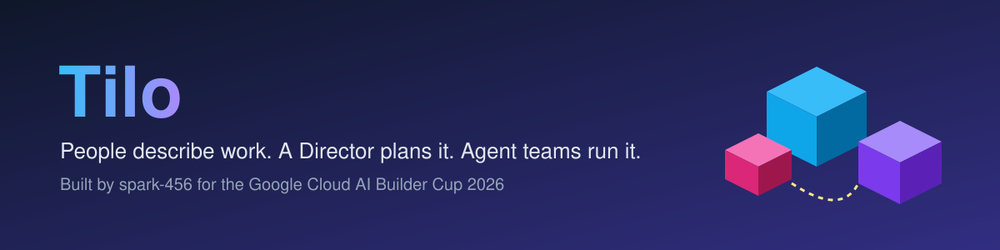

### People describe work. A Director plans it. Agent teams run it. The work is shown as a living isometric world.

[](https://essential-wares-510320-f0.web.app)


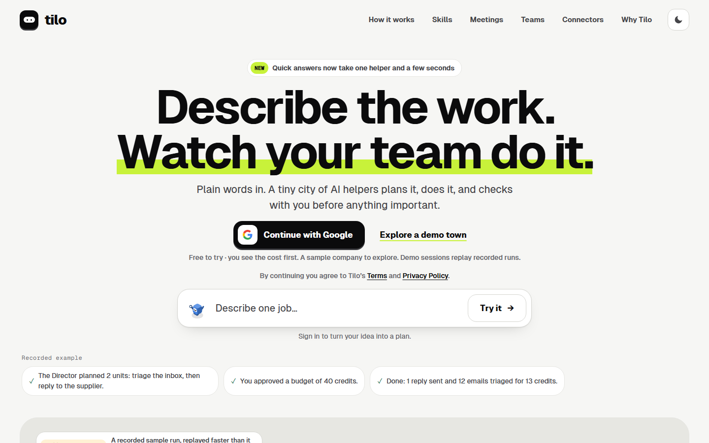

<p align="center">
<a href="#-what-is-tilo">What</a> ·
<a href="#-try-it">Try it</a> ·
<a href="#%EF%B8%8F-tour">Tour</a> ·
<a href="#-how-it-works">How it works</a> ·
<a href="#%EF%B8%8F-the-world">World</a> ·
<a href="#-the-agent-team">Agents</a> ·
<a href="#-you-stay-in-charge">Control</a> ·
<a href="#-meetings">Meetings</a> ·
<a href="#%EF%B8%8F-architecture">Architecture</a> ·
<a href="#-genai-map">GenAI map</a> ·
<a href="#%EF%B8%8F-security-notes">Security</a> ·
<a href="#-honest-notes">Honest notes</a> ·
<a href="#-how-to-run">How to run</a>
</p>

</div>

---

## ✨ What is Tilo?

Organisations are starting to hand real work to AI agents, but that work is invisible: hard to steer, harder to trust. Most tools give you a chat box and a wall of text.

**Tilo** turns one sentence into a priced plan, runs it with a team of specialised agents, and shows the work as a tiny isometric city you can read at a glance. Helpers walk between buildings as they work. Anything that touches the outside world stops at a gate until a person says yes. Every line on screen traces back to something that actually happened.

| 🗣️ **Plain words in** | 🧾 **Price first** | 🏙️ **A world you can read** | 🛡️ **You stay in charge** |
|---|---|---|---|
| One sentence, plus files if they help | Plan and cost shown before anything starts | A map, a Story and a Trace for every job | Risky steps wait at a gate for a person |

Tilo is built around three ideas:

- **Inspectable.** Every animation, Story line and meter change comes from a recorded event. Nothing moves unless it happened.
- **Controllable.** Gates, risk tiers and autonomy levels decide what may run, in deterministic code. A model never decides authorisation.
- **Accountable.** An append-only ledger, a raw archive and provenance on every output answer "why is this here?".

## 🎮 Try it

**👉 [Open the live demo](https://essential-wares-510320-f0.web.app)**, then pick **Explore a demo town**. No sign-in is needed.

- The demo town is **sample data** (a made-up company with 11 worlds). It is labelled as sample throughout.
- **Demo sessions replay recorded runs.** The landing page shows a recorded example (a 44-event run: triage an inbox, answer a supplier) replayed faster than it happened, with a banner saying so. Nothing in the demo sends real email.
- Look around: **Home** (what needs you today), **Chat**, **Worlds** (your town of jobs), open a world and switch between **Story**, **Steps** and **Result**, then **Skills**, **Needs you**, and under **More** the **Ledger**, **Agenda** and **Team** pages (on a wide screen they sit in the top bar).
- In the demo, **approving records nothing** and **uploads are off**. Signing in with Google is optional and is how you run your own work.

## 🖼️ Tour

> Screenshots are taken from the live demo town at 1440 px and 390 px wide. The data is sample data.

<p align="center">
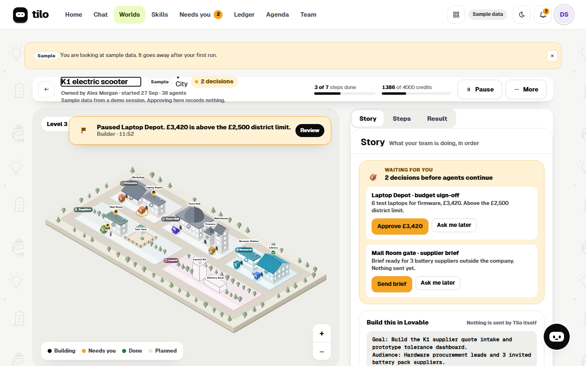
<br/>
<sub><b>A world.</b> The map on the left, Story, Steps and Result on the right. Here a purchase above the district limit is paused at a gate until a person decides.</sub>
</p>

| Home | Your town of worlds |
|---|---|
| 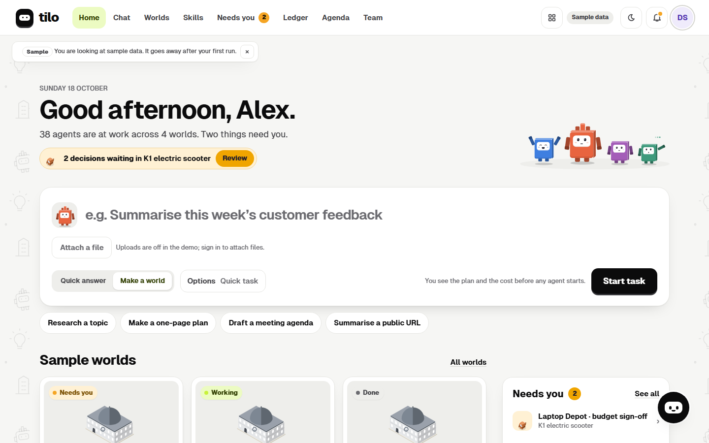 | 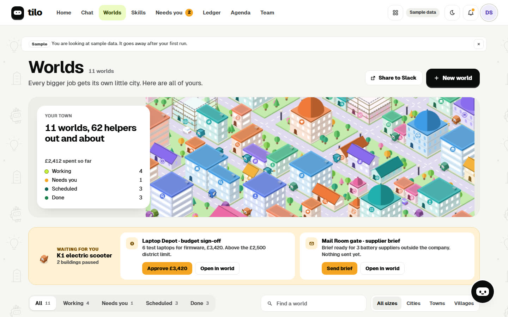 |
| **Agenda with team and personal pinboards** | **Skills: reusable ways of working** |
| 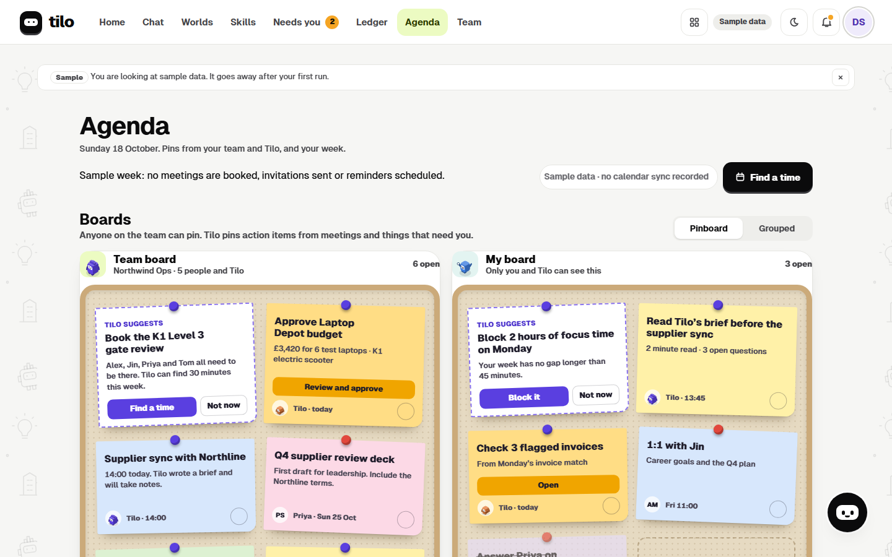 | 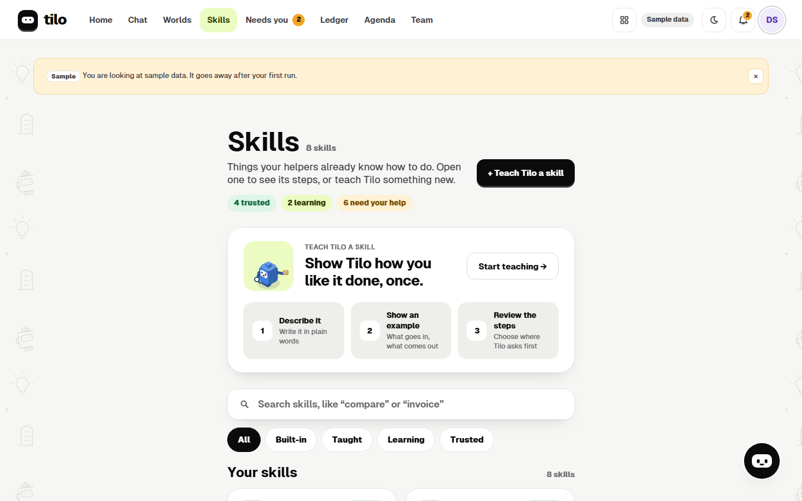 |
| **Team** | **Ledger** |
| 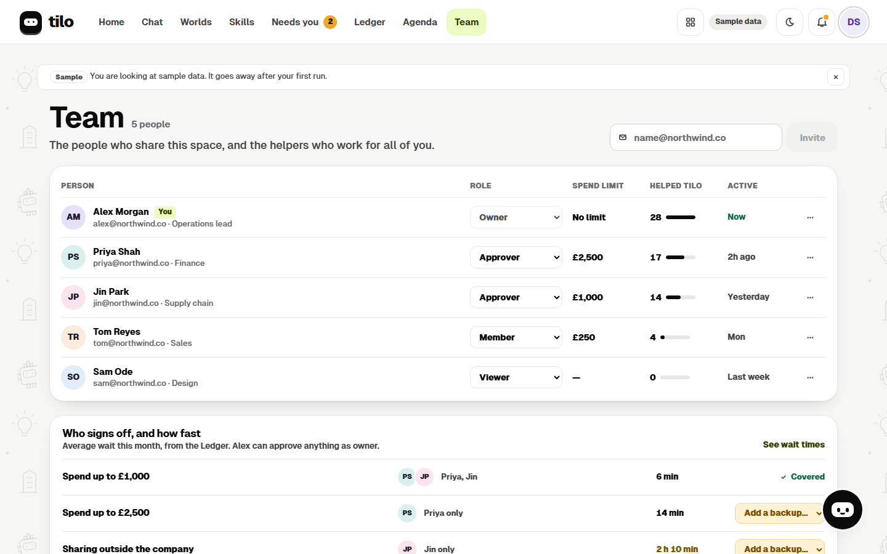 | 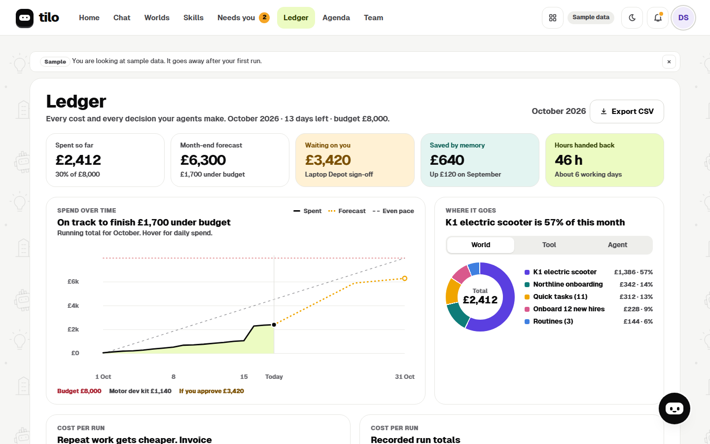 |

<details>
<summary><b>📱 Mobile (390 px wide)</b></summary>

<p align="center">
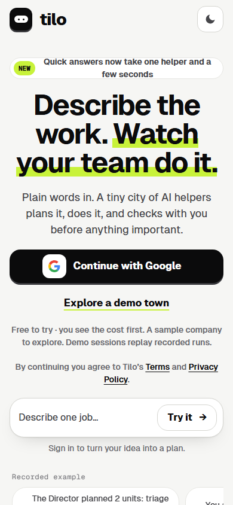
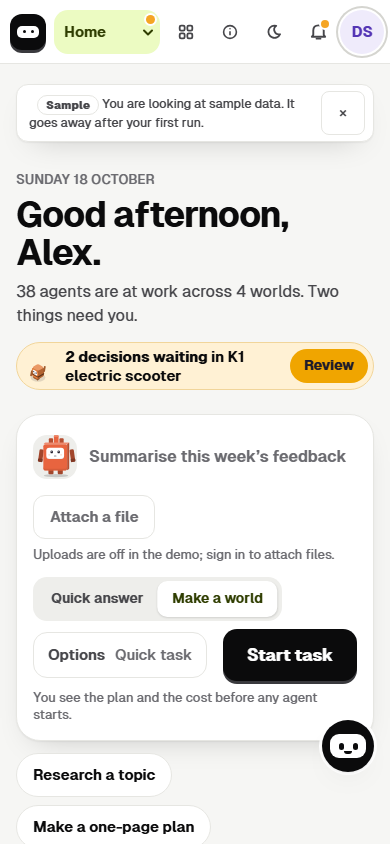
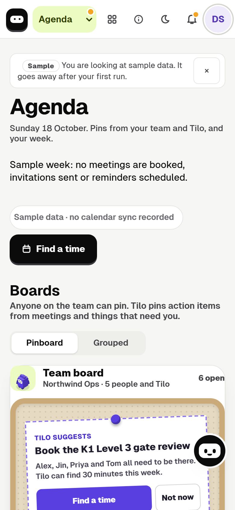
</p>

</details>

## 🧭 How it works

1. **Describe it.** One sentence, plus any files that help. Tilo asks only questions that change the outcome, ranked by impact; agents never ask what they can find out themselves.
2. **Check the plan.** The Director proposes priced approaches (for example "quick" or "careful"), the assumptions it made, and a budget in credits. You edit in place and approve.
3. **Agent teams run it.** The Director picks only the agents the job needs: a quick question gets one, a launch gets the whole crew. Each agent loads the expert skill it needs and uses tools through the connectors layer.
4. **See it, steer it.** The work is drawn as a world and narrated in plain sentences. Anything that sends, shares or deletes goes through a gate. When it finishes you get the result, the cost and the trail behind it.

A step that only reads and thinks just produces a result. A step that would send, share, delete or spend takes this path:

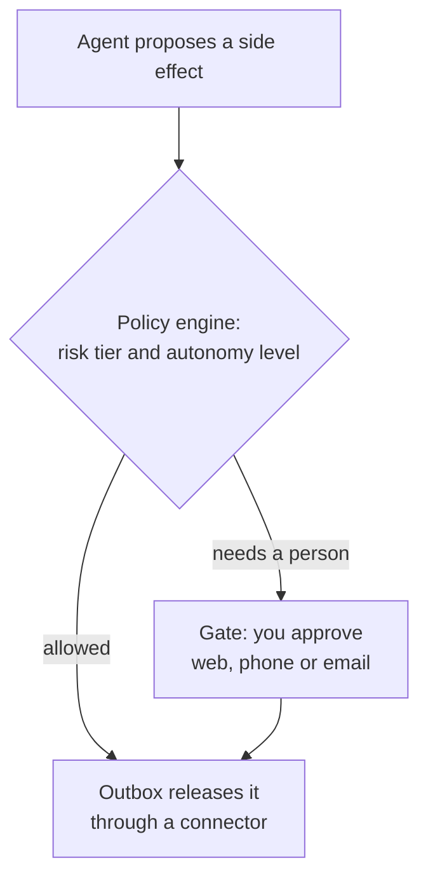

The World, Story and Trace views show every one of these steps as it is recorded.

## 🏙️ The world

Each job is its own world, drawn as an isometric map. The shape of the map carries meaning.

| Element | Represents | Rule |
|---|---|---|
| **World** | One task or routine | Sized by agent count: Outpost (1 to 2), Village (3 to 6), Town (7 to 15), City (16+) |
| **Level** | A phase of the work | Stacked plates; handoffs between phases ride the lift |
| **District** | A workstream | Up to 6 per level, one Lead each |
| **Building** | A capability or sub-task | Up to 5 per district |
| **Common buildings** | Platform functions | Town Hall, Library, Browser Station, Workshop, Meeting Hall, Connector Post, Memory Vault, Treasury, Delivery Dock, Mail Room, Expert Office and more |
| **Island and bridge** | An external system and its connection | Road = API, rail = MCP, footpath = browser |
| **Gate** | An authorisation point before a side effect | Opens by a person's approval or by a policy, and the two look different |
| **Cloud cover** | No access yet | A lock glyph that lifts when you consent |

**Three views on the same recorded events:**

- **World:** the isometric map with zoom and level switching.
- **Story:** a plain-language timeline of what happened, narrated from the events. Next to it, **Steps** shows the plan in order with progress, and **Result** holds the delivered output.
- **Trace:** a switch inside Story that lists every recorded event with its type, actor, model role, tokens, latency and credits. It names the raw archive record for each event; opening that record from the Trace is not built yet.

You can **inspect** any agent, building, gate or artifact, **replay** any finished run (the reducer is deterministic), and switch to a **professional density mode** (smaller characters, labels on, no decorative motion) or a **stage mode** for presentations.

### Honesty rules

The world is a display of facts, not a screensaver. These rules are enforced by tests.

| # | Rule |
|---|---|
| 1 | Every animation, Story line and meter change is caused by a recorded event |
| 2 | No idle animation implies work that is not happening |
| 3 | Movement is cosmetic and capped at 2 s; the world never runs ahead of the harness |
| 4 | Replays carry a permanent "Replay of run, recorded on a date" banner |
| 5 | Unknown event types appear in the Trace only |
| 6 | Any time compression shows a visible speed badge |
| 7 | Actions authorised by a policy look different from actions a person approved, and both link to the authorisation |

> Background motion on the Home screen is decoration and is the one exception; motion inside a world is always real.

## 🤖 The agent team

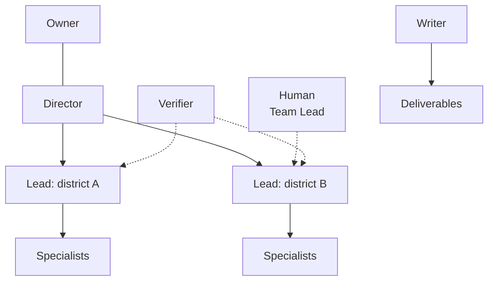

| Role | Job |
|---|---|
| **Director** | Plans, assigns, arbitrates between districts and talks to the owner. One per world. |
| **Lead** | Owns a district: decomposes units, reviews Specialist output at milestones, routes questions, runs handoffs. |
| **Specialist** | Executes one unit with its skill and tools. A capped number run at once per world. |
| **Verifier** | Checks claims, numbers and formats independently of the author. |
| **Writer** | Produces deliverables from verified material. |
| **Narrator** | Turns events into Story lines. |

Supervision runs Specialist, Lead, Director, then a human Team Lead or the owner. Supervisors review at milestones rather than every step to bound cost, and the hierarchy is capped at three agent levels.

<details>
<summary><b>🧠 Expert skills</b> (versioned, signed-off ways of working)</summary>

<br/>

A skill is a folder an expert writes and signs off. Agents load it only when the plan needs it.

```text
skills/<domain>/<skill-id>/
  SKILL.md        when to use, steps, quality bar, checklists, pitfalls
  skill.yaml      id, version, domain, author, reviewer, tools allowed, input and output schemas
  examples/       worked inputs and outputs
  tests/          golden cases with expected results
```

- The planner sees only each skill's name and one-line description, so planning context stays small.
- A run pins skill versions, and the Trace shows which version produced which output.
- New or changed skills need the domain expert's approval; per-skill success rates are tracked.
- The first library covers web research with citations, table extraction, price comparison, deck writing, executive summaries, email triage and reply drafting, invoice-to-PO matching, verification checklists and quote comparison.

</details>

<details>
<summary><b>🧑‍🏫 Human Team Leads and question routing</b></summary>

<br/>

- **Team Leads** are people assigned to a domain (for example Security, Finance, Research), configured in `config/teams.yaml`.
- Agents must ask their supervisor, and the supervisor must ask a person, when the brief is ambiguous in a way that changes the output, a choice has trade-offs outside policy, or a step touches money, personal data, legal terms or outside communication.
- The Lead classifies the question's domain and sends it to the matching Team Lead, otherwise to the owner. Each question carries context, options, a suggested answer, a deadline and a safe default.
- **No repeats.** Answers become stored decisions; a similar later question is answered from the decision with a citation.
- **Load control.** Questions to one person are batched, with an hourly cap and a digest for overflow.

</details>

<details>
<summary><b>♻️ Context handoff and crash recovery</b></summary>

<br/>

Long jobs outlive a single agent's context window, so Tilo hands work over deliberately.

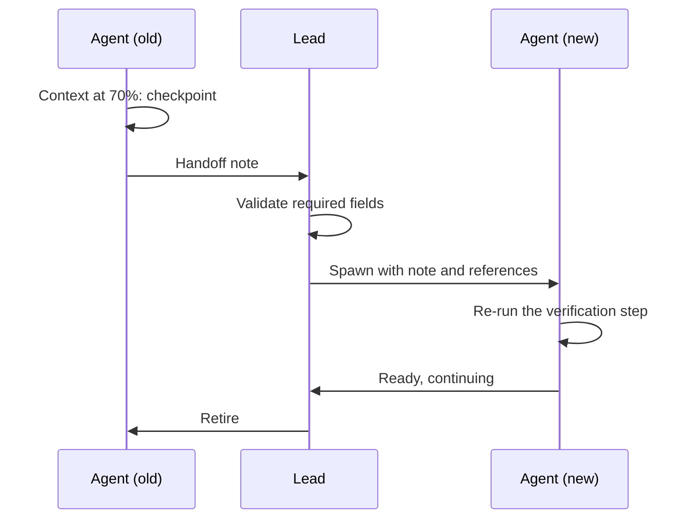

- At 60% of context an agent compacts tool output; at 70% it hands off.
- The note follows `contracts/handoff.schema.json`: goal, unit ids, done, in progress, decisions, open questions, next steps, verification to re-run, gotchas.
- The successor proves it understood the state by re-running the verification step before it continues.
- Crash recovery uses the same path: checkpoints after every unit, a heartbeat, and a sweeper that restarts any silent agent from its last checkpoint. Side effects go through an outbox, so they happen exactly once.

</details>

## 🚦 You stay in charge

### Escalation ladder

When agents need a person, the request rises through a fixed ladder, and the world shows it.

| Rung | World signal | Effect on work |
|---|---|---|
| **FYI** | Small dot on the building | None |
| **Nudge** | Speech bubble | None |
| **Needs you** | Yellow flag; the agent raises a hand | That branch waits |
| **Blocked** | Red marker | That branch stops |
| **Meeting invite** | Meeting Hall lights up | The decision branch waits |
| **Approval gate** | The agent waits at the gate with the item | The action waits |
| **Connection consent** | A bridge under construction | That connection waits |

Every request uses the same **card**: what happened (140 characters or fewer), why it matters, two or three options with one marked "Suggested" and a reason, an add-context field, and Show me, Snooze and Delegate. The same card works on the web app, mobile web and email. Cards have timeouts with safe defaults, a suggested option is never irreversible, and **gates default to hold and never time out to go**.

### Autonomy levels and risk tiers

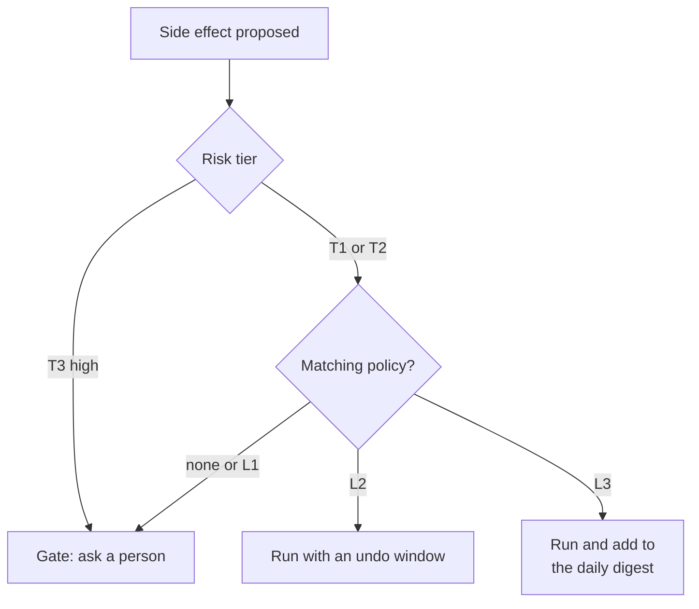

| Level | Name | Behaviour |
|---|---|---|
| **L0** | Observe | Agents may only draft; nothing leaves Tilo |
| **L1** | Ask each time (default) | Every side effect waits at a gate |
| **L2** | Instruction is approval | If your own instruction explicitly asks for the action, Tilo acts, with an undo window |
| **L3** | Standing rules | Pre-authorised classes of action run within limits and appear in a daily digest |

| Tier | Examples | Highest level allowed |
|---|---|---|
| **T1** | Create a draft; save a file to your own Drive; spend credits under the run budget | L3 |
| **T2** | Reply in an existing thread to a known contact | L3 |
| **T3** | New recipients, attachments, external sharing, deleting anything, money or legal terms, content flagged by injection detection | L1 only: **always a person** |

Risk tiers are assigned deterministically by action type and context. Policies are objects with scope, limits, conditions, expiry and an undo window (`contracts/policy.schema.json`). Every side-effect event records who or what authorised it, and a kill switch sets every policy back to L1 instantly.

## 🎥 Meetings

Tilo can join a Google Meet to take minutes and draft the follow-ups.

- **A guest, not a login.** The bot joins as a named guest and waits to be let in: **the host admits it**. It never creates a call and never admits anyone else.
- **It says who it is first.** It posts a disclosure in the Meet chat before it reads anything, and any participant can say or type "Tilo leave" to stop it.
- **Minutes as you talk.** It reads the live captions and every 45 seconds sends the last few minutes to a model (through the providers layer) to track the agenda, decisions, action items and open questions. Code, not the model, decides whether it may speak: at most four short chat nudges per meeting, at least five minutes apart.
- **Follow-ups wait for your yes.** Anything it would send goes through a gate like every other side effect.
- **Test meetings only for now.** The bot lives in `meet-bot/` and is still a prototype. Do not use it for sensitive meetings until Google's data terms for that use are reviewed.

## 🏗️ Architecture

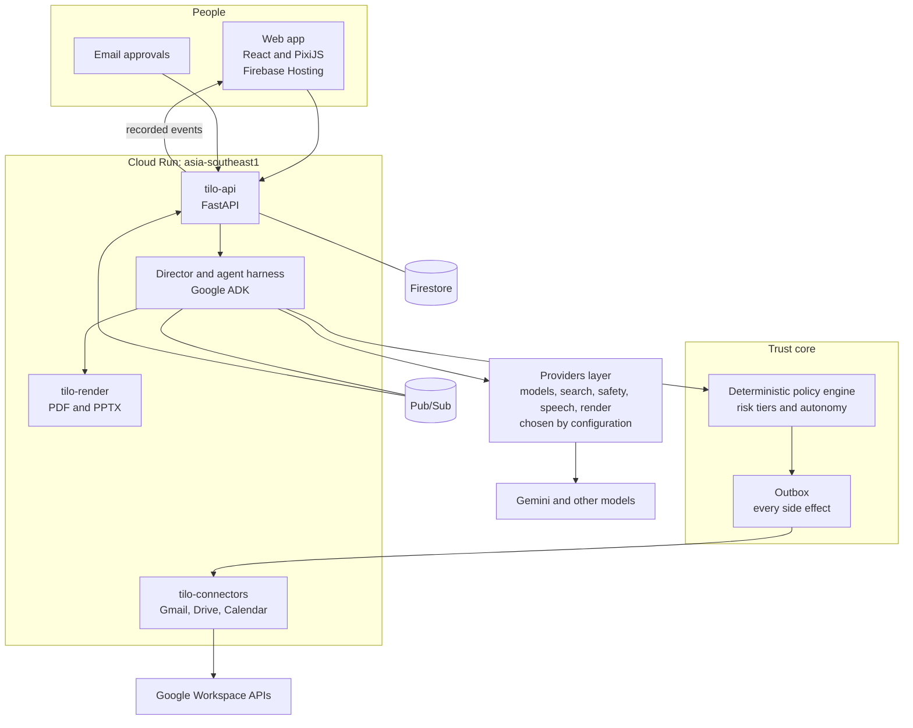

### Services

| Service | Job |
|---|---|
| **Web client** (`apps/web`, Firebase Hosting) | React UI, PixiJS world, lenses, cards and settings |
| **tilo-api** (`services/api`) | Sessions, tasks, cards, approvals, policies, downloads, sharing, access control |
| **tilo-harness** (`services/harness`) | Runs the work: one single-writer process per world for planning, agents, handoff and events (Google ADK, Python) |
| **tilo-channels** (`services/channels`) | Notifications and approval links, channel identity binding |
| **tilo-connectors** (`services/connectors`) | OAuth token broker, Gmail, Drive and Calendar adapters, and the outbox for side effects |
| **tilo-browser** (`services/browser`) | Groundwork for browser work: one isolated headless browser per instance, with allowlisted egress and masking. Browser control you can watch (with a visible AI cursor) is coming, not live yet |
| **tilo-render** (`services/render`) | Deliverables: PDF and PPTX rendered from templates; charts drawn by code from data, never by a model |
| **tilo-sandbox-web** (`services/sandbox-web`) | Fictional websites used by scenarios and evals, so tests never touch the real web |

<details>
<summary><b>☁️ Google Cloud service map (one job each)</b></summary>

<br/>

| Service | Job in Tilo |
|---|---|
| Gemini (Agent Platform) | Default model profiles |
| Agent Development Kit | Agent definitions, tools, callbacks, tracing |
| Model Armor | Screens intake, model output, tool output and inbound mail |
| Cloud Run | All services, scale to zero |
| Firestore | Worlds, events, cards, policies, checkpoints, grants |
| Cloud Storage | Artifacts and versions, raw archive, snapshots |
| Pub/Sub, Cloud Tasks, Cloud Scheduler | Events, rate-limited run starts, schedules and sweepers |
| BigQuery | Ledger, audit log, eval results, analytics |
| Firebase Authentication and App Check | Google sign-in and anonymous demo sessions; abuse control |
| Secret Manager and Cloud KMS | Platform secrets; envelope encryption of user OAuth tokens |
| Cloud Logging, Monitoring, Trace | Logs, alerts and spans |
| Cloud Build and Artifact Registry | CI/CD into Cloud Run |

Infrastructure is Terraform in `infra/` (modules for services, IAM, KMS, storage, events, monitoring, budget and workload identity).

</details>

### Events are the source of truth

Everything in Tilo is an event: a typed, schema-validated record with a cause, a visibility scope and a short plain-language summary. The reducer turns events into world state; the Story and Trace lenses are views of the same stream. Events are registered in `contracts/` with fixtures, and an unregistered event type fails the build.

## 🧬 GenAI map

Business code never names a model. It asks for a **role**, and configuration decides which model serves it.

| Role | What it does | Model need |
|---|---|---|
| `director` | Plans, prices, arbitrates | Strongest reasoning, high thinking |
| `lead` | Runs a district, reviews milestones | Strong reasoning, medium thinking |
| `specialist` | Executes one unit with a skill and tools | Fast, tool-calling |
| `verifier` | Independent checks of claims and numbers | Strong reasoning, high thinking |
| `writer` | Drafts deliverables from verified material | Strong writing |
| `narrator` | Turns events into Story lines | Smallest, cheapest model |
| `autopilot` | Email triage and reply drafting | Fast, tool-calling |

- **One interface per concern** in `packages/providers`: `ModelProvider` (generate, stream, embed, count tokens, capabilities, price), plus `SearchProvider`, `SafetyProvider`, `SpeechProvider` and `RenderProvider`.
- **Two adapters ship:** `google` (Gemini through Google's Agent Platform, the default) and a generic OpenAI-compatible adapter used for live tests against other providers during development.
- **A router** picks by role, capability and budget, and falls back on errors, quota or a missing capability; the Trace records both attempts.
- **Config, not code:** profiles and roles live in `config/models*.yaml`, prices in `config/prices.yaml` with a date and source, prompts as templates in `prompts/`. A lint check fails the build on any model id outside `config/` and `packages/providers`, and denylisted models refuse to load.
- **Efficiency by design:** dev and CI use record-and-replay or fake providers and make no paid calls; cheaper models handle cheaper roles; results are cached by request and source fingerprint.

## 🧱 Memory, records and provenance

| Layer | Holds | Reuse rule |
|---|---|---|
| Working memory | The run's plan graph, artifact registry and blackboard | This run only |
| Result cache | Tool results and extracted tables, with their original cost | Web results stay fresh for a limited time; email bodies are never cached |
| Artifact memory | Past deliverables and their manifests | Offered as a starting point, never silently reused |
| Decisions | Answers from owners and Team Leads, with scope and expiry | Repeat questions are answered from them |
| Preferences | User and org preferences, triage corrections, style | Applied in planning and drafting |
| Skills | Expert skills and versions, kept in Git | Pinned per run |

- **Provenance:** every output links to the agent, skill version, model profile, inputs, sources, causing events, and the person or policy that authorised it. "Why is this here?" on any claim or number opens the Trace at its cause, and exports carry a provenance manifest so the trail survives outside Tilo.
- **Records:** an append-only ledger and audit log, plus a raw archive of what agents saw and did.
- **Rollback:** deliverables are versioned and can be restored.

## 💳 Budget and credits

- **1 credit = US$0.005** at standard list prices, covering model tokens, tools and compute. The unit stays stable when providers run promotions.
- **Reserve, then commit.** Each step reserves its estimated cost plus a margin before it runs and commits the actual cost afterwards; a step that cannot reserve waits.
- **Budget requests.** At 80% of the approved budget the Director asks for more, with the remaining plan and a new estimate.
- **Caps** per run, per user per day and per organisation per day, all from configuration; a hard daily cap trips a kill switch.
- **Ledger.** The Ledger page shows what was spent and what it bought, and the meter reconciles against the same price file the router uses.

## 🔌 Connectors and deliverables

| Connector | What it can do | Scopes |
|---|---|---|
| **Gmail** | Read, search, create drafts, send in an existing thread | Least privilege: readonly, compose, send; never full mailbox access |
| **Google Drive** | Read the files you pick; write deliverables to a Tilo folder. Importing a CSV from Drive is coming | `drive.file` only |
| **Google Calendar** | Read availability for scheduling | Read-only |

Every connector action is declared in `config/connectors.yaml` with a risk tier, limits, and a data class that says what is redacted. User OAuth tokens are envelope-encrypted with Cloud KMS and decryptable only by the connectors service.

**Deliverables:** PDF and PPTX are rendered from templates (`templates/`) with brand tokens; every deliverable is versioned and carries a provenance manifest.

## 🛡️ Security notes

**Credential policy (hard rules)**

1. No password fields anywhere in Tilo; agents never type passwords.
2. Third-party access only through OAuth with least-privilege, incremental scopes.
3. Browser sessions are ephemeral; nothing is stored between runs.
4. Secrets never enter prompts, logs, traces, the raw archive or analytics.
5. Automation authenticates with Workload Identity Federation: no service-account keys in the repo.

**Prompt-injection defence in depth**

1. External content reaches models only as delimited data, never as instructions.
2. A safety provider screens intake, tool output, inbound mail and model output.
3. Privilege separation: agents that read untrusted content have no side-effect tools; they return structured data to a privileged agent.
4. Every side effect passes the deterministic policy engine and risk tiers, and T3 always needs a person.
5. Recipient, domain and egress allowlists.
6. Gates and undo windows before anything leaves Tilo.
7. Red-team cases are part of every eval pass; a failure blocks deploys.

**Engineering guards:** a secret scanner runs on every change, fake secrets in tests are assembled at runtime, and repository hooks block edits to protected paths, `.env` files and secret-looking content.

## 📊 Eval results

Tilo ships a **160-case eval bank** (`evals/cases/`, schema in `evals/case.schema.json`) in eight groups:

| Group | What it measures |
|---|---|
| E-PLAN | Brief validity, question ranking, approach distinctness, estimate accuracy |
| E-RES | Research task success and groundedness, against the Sandbox Web |
| E-DOC | Required sections present, chart values equal sources, files open cleanly |
| E-MAIL | Triage agreement with ground truth, no invented commitments, style, threading and recipient rules |
| E-CHN | Correct redirection of off-topic messages |
| E-ROUTE | Team Lead routing accuracy and repeat detection |
| E-HAND | Forced handoffs that finish without rework |
| E-RED | Red-team: hidden-text, document and email injections, exfiltration bait, link smuggling, obfuscated characters; target is 100% blocked or flagged with zero side effects |

Run the harness with `just eval`. Scores are not claimed here; measured results are published from `evals/` only after a run, so this README never quotes a number it did not measure.

## 🧰 Tech stack

| Layer | Technology |
|---|---|
| Frontend | React 18, TypeScript, Vite, PixiJS v8, Playwright end-to-end tests |
| Backend | Python, FastAPI, Pydantic v2 models generated from JSON Schema contracts |
| Agents | Google ADK, Google GenAI SDK |
| Models | Gemini by default; other providers selectable by configuration |
| Data and events | Firestore, Pub/Sub |
| Hosting | Firebase Hosting (web), Cloud Run in `asia-southeast1` (services) |
| Infrastructure | Terraform modules in `infra/` |
| Tooling | `uv`, `pnpm`, `just`, Biome, Ruff, mypy |

## 🗂️ Repo layout

```
apps/web            React and PixiJS web app
services/           api, harness, connectors, channels, browser, render, sandbox-web
meet-bot/           Google Meet guest bot (prototype)
packages/           providers, policy, planning, memory, archive, metering, people, world,
                    logging, redact, contracts-py, contracts-ts
contracts/          JSON Schemas, event registry and fixtures (the source of truth)
config/             models, prices, autonomy, connectors, teams, scenarios and other configuration
prompts/ skills/    prompt templates and teachable skills
templates/          deliverable templates
evals/              eval harness and the 160-case bank
infra/              Terraform
docs/               PRD, architecture decision records, notes
design/             design tokens and design source
tests/              acceptance tests named after requirement IDs
```

### How it is built

- **Contracts first.** JSON Schemas and the event registry in `contracts/` win over prose; Python and TypeScript types are generated from them, and drift fails the build.
- **Spec-driven.** The product spec is `docs/prd/tilo-prd-v2.md`. Every requirement has an ID that doubles as its ticket, and each acceptance test is the definition of done, with the ID in the test name.
- **Decisions are written down** as architecture decision records in `docs/adr/`.
- **Models are configuration**, side effects go through the outbox and policy engine, and nothing animates without a recorded event.
- **Local-first.** Development uses the Firestore and Pub/Sub emulators with a `demo-` project id, and makes no paid calls.

## 🚀 How to run

Prerequisites: Python 3.12 with [`uv`](https://docs.astral.sh/uv/), Node 22 or newer with `pnpm` 10, and [`just`](https://github.com/casey/just).

```bash
just setup   # uv sync, pnpm install and git hooks for every workspace member
just dev     # web dev server
just dev-api # tilo-api dev server
just check   # format, lint, typecheck and all tests (the full gate)
```

On Windows install `just` with `winget install Casey.Just`; the repo runs natively without WSL.

Local development uses fake and record-and-replay providers, so it makes no paid calls and needs no cloud credentials. Live model calls happen only when you opt in with `LIVE=1`.

## 📝 Honest notes

- **The demo is sample data.** The demo town and its worlds are a made-up company. Demo sessions replay recorded runs and say so; approving in the demo records nothing.
- **Google connectors:** Gmail, Drive and Calendar are the connectors in scope for this release. Other connectors (for example Microsoft 365, MCP servers, Slides, Docs and Sheets creation, and Lovable) are future scope.
- **Channels:** approvals work from the web app, mobile web and email. WhatsApp is not part of this release.
- **Email Autopilot** is limited to a small test group until Google's app verification is complete.
- **Meetings:** the Meet bot joins as a guest the host admits. It is a prototype for test meetings only.
- **Coming, not live yet:** browser control you can watch, with a visible AI cursor; public app pages for small apps Tilo builds; importing a CSV from Drive. The `tilo-browser` service and the app-page contracts exist, but these experiences are not available on the live site.
- **Roadmap items, not shipped:** desktop control, Build mode, workforce orchestration, scoped contributors who talk to agents directly.
- **Evals:** the bank and harness exist; this README quotes no scores (see above).
- **Models:** the default build routes every role through Google's Agent Platform; other adapters are for development and tests, and recordings made on them are not claimed as evidence for the default.
- **Design and spec:** parts of this README describe the design in the PRD. The PRD, the contracts and the tests are the sources of truth where they differ from prose.

## 🗺️ Roadmap

- ✅ Describe, plan, run, approve; isometric worlds with World, Story and Trace lenses
- ✅ Gmail, Drive and Calendar connectors
- ✅ Agenda with team and personal pinboards, Team page, Skills, Ledger
- ✅ Meet bot that joins as a guest (prototype, test meetings)
- 🔜 Browser control you can watch, with a visible AI cursor
- 🔜 Public app pages
- 🔜 Importing a CSV from Drive
- 🔜 More connectors for other work tools
- 🔜 Native Google Slides, Docs and Sheets deliverables
- 🔜 Desktop control and Build mode

## 📚 Documentation

| Doc | What is in it |
|---|---|
| [`docs/prd/tilo-prd-v2.md`](docs/prd/tilo-prd-v2.md) | The full product spec: pillars, requirements, acceptance tests |
| [`docs/adr/`](docs/adr) | Architecture decision records |
| [`contracts/`](contracts) | Schemas, event registry and fixtures |
| [`docs/licences.md`](docs/licences.md) | Licence of every dependency |
| [`CLAUDE.md`](CLAUDE.md) | Engineering rules for contributors and coding agents |

## 🙌 Credits

Built by [@spark-456](https://github.com/spark-456) for the Google Cloud AI Builder Cup 2026, with AI coding agents in the loop. Characters, buildings and the isometric kit are Tilo's own design. Licensed under [Apache-2.0](LICENSE) (see the **License** section below).

## License

Apache-2.0, see [`LICENSE`](LICENSE).
