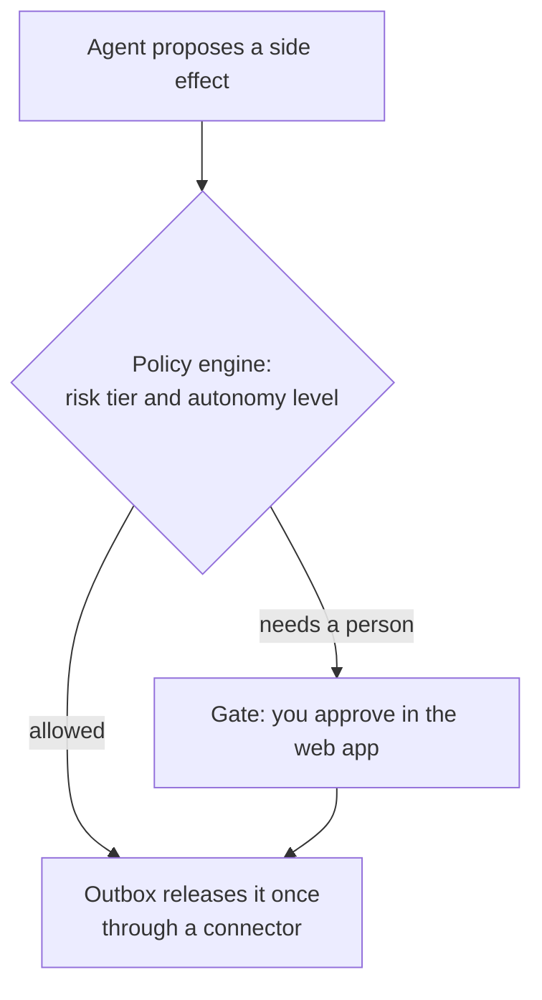
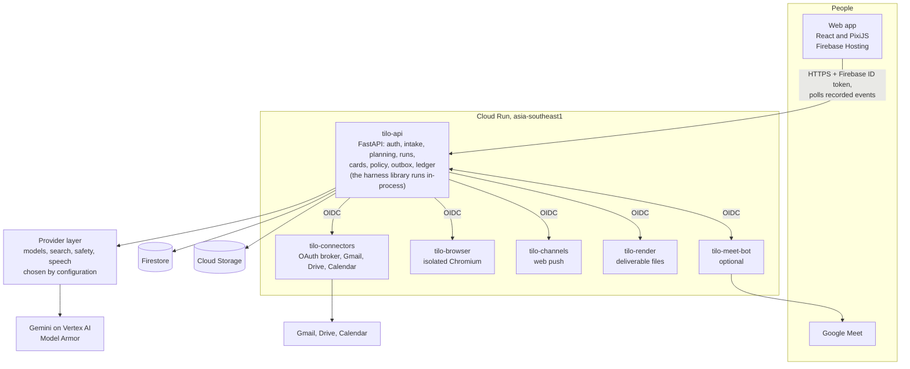

<div align="center">


### People describe work. A Director plans it. Agent teams run it. The work is shown as a living isometric world.

[](https://essential-wares-510320-f0.web.app)


<p align="center">
<a href="#results-and-impact"><b>Results</b></a> ·
<a href="#what-is-tilo">What</a> ·
<a href="#features">Features</a> ·
<a href="#try-it">Try it</a> ·
<a href="#tour">Tour</a> ·
<a href="#how-it-works">How it works</a> ·
<a href="#architecture">Architecture</a> ·
<a href="#repository-map">Repo map</a> ·
<a href="#how-to-run">How to run</a> ·
<a href="#deploys">Deploys</a> ·
<a href="#genai-map">GenAI map</a> ·
<a href="#security-notes">Security</a> ·
<a href="#honest-notes">Honest notes</a> ·
<a href="#documentation">Docs</a>
</p>

</div>

---

## Results and impact

<div align="center">


-51-ff7a59?style=flat-square)

</div>

**Tilo turns a sentence into finished, checked work, at the price of a coffee sip, while you watch and stay in charge.** Every number below was measured on the live service or in the repo's test and proof runs; estimates are labelled as estimates.

### Tested results

| What we measured | Result | How it was measured |
| --- | --- | --- |
| 🌐 Agentic browser task (real Chromium, live web) | **76.8 s → 45.1 s** (41% faster), model calls **18 → 7** | Same research task before and after the stall fix and speed-up, on real Chromium; build `ea15c9f`, live on tilo-browser 00029 |
| 🖼️ Screenshot sent to the model | **323 KB → 74 KB** per frame (77% smaller) | Frames capped at 768 px and 256 colours; measured on recorded runs |
| ⚡ Home page reveal (desktop) | **4,883 ms → 1,274 ms** (3.8× faster) | Lazy thumbnails, WebP art, capped boot cover; Home is 176 KB gzipped with no layout shift |
| 🏙️ World artwork payload | **1,133 KB → 143 KB** (87% smaller) | Slimmed world art, studio SVG and loader images |
| 📡 Live event feed | **up to 174 KB per poll → new events only** | Cursor-based feed (`?after_seq`) and one shared subscription per world |
| 📝 Meeting minutes | **501 s worst case → ≤ 90 s** | Per-call and total deadlines with fallback |
| 🎥 Meet bot answer after it is named | **≈ 3 s** | Live Google Meet calls, bot log timings (named at 16:42:22, reply at 16:42:25) |
| 🧭 One sentence → priced plan | **13–30 s** for a plan, approaches in **7–58 s** | Live runs on tilo-api |
| 💸 A real 6-agent website world | **27.9 credits ≈ US$0.14** | Live run: one-page event website, built, checked and opened inside Tilo |
| 💸 A real 12-agent research world | **39.7 credits ≈ US$0.20** at 4 of 8 steps | Live run: Bengaluru vs Hyderabad vs Pune comparison with launch plan |
| ❓ Quick answers | **≤ 0.5 credit** each, one helper, a few seconds | Quick mode on Home |
| ✅ Automated tests | **≈ 19,300** (≈13,900 Python, 5,423 web, 149 Playwright specs) | Counted across the repo's suites |
| 🧪 Evaluation cases | **160 recorded cases in 8 groups**, plus a nightly replay job | `evals/` |

### Time saved for users

| Task, as you'd type it on Home | Doing it by hand *(our estimate)* | With Tilo *(measured or quoted)* | Saved per task |
| --- | --- | --- | --- |
| "Build a one-page event website for our meetup" | 2–4 hours | One sentence + a few minutes of agent time; about US$0.14 | **~2–4 hours** |
| "Compare three cities as tech hubs and give me a launch plan and budget" | 3–5 hours of reading and writing | 90–180 s quoted on the plan card; about US$0.20–0.30 | **~3–5 hours** |
| "Run my Event budget pack skill: product launch, Bengaluru, 150 guests" (PDF brief + Excel budget) | 2–3 hours | One line with @skill; 4.6 credits used mid-run | **~2–3 hours** |
| Meeting notes, transcript and minutes | 20–30 minutes per meeting | Automatic; minutes in ≤ 90 s | **~20–30 min per meeting** |
| "Find us a free slot next week and book the follow-up" | 5–10 minutes of back-and-forth | Asked out loud in the call; Tilo checks calendars, reads back, books | **~5–10 min per meeting** |
| A routine you do every week | The full time, every week | Teach it once in plain words, then run it with @ | **The whole routine, every time** |

> **Example:** a small team that runs one research report, one budget pack and four meetings a week saves roughly **6–10 hours a week**, for a few US dollars of model spend.
>
> *Method: manual times are our own estimates for a skilled person doing the same task by hand (research, writing, formatting, scheduling). Tilo's figures are the measured credits and quoted or measured times from live runs on 21–22 October 2026; 60 credits ≈ US$0.30. Your numbers will vary with the task.*

### Why Tilo stands out

- 🙋 **You stay in charge.** Spending, sending, sharing and anything that can't be undone waits for a person's yes. A model never decides authorisation; deterministic code does.
- 🏷️ **Price before work.** Every run shows its plan, assumptions and cost in credits and US$ before a single agent starts, with caps per call, per run, per person and per day.
- 🏙️ **Work you can see.** The animated world only moves for events that really happened. No fake progress bars, and a full **Trace** for engineers.
- 📦 **Real deliverables, not chat.** Websites, PDF, Word, Excel, slides, CSV and quiz apps, each versioned with a provenance manifest.
- 🎥 **A meeting teammate that acts.** Tilo joins Google Meet, answers out loud and in chat, pins notes, finds free times, reads the plan back and books it after your yes, then leaves when asked.
- 🧑‍🏫 **Teach once, reuse forever.** Describe a routine in plain words; Tilo writes the steps, asks only what it needs, and anyone on the team runs it with @.
- 🛡️ **Safe by design.** Model Armor screening, OIDC between services, KMS-sealed OAuth tokens, an egress allowlist for the browser, masked secure fields, and an automatic replay-only switch at the daily cap.
- 💡 **Right-sized AI.** Gemini 3.8 Flash where thinking pays off, 3.1 Flash-Lite for fast, frequent work, with a fallback for every role.
- ☁️ **All Google Cloud.** Eight Cloud Run services, Gemini on Vertex AI, Agent Development Kit, Firestore, Cloud Storage, Cloud KMS, Model Armor, Cloud Build and Firebase Hosting.

### Built and verified

- **≈19,300 automated tests**, 156 shared JSON Schema contracts (Python and TypeScript), 51 architecture decision records and 160 evaluation cases.
- **Every deploy passes a cloud test gate** against the exact commit, and the environment is checked to be identical before and after.
- **Security reviews** on every feature that touches tokens, money, sharing or outside content.
- **Honest by default:** what is live, behind a switch, or built but not yet deployed is listed in [Honest notes](#honest-notes) and [docs/REVIEWER-GUIDE.md](docs/REVIEWER-GUIDE.md).

## What is Tilo?

Tilo turns one plain-language sentence into a priced plan, then runs it with a team of AI agents that make real deliverables (websites, PDFs, Word, Excel and PowerPoint files, browser research).
The work is drawn as a tiny isometric city you can read at a glance, with a plain-language **Story** and a technical **Trace** of the same recorded events.
Anything that sends, shares, saves or spends stops at a gate until a person says yes; a model never decides authorisation.

Tilo is built around three ideas:

- **Inspectable.** Every animation, Story line and meter change comes from a recorded event. Nothing moves unless it happened.
- **Controllable.** Risk tiers, autonomy levels and gates decide what may run, in deterministic code.
- **Accountable.** An append-only credits ledger, a raw run archive and provenance on every output answer "why is this here?".

## Features

| | |
| --- | --- |
| **Describe, price, approve** | One sentence (plus files) becomes a brief, ranked questions and two or three priced approaches. One confirmation card shows scope, assumptions and the credit estimate before anything starts |
| **Agent teams that run the work** | A Director plans; Leads own districts; Specialists execute units with expert skills and tools; a Verifier and a Writer check and deliver. Context handoff to a successor agent at 70% of a window |
| **A world you can read** | Worlds are drawn from events: levels, districts, buildings, gates. Switch between the map, **Story**, **Steps**, **Result** and **Trace**; replay a finished run |
| **Real deliverables** | PDF, PowerPoint, Word, Excel, CSV, a website, and a small quiz app, each versioned with a provenance manifest; Drive saves convert to native Google files |
| **You stay in charge** | Side effects pass the policy engine and the outbox. Level L1 asks every time; higher levels need your own typed instruction or a standing rule; anything risky (T3) always needs a person |
| **Skills, taught in plain words** | A library of 18 expert skills, plus skills you teach from a description or a recording, with ratings and fixes |
| **Gmail, Drive and Calendar** | OAuth with least-privilege scopes; tokens sealed with Cloud KMS; reads for agents, and drafts, sends, saves and events through the outbox |
| **Browser research** | An isolated Chromium with an egress allowlist and masked secure fields. The World's browser panel replays each step as a masked screenshot with a cursor drawn from the recorded action; Tilo never types a password |
| **Agenda and the Meet bot** | Pinboards, a calendar, meeting briefs. A bot joins a Google Meet you invite it to, answers, pins, finds free times and can draft follow-ups for your approval |
| **Teams and sharing** | Self-serve teams with roles and limits, team-shared worlds, approver links, a Team Lead question console |
| **Spend you can see** | Credit grants per run, hard live-spend caps, and a Ledger page fed by an append-only Treasury ledger |
| **Routines and memory** | Scheduled runs, memory notes, a morning brief, push notices |

## Try it

**[Open the live site](https://essential-wares-510320-f0.web.app)** (Firebase Hosting, project `essential-wares-510320-f0`).

- **Explore a demo town** needs no account. It opens a made-up company with sample worlds and replays recorded runs, labelled as such; approving records nothing and uploads are off.
- **Continue with Google** signs in to your own workspace and starts real runs. The Google app is in testing mode, so only listed test users can sign in. A signed-in run is live only where the deployment has switched live models on, and it is bounded by the spend caps below.
- The [three-minute walkthrough](docs/demo.md) says what each step proves, and what a recording does not prove.

To try a task: sign in, type "Draft a one-page plan for a community garden" in the Home composer, review the confirmation card, choose **Start**, then follow the world and answer any **Needs you** card. Open **Story** or **Trace** for the account of what happened.

## Tour

> Screenshots are taken from the demo town (sample data) at 1440 px and 390 px wide.

<p align="center">

<br/>
<sub><b>A world.</b> The map on the left, Story, Steps and Result on the right. Here a purchase above the district limit is paused at a gate until a person decides.</sub>
</p>

| Home | Your town of worlds |
|---|---|
|  |  |
| **Agenda with team and personal pinboards** | **Skills: reusable ways of working** |
|  |  |
| **Team** | **Ledger** |
|  |  |

<details>
<summary><b>Mobile (390 px wide)</b></summary>

<p align="center">


</p>

</details>

## How it works

1. **Describe it.** One sentence, plus files. Tilo screens the text, then asks only the questions that change the outcome.
2. **Check the plan.** The Director proposes priced approaches and the assumptions it made. One confirmation card; you approve it.
3. **Agent teams run it.** The plan is compiled and validated, laid out as a world, and executed as units: concurrent Specialists (at most six), Leads reviewing at milestones, a Verifier and a Writer. Skills are pinned by hash for the run.
4. **See it, steer it.** The web app polls the recorded events about once a second, draws the world and narrates it. A step that reads and thinks just produces a result. A step that would send, share, delete or spend takes this path:



### The world

Each job is its own world, drawn from events. Its size follows the agent count: Outpost (1 to 2), Village (3 to 6), Town (7 to 15), City (16+). A **level** is a phase of the work, a **district** a workstream with one Lead, a **building** a capability or sub-task. Common buildings include the Town Hall, Browser Station, Connector Post, Memory Vault, Treasury, Delivery Dock, Mail Room and Expert Office. A **gate** marks an authorisation point; it opens by a person's approval or by a policy, and the two look different.

**Honesty rules**, enforced by tests (PRD 9.4):

| # | Rule |
|---|---|
| 1 | Every animation, Story line and meter change is caused by a recorded event |
| 2 | No idle animation implies work that is not happening |
| 3 | Movement is cosmetic and capped at 2 s; the world never runs ahead of the harness |
| 4 | Replays carry a permanent "Replay of run, recorded on a date" banner |
| 5 | Unknown event types appear in the Trace only |
| 6 | Any time compression shows a visible speed badge |
| 7 | Actions authorised by a policy look different from actions a person approved |

Background motion on the Home screen is decoration and the one exception; motion inside a world is always real.

### Autonomy and risk

| Level | Name | Behaviour |
|---|---|---|
| **L0** | Observe | Agents may only draft; nothing leaves Tilo |
| **L1** | Ask each time (default) | Every side effect waits at a gate |
| **L2** | Your instruction is approval | If your own typed instruction asks for the action, Tilo acts, with an undo window |
| **L3** | Standing rules | Pre-authorised classes of action run within limits and appear in a daily digest |

Actions have a risk tier from `config/autonomy.yaml`: **T1** (reads, a draft, a save to your own Drive, spend under the run budget) and **T2** (sending an email, such as a reply in an existing thread) can reach L3; **T3** (sharing, deleting, a new calendar guest, a meeting host event) is limited to L1 and always needs a person. An action not in the table is T3, and six modifiers raise any action to T3: new recipients, attachments, external sharing, deletion, money or legal terms, and a safety flag. Gates hold; they never time out into "go".

## Architecture

A Firebase-hosted web client over a handful of Cloud Run services. The full description is in [docs/ARCHITECTURE.md](docs/ARCHITECTURE.md).



Points worth knowing before you read the code:

- **Runs execute inside `tilo-api`.** It imports `tilo_harness` as a library and runs each approved plan on a thread. The deployed `tilo-harness` service is only a health check and a schedule-tick stub.
- **The browser never reads Firestore.** It polls the API for a world's events about once a second; Firestore rules deny all client access.
- **Every model, search, safety and speech call goes through `packages/providers`**, by role, driven by `config/`. No model id appears outside `config/` and `packages/providers`.
- **Events are the source of truth.** The world, Story and Trace are views of one ordered stream of schema-validated events (101 registered types), and the single writer per world validates each one before it is stored.

### Repository map

| Path | What it is |
| --- | --- |
| [`apps/web`](apps/web/README.md) | the React web client: Park shell and pages, the PixiJS world, Story and Trace lenses |
| [`services/api`](services/api/README.md) | `tilo-api`: sign-in, intake, planning, run execution, cards, policy and outbox, spend, people and teams, meetings |
| [`services/harness`](services/harness/README.md) | the run engine library (`run_plan`, single-writer event store, tool loop) and its stub service |
| [`services/connectors`](services/connectors/README.md) | `tilo-connectors`: OAuth token broker, Gmail, Drive and Calendar adapters, outbox execution |
| [`services/browser`](services/browser/README.md) | `tilo-browser`: isolated Chromium sessions and an SSRF-guarded fetch |
| [`services/render`](services/render/README.md) | `tilo-render`: PDF, PPTX, DOCX, XLSX and CSV from a deliverable spec |
| [`services/channels`](services/channels/README.md) | `tilo-channels`: web push sender; links, digests and Email Autopilot libraries |
| [`services/sandbox-web`](services/sandbox-web/README.md) | `tilo-sandbox-web`: fictional websites for scenarios and evals |
| [`meet-bot`](meet-bot/README.md) | the Google Meet bot (a separate Python project with its own Docker images) |
| [`packages`](packages/README.md) | providers, policy, planning, world, memory, archive, metering, people, redact, logging, generated contract types |
| [`contracts`](contracts/README.md) | JSON Schemas, the event registry and fixtures: the source of truth |
| `config` | models, prices, autonomy, spend caps, connectors, teams, rate limits, themes and other configuration |
| `prompts`, `skills`, `templates` | prompt templates by role; the expert skill library; report and deck templates |
| [`evals`](evals/README.md) | the replay eval harness, 160 cases and a 38-case generality bank |
| [`infra`](infra/README.md) | Terraform for the Cloud project (applied by the project owner only) |
| `scripts` | contract codegen, lint and secret scans, smoke tests, the web build wrapper, the cloud test gate |
| `tests` | repository guards (`repo`), contract tests, whole-stack tests (`system`) |
| [`docs`](docs/ARCHITECTURE.md) | architecture, reviewer guide, the PRD, ADRs, runbooks, connector status, open questions |
| `design`, `design_handoff_tilo_web_app` | design tokens and read-only design exports used as references |
| `.claude`, `.github` | coding-agent hooks and guards; CI and deploy workflow definitions |

Root files: `justfile` (task runner), `cloudbuild.yaml` and `cloudbuild.tests.yaml` (Cloud Build), `firebase.json`, `firestore.rules`, `pyproject.toml` and `uv.lock` (Python workspace), `package.json` and `pnpm-workspace.yaml` (JavaScript workspace).

## How to run

Prerequisites: Python 3.12 with [`uv`](https://docs.astral.sh/uv/), Node 22 or newer with `pnpm` 10, and [`just`](https://github.com/casey/just). Local runs use fake and record-and-replay providers: no paid call, no cloud credentials. Live calls happen only on a deployment whose owner has switched them on.

**Windows (PowerShell, native, no WSL; ADR-0001)**

```powershell
winget install Casey.Just          # once; uv: winget install astral-sh.uv; Node 22 and pnpm 10 as usual
git clone https://github.com/spark-456/tilo.git
cd tilo
just setup                          # uv sync, pnpm install, git hooks
just dev                            # web dev server (a fixture world: works with no backend)
just dev-api                        # second terminal: tilo-api in dev mode on 127.0.0.1:8080
just check                          # format, lint, types, contract drift and all tests (the full gate)
```

**Linux or macOS**

```sh
git clone https://github.com/spark-456/tilo.git && cd tilo
just setup
just dev            # web dev server
just dev-api        # in a second terminal
just check
```

To point the web app at your local API, set `VITE_TILO_API_URL` before starting it:

```powershell
$env:VITE_TILO_API_URL = "http://127.0.0.1:8080"; just dev
```

```sh
VITE_TILO_API_URL=http://127.0.0.1:8080 just dev
```

Dev mode uses an in-memory store, a fixed owner and a fake Director, and refuses to start on Cloud Run or with `LIVE=1`. Other recipes:

| Command | What it does |
| --- | --- |
| `just check-fast` | format, lint and tests, without the type checks |
| `just test` | all Python and web unit tests (skips emulator and whole-stack tests) |
| `just system-test` | the real API and services as processes, driven over HTTP (about 3 minutes) |
| `just meet-bot-test` | the meeting bot's offline tests |
| `just eval` | replay the 160 eval cases with no paid calls |
| `just tokens` | regenerate web design tokens |
| `just contracts-gen` | regenerate Python and TypeScript types from `contracts/` |
| `just e2e-cp2` | a browser walk against the dev API (local only) |

The [reviewer guide](docs/REVIEWER-GUIDE.md) says how the tests are organised and where to start reading.

## Deploys

Deploys go to one Google Cloud project, `essential-wares-510320-f0`, in `asia-southeast1`, and are run by the project owner after `gcloud auth login` and `firebase login`. Nothing in CI or development deploys.

| What | How |
| --- | --- |
| **Cloud Run services** (`api`, `harness`, `channels`, `connectors`, `browser`, `render`, `sandbox-web`) | `just deploy-dev-cloudbuild api`, then `just deploy-dev-cloudbuild` (or `just deploy dev` for both). [`cloudbuild.yaml`](cloudbuild.yaml) builds `services/<name>/Dockerfile` with the repository root as context, pushes to Artifact Registry repo `tilo`, and switches each service to the new image **by digest**. Only the image and instance limits change; ingress, IAM, environment and secrets stay with Terraform and `gcloud` |
| **Web app** | `just deploy-web` builds the fixture / replay app; `just deploy-web-live` builds against the deployed `tilo-api`. Both run `scripts/web_build_env.py` and then `firebase deploy --only hosting` to Firebase Hosting |
| **Meet bot** | its own image, `meet-bot/docker/cloudbuild.yaml`; the service is optional (Terraform `meet_bot_enabled`) |
| **Infrastructure** | Terraform in `infra/envs/dev` (`just tf-validate` checks it offline). The owner runs `terraform apply`; repository hooks refuse it |
| **Checks** | `just smoke-dev <api-url>` and `just smoke-hosted <hosting origin>` for the deployed pieces; `just gate-cloud <ref>` runs a capped test subset on Cloud Build |

The full runbook is [docs/deploy-dev.md](docs/deploy-dev.md). GitHub Actions workflow files exist (`.github/workflows`), but the runbook records them as unused under the current policy; Cloud Build and local runs gate merges.

## GenAI map

Business code never names a model. It asks for a **role**, and `config/models.yaml` decides which profile serves it. The shipped profiles are Gemini models on Vertex AI and are marked `example: true`; changing them is a configuration change.

| Role | What it does |
| --- | --- |
| `director` | intake brief and questions, approaches and estimate, the plan |
| `lead`, `lead_review` | run a district and review at milestones |
| `specialist` | execute one unit with a skill and tools |
| `verifier` | independent checks of claims and numbers |
| `writer` | draft deliverables from verified material |
| `assistant`, `skill_capture` | the assistant panel and skill routing; turning a person's words into a skill |
| `embed`, `search` | skill matching and retrieval vectors; grounded web search |
| `meeting`, `meeting_fast`, `meeting_analyst`, `meeting_room` | the Meet bot's answers, minutes analysis and the Meeting Hall in a world |
| `autopilot` | Email Autopilot triage and drafts |
| `safety` | screening with Model Armor (`armor-default`); a fake only in dev |
| `autorater`, `generator` | evals |

- **One interface per concern** in `packages/providers`: models, search, safety, speech. Adapters: Google (Vertex AI, global endpoint), Model Armor, Google Search grounding, Cloud Speech and Chirp 3 HD voice, and an OpenAI-compatible adapter used in development against NVIDIA NIM or the Gemini compatibility endpoint. Fake and record-and-replay providers serve dev and CI.
- **The router** picks candidates by role and capability, reserves cost against a budget, retries once after a truncation, repairs schema failures once, escalates on a failed check and falls back on provider errors, keeping a record of each attempt. Prompts and tool output are redacted before they leave.
- **Live is opt-in.** Only the owner sets `LIVE`; a deployment can also switch live models on for signed-in Google people (`TILO_JUDGE_LIVE`). Every live call is a metered unit under the caps below, and a call that cannot be metered runs in replay.
- **Efficiency by design:** dev and CI make no paid calls, cheaper models take cheaper roles, prices live in `config/prices.yaml` (1 credit = US$0.005 at list prices), and a run's grant is floored at 60 credits and capped at 300.

Google Cloud pieces in use: Cloud Run, Firebase Hosting, Authentication and App Check, Firestore, Cloud Storage, Cloud KMS, Secret Manager, Model Armor, Vertex AI, Cloud Tasks and Scheduler, Cloud Build and Artifact Registry. Pub/Sub and BigQuery are provisioned by Terraform for the event ledger but nothing publishes to them yet.

## Security notes

- **Identity.** Firebase sign-in is verified by `tilo-api` itself; App Check (reCAPTCHA Enterprise) is logged until enforcement is switched on. Internal calls use Google OIDC ID tokens, and each service accepts only its named callers. Firestore denies every client read and write. There are no service-account keys: CI and deploys use Workload Identity Federation or Cloud Build's service account.
- **No passwords.** Tilo never handles one. Third-party access is OAuth with least-privilege, incremental scopes; user tokens are sealed with a per-record AES-GCM key wrapped by Cloud KMS in a separate Firestore database that no client can read. Secrets live in Secret Manager and never enter prompts, logs, traces or the archive.
- **Prompt-injection defence.** External content reaches models only as delimited data. Intake text, uploads, tool output and stored outputs are screened by Model Armor. Side-effect tools never run inline: they become outbox entries behind the policy engine, idempotent and exactly-once, and T3 always needs a person's recorded approval.
- **Egress.** The browser service checks every request and redirect hop against an allowlist, masks secure fields and refuses form submits; its file fetch pins DNS to public addresses, honours `robots.txt` and caps size and redirects.
- **Spend.** Rate limits per IP and person, a per-run grant, and live-model caps in `config/spend_caps.yaml` (500 INR per person over their lifetime, 150 INR per run, 5,000 INR per day for the whole deployment; reaching the daily cap switches the deployment to replay).
- **Engineering guards.** A secret scanner runs on every change, fake secrets in tests are assembled at runtime, and repository hooks block edits to protected paths, `.env` files and secret-looking content, force pushes and `LIVE=1`.

Details: [Security model](docs/ARCHITECTURE.md#security-model), PRD section 16 and [docs/licences.md](docs/licences.md).

## Eval results

`evals/` holds the replay harness: 160 recorded cases (E-MAIL 50, E-CHN 30, E-HAND 20, E-ROUTE 20, E-RED 14, E-PLAN 10, E-RES 10, E-DOC 6) and a 38-case generality bank that runs the real API end to end on fakes. `just eval` replays the cases with no paid calls and writes `evals/results.local.md` (git-ignored).

**No committed pass record exists:** `evals/results.md` is not in the repository, so this README claims no score. The numbers above are file counts, not results. See [evals/README.md](evals/README.md).

## Honest notes

- **The demo is sample data.** Demo sessions replay recorded runs and say so; approving there records nothing.
- **Live access depends on the deployment.** Live models, Gmail, Drive and Calendar work only where the owner has set the live switches and configured the token store; they are off in dev and CI. The repository cannot show the current state of a deployment.
- **Connectors in scope:** Gmail, Drive and Calendar. Other connectors (Slack, Teams, Outlook, Lovable, Canva, MCP servers, Docs/Sheets/Slides creation through their own APIs) are prepared or future work, and no MCP server can connect today.
- **Notifications:** approvals are answered in the web app, desktop or phone. Web push and the daily digest email are opt-in and behind owner switches; answering a card by email is designed but not wired. WhatsApp is out of scope.
- **Meetings:** the bot joins as a guest the host must admit, and posts a disclosure before it listens. Its live behaviour is tested only with fakes and saved caption pages; minutes analysis and follow-ups are behind a flag that is off in the shipped config. Do not use it for sensitive meetings until Google's data terms for that use are reviewed.
- **Not finished:** browser work shows masked step screenshots, not a live video stream, and a person cannot take over the browser; several built libraries (run export/import, reuse of verified units) are not yet called by the API. The [reviewer guide](docs/REVIEWER-GUIDE.md#known-gaps) lists the known gaps, and [docs/open-questions.md](docs/open-questions.md) the questions and defaults taken.
- **Roadmap (PRD 3.4), not shipped:** desktop control, Build mode, workforce orchestration, native mobile apps.
- **Where prose and code differ**, the contracts, the code and the tests are the sources of truth. Google sign-in and Email Autopilot run in testing mode for listed test users until Google's app verification is complete.

## Tech stack

| Layer | Technology |
| --- | --- |
| Frontend | React 18, TypeScript 5, Vite 6, PixiJS 8, Firebase Auth and App Check, Vitest, Playwright |
| Backend | Python 3.12, FastAPI, Pydantic v2 models generated from JSON Schema, uvicorn |
| Models | Gemini on Vertex AI by default via the google-genai SDK; Model Armor; OpenAI-compatible adapter for development |
| Browser and files | Playwright and Chromium; reportlab, hand-built OOXML, xlsxwriter |
| Data | Firestore (two databases), Cloud Storage, Cloud KMS, Secret Manager |
| Hosting and delivery | Cloud Run in `asia-southeast1`, Firebase Hosting, Cloud Build, Artifact Registry, Cloud Tasks and Scheduler |
| Infrastructure | Terraform (`infra/`) |
| Tooling | `uv`, `pnpm`, `just`, Ruff, mypy, Biome, pytest, pre-commit |

Contracts first: JSON Schemas and the event registry in `contracts/` generate the Python and TypeScript types, and drift fails the build. Every requirement in the PRD is a ticket id and its acceptance test, named after the id, is the definition of done. Decisions are written down in [`docs/adr/`](docs/adr).

## Documentation

| Doc | What is in it |
| --- | --- |
| [`docs/ARCHITECTURE.md`](docs/ARCHITECTURE.md) | services, data stores, the run flow, the meeting bot, connectors, the security model |
| [`docs/REVIEWER-GUIDE.md`](docs/REVIEWER-GUIDE.md) | where to start reading, entry points, how the tests are organised, known gaps |
| [`docs/prd/tilo-prd-v2.md`](docs/prd/tilo-prd-v2.md) | the product spec: pillars, requirements, acceptance tests (read-only) |
| [`contracts/`](contracts/README.md) | schemas, event registry and fixtures |
| [`docs/adr/`](docs/adr) | architecture decision records |
| [`docs/deploy-dev.md`](docs/deploy-dev.md) | the deploy runbook, including live connectors and durable stores |
| [`docs/connectors/README.md`](docs/connectors/README.md) | connector status and owner activation |
| [`docs/open-questions.md`](docs/open-questions.md) | questions found while building and the defaults taken |
| [`docs/schedules.md`](docs/schedules.md), [`docs/minutes.md`](docs/minutes.md), [`docs/live-e2e.md`](docs/live-e2e.md) | scheduled runs, meeting minutes, running one case live |
| [`docs/licences.md`](docs/licences.md) | the licence of every dependency |
| [`CLAUDE.md`](CLAUDE.md) | engineering rules for contributors and coding agents |

## Credits

Built by [@spark-456](https://github.com/spark-456) for the Google Cloud AI Builder Cup 2026, with AI coding agents in the loop. Characters, buildings and the isometric kit are Tilo's own design.

## License

Apache-2.0, see [`LICENSE`](LICENSE).
