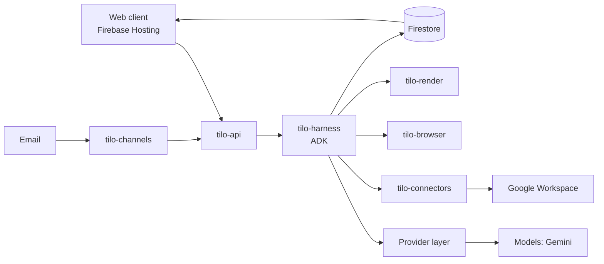

# Tilo

Tilo is an agentic work platform. You describe work in plain language; a Director plans it and offers one priced
confirmation card; teams of agents run it. You watch the work as a living isometric world, a plain-language Story, or a
technical Trace, and agents come to you (web, phone or email) when they need a decision. Every animation traces to a
recorded event, and nothing that leaves Tilo is sent without the policy engine and, for the highest tier, a person.

Built for the Google Cloud AI Builder Cup 2026. The full specification is `docs/prd/tilo-prd-v2.md` (read-only);
`contracts/` (JSON Schemas, event registry, fixtures) wins over prose where they differ.

## Try it

- Live site: <https://essential-wares-510320-f0.web.app> (Firebase Hosting, project `essential-wares-510320-f0`,
  region `asia-southeast1`).
- **Explore a demo session** on the sign-in page opens a sample company with no account. A demo session replays
  recorded runs and shows sample data, labelled as such: nothing in it is sent, started or paid.
- **Continue with Google** signs in to your own workspace. The Google app is in testing mode, so only listed test
  users can sign in.
- Deploying it yourself: `docs/deploy-dev.md`.

### Judges: try a task from Home

See the [three-minute judges' walkthrough](docs/demo.md) for the post-GATE-OLDUI
flow, the recorded evidence at each step, and the conditional publication status.

1. Sign in with **Continue with Google**, then open **Home** (`/`).
2. Type a task, such as “Draft a one-page plan for a community garden”, into the Home composer and submit it.
3. Review the single confirmation card, including its scope and estimated cost.
4. Choose **Start** on that card. The World opens for the run; follow its progress and answer any Needs-you cards.
5. Open **Story** for the plain-language account or **Trace** for the recorded technical events.

A live run requires the signed-in API and its configured runner. Local fake-provider runs and demo replays are
labelled as samples or recordings; they do not prove a live model call or an external action. If the run cannot
start, use the displayed error rather than treating the sample world as a completed task.

For a historical view of the world renderer, see the existing
[World screenshot](docs/screenshots/s04/world-finished-1440x900-after.png). This is a recorded reference, not
evidence that the current hosted run completed.

## How to run

For meeting notes and messages, see [Meeting minutes and follow-ups](docs/minutes.md).

You need `just`, `uv` (Python 3.12), Node 22 or newer and `pnpm`.

### Windows (native, no WSL; see `docs/adr/0001-native-windows-just-task-runner.md`)

```powershell
winget install Casey.Just
just setup   # uv sync + pnpm install + the pre-commit hook
just dev     # web dev server; `just dev-api` runs the API in a second terminal
just check   # format, lint, typecheck and all tests
```

### Linux / CI

```sh
just setup
just dev
just check
```

Local runs use fake providers and recordings; no command here makes a paid model call. Live calls are only made by
a deployment that sets `LIVE` (see "Honest notes").

## Architecture

A Firebase-hosted web client over Cloud Run services. Every model, search, safety and speech call goes through
`packages/providers`, driven by `config/`; business code asks for a role, never a model name.



This is the design in PRD section 6.1 with WhatsApp left out (out of scope: SD-01, ADR-0019). The client and channels
write only through the API; the client reads live state from Firestore under security rules.

| Path | What it is |
| --- | --- |
| `apps/web` | React web client: Park shell and pages, PixiJS world, Story and Trace lenses |
| `services/api` | `tilo-api`: sessions, tasks, cards, approvals, policies, sharing, RBAC |
| `services/harness` | `tilo-harness`: ADK single-writer run process, planning, agents, handoff, events |
| `services/channels` | `tilo-channels`: email notifications, web push, Email Autopilot, signed email links |
| `services/connectors` | `tilo-connectors`: OAuth token broker, Gmail, Drive and Calendar adapters, MCP client, outbox |
| `services/browser` | `tilo-browser`: isolated headless browser, allowlisted egress, masked secure fields |
| `services/render` | `tilo-render`: PPTX, PDF and chart deliverables |
| `services/sandbox-web` | `tilo-sandbox-web`: fictional sites for scenarios and evals |
| `packages/providers` | Model, search, safety, speech and render provider layer; router, fallback, recordings |
| `packages/*` | policy engine, world engine, memory and ledger, metering, redaction, planning, people |
| `contracts/`, `config/`, `prompts/`, `skills/` | schemas and event registry; models, prices, autonomy; prompt templates; expert skills |
| `infra/` | Terraform for the `tilo-dev` project (applied by the project owner only) |
| `meet-bot/` | the meeting bot (separate Python project; see its own README) |

## GenAI map

Roles are mapped to profiles in `config/models.yaml` (PRD 6.4). The profiles shipped there are marked `example: true`:
the final set is chosen under the efficiency rules in PRD 6.6 and changes go through a pull request. Model ids appear
only in `config/` and `packages/providers`.

| Role | Primary, fallback | Used for |
| --- | --- | --- |
| `director` | `gemini-3.8-flash`, `gemini-3.7-flash` (thinking high) | intake, planning, confirmation card |
| `lead`, `verifier`, `writer` | `gemini-3.8-flash`, `gemini-3.7-flash` | district leadership, verification, documents |
| `specialist`, `narrator`, `lead_review` | `gemini-3.1-flash-lite`, `gemini-3.7-flash` | cheapest-first step work, Story narration, short verdicts |
| `autopilot`, `autorater` | `gemini-3.7-flash`, `gemini-3.1-flash-lite` | Email Autopilot triage and drafts, eval grading |
| `assistant` | `gemini-3.1-flash-lite`, `gemini-3.7-flash` | assistant panel fallback |
| `safety` | Model Armor template `tilo-default` (`fake-safety` in dev only) | screening of intake and tool text |

Google Cloud pieces used: Cloud Run, Firebase Hosting, Authentication and App Check, Firestore, Cloud Storage,
BigQuery, Secret Manager and Cloud KMS, Model Armor. The service map is PRD 6.3.

## Eval results

`evals/` holds the replay harness: 160 recorded cases (`evals/cases/`, PRD 19) and a 38-case generality bank
(`evals/bank/`). `just eval` replays the cases with no paid calls and writes `evals/results.local.md` (git-ignored).
No committed pass record exists yet (`evals/results.md` is not in the repository); the numbers above are file counts,
not results.

## Security notes

- Every side effect goes through the outbox and a deterministic policy engine; a model never decides authorisation,
  and the highest risk tier (T3) always needs a person.
- Intake and tool text is screened by Model Armor; secrets stay in Secret Manager and user OAuth tokens are
  envelope-encrypted with Cloud KMS. Tilo never handles passwords.
- Dev and CI make no paid calls and hold no cloud credentials. Details: PRD section 16 and `docs/licences.md`.

## Honest notes

- The demo session is a recorded sample, not a live run. Pages that show sample data say so.
- Live model calls, and live Gmail, Drive and Calendar access, exist only where a deployment sets `LIVE`
  (`docs/deploy-dev.md`, "Live connectors"); they are off by default, in dev and in CI.
- WhatsApp is out of scope; the channels are web, phone web push and email.
- Email Autopilot and Google sign-in run in testing mode for listed test users until Google's app verification is
  complete (PRD 1.4).
- Roadmap, not built (PRD 3.4): desktop control, Build mode, workforce orchestration, native mobile apps,
  Microsoft 365 connectors.
- Open questions and the defaults taken are logged in `docs/open-questions.md`.

## License

Apache-2.0, see `LICENSE`.
