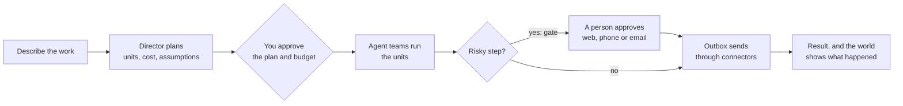
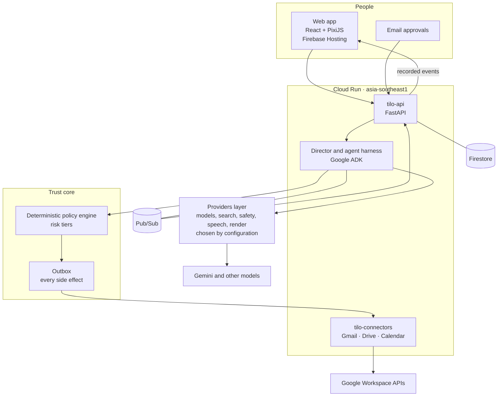

<div align="center">


### People describe work. A Director plans it. Agent teams run it. The work is shown as a living isometric world.

[](https://essential-wares-510320-f0.web.app)


</div>

<p align="center">
<a href="#-what-is-tilo">What</a> ·
<a href="#%EF%B8%8F-tour">Tour</a> ·
<a href="#-how-it-works">How it works</a> ·
<a href="#%EF%B8%8F-architecture">Architecture</a> ·
<a href="#%EF%B8%8F-trust-and-safety">Trust</a> ·
<a href="#-run-it-locally">Run it</a>
</p>

---

## ✨ What is Tilo?

Most AI tools hand you a chat box and a wall of text. **Tilo** turns a one-sentence request into a plan with a price, runs it with a team of specialised helpers, and shows the work as a tiny isometric city you can read at a glance: helpers walk between buildings, and anything important stops at a gate until a person says yes.

- **Describe it in plain words.** "Compare 3 battery suppliers for the K1 scooter."
- **See the plan and the cost first.** Assumptions are editable in place; the price is shown in credits before anything starts.
- **Watch it happen.** Every step is written in plain sentences next to the world, with a Story lens and a Trace lens.
- **You stay in charge.** Risky steps wait for approval from the web app, phone or email.

| 🗣️ **Plain words in** | 🧾 **Price first** | 🏙️ **A world you can read** | 🛡️ **You stay in charge** |
|---|---|---|---|
| One sentence, plus files if they help | Plan and cost in real money before anything starts | Story and Trace lenses on every job | Risky steps wait at a gate for a person |


## 🖼️ Tour

> Screenshots are taken from the live demo town. Demo sessions replay recorded runs on sample data; nothing in the demo sends real email.

| Home | Your town of worlds |
|---|---|
|  |  |
| **Agenda with team and personal pinboards** | **Skills (teach Tilo a repeatable way of working)** |
|  |  |
| **Team** | **Ledger** |
|  |  |

<details>
<summary><b>📱 Mobile (390 px wide)</b></summary>

<p align="center">


</p>

</details>

## 🧭 How it works

1. **Describe it.** One sentence, plus any files that help.
2. **Check the plan.** The Director proposes units of work, the assumptions and a budget in real money. You edit in place, then approve.
3. **Agent teams run it.** The Director picks only the helpers the job needs: a quick question gets one, a launch gets the whole crew. Each helper uses tools through the connectors layer.
4. **See it, steer it.** The work is drawn as a world. Anything that touches the outside world, such as sending a reply, stops at a gate and waits for a person.



## 🏗️ Architecture



<details>
<summary><b>What each piece does</b></summary>

| Piece | Role |
|---|---|
| **Web app** (`apps/web`) | React and TypeScript, with the isometric world drawn in PixiJS v8. Story and Trace lenses, approvals, Agenda and Team pages, mobile layout. |
| **tilo-api** (`services/api`) | FastAPI service: sessions, plans, approvals, the event stream. |
| **Director and harness** (`services/harness`) | The Director plans; agent teams built on Google ADK run the units. |
| **Providers layer** (`packages/providers`) | The only place a model, search, safety, speech or render call is made. Models are configuration (`config/`), so changing a model is a config change, not a code change. |
| **Policy engine** (`packages/policy`) | Deterministic rules decide whether an action may run. A model never decides authorisation. |
| **Outbox** | Every side effect is queued here and released only after the policy check. |
| **tilo-connectors** (`services/connectors`) | Gmail, Drive and Calendar with least-privilege scopes (for example Drive uses `drive.file` only; Gmail never asks for full mailbox access). |
| **Firestore and Pub/Sub** | State and events. Dev and CI use emulators with a `demo-` project id. |

</details>

## 🛡️ Trust and safety

- **Every side effect goes through the outbox and the deterministic policy engine.** Sending, creating or changing anything outside Tilo is queued, checked against rules, and only then released.
- **Tier 3 actions always need a person.** The highest-risk actions can never be auto-approved.
- **A model never decides authorisation.** Models draft and plan; code decides what is allowed.
- **Honesty rules: nothing animates without a recorded event.** If a helper walks, an event happened. Replays are labelled as recorded; sample data is labelled as sample.
- **Least-privilege connectors**, no secrets in code, prompts, logs or fixtures, and Tilo never handles passwords.
- **No paid calls in dev or CI.** Record-and-replay or fake providers only; live calls need an explicit switch.

## 🧰 Tech stack

| Layer | Technology |
|---|---|
| Frontend | React 18, TypeScript, Vite, PixiJS v8, Playwright for end-to-end tests |
| Backend | Python, FastAPI, Pydantic v2 models generated from JSON Schema contracts |
| Agents | Google ADK, Google GenAI SDK |
| Models | Gemini by default; other providers selectable through configuration |
| Data and events | Firestore, Pub/Sub |
| Hosting | Firebase Hosting (web), Cloud Run in `asia-southeast1` (services) |
| Infrastructure | Terraform modules in `infra/` |
| Tooling | `uv`, `pnpm`, `just` |

## 🗂️ Repo layout

```
apps/web            React and PixiJS web app
services/           api, harness, connectors, channels, browser, render, sandbox-web
packages/           providers, policy, planning, memory, archive, metering, people, world, contracts-py, contracts-ts
contracts/          JSON Schemas, event registry and fixtures (the source of truth)
config/             models, autonomy, connectors, teams and other configuration
prompts/ skills/    prompts and teachable skills
evals/              evaluation harness
infra/              Terraform
docs/               PRD, architecture decision records, notes
```

## 🚀 Run it locally

Prerequisites: Python with [`uv`](https://docs.astral.sh/uv/), Node with `pnpm`, and [`just`](https://github.com/casey/just).

```bash
just setup   # uv sync and pnpm install for every workspace member
just dev     # web dev server
just check   # format, lint, typecheck and all tests
```

Local development uses fake and record-and-replay providers and the Firestore and Pub/Sub emulators, so it makes no paid calls and needs no cloud credentials.

## 🗺️ Roadmap

- ✅ Describe, plan, run, approve; isometric worlds with Story and Trace lenses
- ✅ Gmail, Drive and Calendar connectors
- ✅ Agenda with team and personal pinboards, Team page, Skills, Ledger
- 🔜 More connectors (other work tools) are future scope

## 🙌 Credits

Built by [@spark-456](https://github.com/spark-456) for the Google Cloud AI Builder Cup 2026, with AI coding agents in the loop. Licensed under [Apache-2.0](LICENSE).
