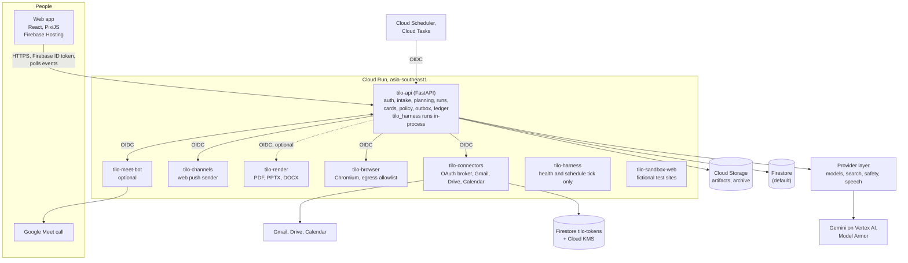
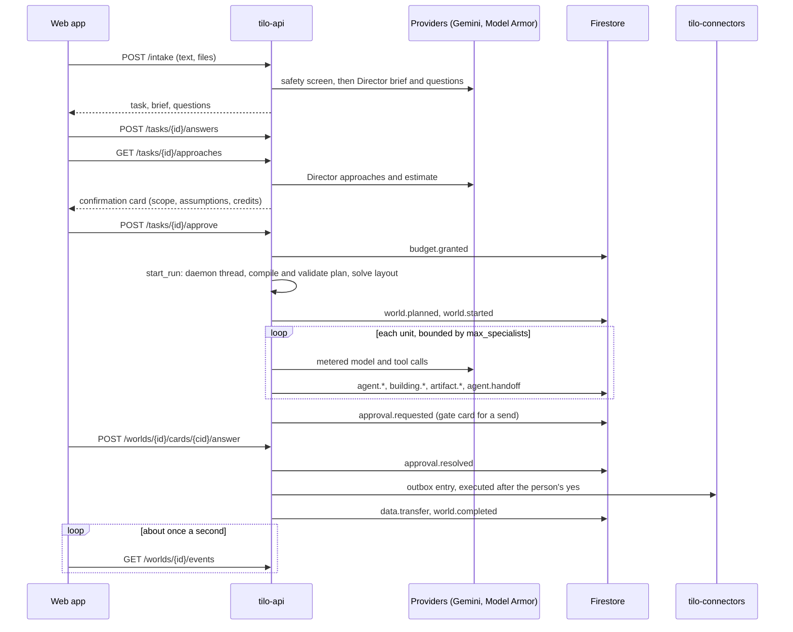
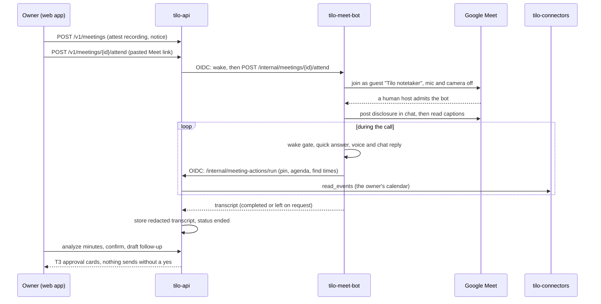

# Tilo architecture

This describes what the code in this repository does today, service by service, and where it differs from what the
names suggest. It was written by reading the code; where a statement could not be confirmed from the repository (for
example how a live Cloud Run service is configured right now) it says so. A service or adapter being listed here is
not evidence that it is deployed, activated or has made a successful live call. For the product spec see
[the PRD](prd/tilo-prd-v2.md); for the reasons behind decisions see [docs/adr/](adr/); where the two disagree with
the code, the code and [contracts/](../contracts) are authoritative.

Contents: [Overview](#overview) · [Services](#services) · [Data stores](#data-stores) ·
[A world run](#request-flow-of-a-world-run) · [Events](#events-and-the-world) · [Meeting bot](#the-meeting-bot-flow) ·
[Connectors](#connectors-gmail-drive-and-calendar) · [Security model](#security-model) · [Modes](#modes-dev-replay-and-live) ·
[Deployment](#deployment-topology)

## Overview

A person describes work in a sentence. `tilo-api` screens it, asks a **Director** model for a brief, ranked questions
and priced approaches, and shows one confirmation card with the scope and an estimated cost. On approval the API
compiles a plan and executes it: units of work run as agents (specialists, leads, a verifier, a writer), each step is
recorded as a typed **event**, and the web app draws the events as an isometric **world** with **Story** and **Trace**
lenses. Anything that sends, shares, saves or spends passes a deterministic **policy engine** and the **outbox**; the
highest risk tier (T3) always needs a person.

Three things surprise readers, so they come first:

1. **Runs execute inside `tilo-api`.** The API imports `tilo_harness` as a library and runs each approved plan in a
   daemon thread of its own process. The deployed `tilo-harness` Cloud Run service serves only `/health` and a schedule
   tick route that is not wired to anything yet. Google ADK is used by the harness's three-agent skeleton fixture, not
   by `run_plan`.
2. **The web app does not read Firestore.** It polls `GET /worlds/{id}/events` on `tilo-api` about once a second.
   `firestore.rules` denies every client read and write; all data access is server-side.
3. **Several packages are libraries used by the API, not services:** `tilo-channels` (apart from one push route),
   the planning, policy, people and memory packages, and most of `tilo-render`'s formats.

## Services

| Service | Kind | What it does today |
| --- | --- | --- |
| [`apps/web`](../apps/web/README.md) | Firebase Hosting | React 18 client: Park shell and pages, the PixiJS world, Story and Trace lenses, cards, settings. Talks to `tilo-api` over HTTP only |
| [`services/api`](../services/api/README.md) | Cloud Run, public | The one door for the web app. Firebase sign-in, App Check, intake, planning, **run execution**, cards and approvals, policy and outbox, sharing, people and teams, skills, schedules, costs and the spend ledger, memory, push, meetings and the meeting bot gateway |
| [`services/harness`](../services/harness/README.md) | Library + Cloud Run stub | Run engine (`run_plan`, single-writer event store, tool loop, must-ask, handoff, deliverables). Deployed as health + an unwired tick route |
| [`services/connectors`](../services/connectors/README.md) | Cloud Run, internal | The only holder of Google OAuth grants: consent flow, encrypted token store, Gmail/Drive/Calendar adapters, outbox execution, workspace reads |
| [`services/browser`](../services/browser/README.md) | Cloud Run, internal | Isolated headless Chromium sessions for visible browsing, plus an SSRF-guarded file fetch |
| [`services/render`](../services/render/README.md) | Cloud Run, internal | Deterministic PDF, PPTX, DOCX (HTTP) and XLSX, CSV (in-process) from a deliverable spec |
| [`services/channels`](../services/channels/README.md) | Cloud Run | Web Push sender route; the rest is library code (links, digests, Email Autopilot, nudges) that the API imports |
| [`services/sandbox-web`](../services/sandbox-web/README.md) | Cloud Run, public | Fictional websites and fetch fixtures for scenarios and evals |
| [`meet-bot`](../meet-bot/README.md) | Cloud Run, internal, opt-in | Joins a Google Meet, hears captions, answers by voice and chat, pins, finds times |

Shared libraries live in [`packages/`](../packages/README.md); [`contracts/`](../contracts/README.md) holds the JSON
Schemas and the event registry that both Python and TypeScript types are generated from.

### tilo-api in more detail

`tilo_api:app` is a module-level FastAPI app (`services/api/src/tilo_api/__init__.py`) with these concerns:

- **Request pipeline** (outermost to innermost): CORS, log context, rate limit, `no-store` for `/v1/*`, App Check, the
  access gate (every non-public route needs a verified sign-in when deployed), then the route.
- **Intake and planning:** `POST /intake`, `POST /tasks/{id}/answers`, `GET /tasks/{id}/approaches`,
  `POST /tasks/{id}/approve` (`intake.py`, `tasks.py`, `quick.py`).
- **Run execution:** `runs.py` (`start_run`, `Run`), which wires the plan compiler, layout solver, unit runner, tools,
  policy engine, outbox and event writer. `GET /worlds/{id}/delivery`, `/result`, `/events`, `/layout`.
- **Approvals:** `cards.py`, `cards_feed.py`, `console.py` (Team Lead console), `sharing.py` (approver links),
  `dispatch.py` (pause, stop autopilot, revoke a policy).
- **People and teams:** `people*.py`, `team_*.py`: meetings, work items, pinboards, teams and roles, with every read and
  write passing the `tilo_people` visibility oracle.
- **Skills:** `skills_*.py` teach a skill from words or a recording, route a task to a skill, collect ratings.
- **Money:** `spend.py`, `spend_units.py`, `costs.py`, `treasury_firestore.py` (see [Security model](#security-model)).
- **Schedules:** `schedules.py` with `POST /internal/schedules/tick`.
- **Meetings:** `meeting_*.py` (see [the meeting bot flow](#the-meeting-bot-flow)).
- **Stores and seams:** `deps.py` builds every store and client; `store_door.py` and `prod.py` are the guarded doors to
  Firestore.

Dev mode (`just dev-api`, `TILO_API_DEV=1`) swaps in an in-memory store, a fake owner and fake providers, and refuses to
start on Cloud Run or with `LIVE=1`.

## Data stores

All data is in the project's Firestore **(default)** database under one organisation id (`org_tilo`), plus Cloud Storage
and the separate token database. No client has direct access.

| Store | Path or name | Written by | Holds |
| --- | --- | --- | --- |
| Firestore (default) | `orgs/{org}/worlds`, `tasks`, `policies` | api (`durable_store.py`) | worlds, tasks, policies; a write-through cache over the store |
| | `orgs/{org}/worlds/{w}/events/{seq}`, `.../views/{scope}/events`, `.../_head/state` | harness `WorldWriter` through api | the ordered event log, per-district redacted views, the single-writer lease |
| | `orgs/{org}/worlds/{w}/artifacts/{id}/versions` | api (`tilo_memory.artifacts`) | artifact version records (bytes are in Cloud Storage) |
| | `orgs/{org}/people_*`, `people_directory`, `users/{u}/memory`, `chat_users/...`, `brief_*`, `mail_triage` | api people stores | persons, meetings, work items, pinboard items, calendar entries, teams, memory notes, chats |
| | `orgs/{org}/spend_ledger`, `treasury_ledger`, `treasury_rollup` | api | per-uid spend guard; the credits ledger and per-run rollups |
| | `outbox/{id}`, `outbox_keys/{world}/keys/{hash}` | api (`outbox_firestore.py`) | the durable outbox, with idempotency keys |
| | `orgs/{org}/schedules`, `push/{uid}/devices`, `push_endpoints`, `taught_skills`, `team/settings`, `user_settings`, `nudge_state`, `link_nonces`, `feedback`, `followup_drafts` | api | feature state |
| Firestore `tilo-tokens` | `token_grants/{user}/connectors/{connector}`, `token_revoke_retry/...` | connectors | Google OAuth grants, sealed (below). Rules deny all clients |
| Cloud Storage | `<project>-artifacts` (versioned) | api | artifact bytes |
| | `<project>-archive` (CMEK) | api | raw run archive, create-only `{org}/{run}/{n}.jsonl` |
| | `<project>-cloudbuild-staging` (7-day expiry) | `gcloud builds submit` | Cloud Build source uploads |
| | `<project>-snapshots` (90-day expiry) | nothing found in code | provisioned by Terraform for world snapshots; no writer exists yet |
| Cloud KMS | key ring `tilo-asia-southeast1`: `oauth-tokens`, `archive` | connectors; Cloud Storage | wraps token data keys; encrypts the archive bucket |
| Secret Manager | `workspace-oauth-client-id`, `-secret`, `webpush-vapid-private-key`, link-signing and channel keys | Terraform declares empty placeholders; values are added and mounted by hand with `gcloud` | the OAuth client, VAPID key, signing keys. No values in the repository |
| Pub/Sub, BigQuery | topic `tilo-events` -> table `tilo_ledger.events`; Gmail notification topic | Terraform only | provisioned, but no deployed service publishes to them yet; the live ledger is the Firestore Treasury ledger |

Some state is deliberately in memory only: per-run card state, approver share-link tables, the rate limiters, the BYOK
stores and the meeting bot's per-attend claims (which is why the API stays at one instance). Deployed, the API refuses to
run on in-memory stores: without Firestore configured, store routes answer 503 (the one exception is the outbox, which is
durable only when `TILO_OUTBOX_STORE=firestore` is set). Demo sessions get a per-session in-memory bundle and store
nothing durable.

## Request flow of a world run

1. **Intake.** `POST /intake` takes the text, optional files and a mode (`quick` for small asks, `thinking` for a full
   world). Every typed string and every upload is screened by the `safety` role (Model Armor when deployed; a fake one
   is refused on Cloud Run). The Director returns a brief and ranked questions; the person's answers go to
   `POST /tasks/{id}/answers`.
2. **Plan and price.** `GET /tasks/{id}/approaches` returns two or three approaches with credits. A credit is US$0.005
   at list prices (`config/prices.yaml`); the grant is floored by `config/run_grant.yaml` and capped by
   `config/metering.yaml` (`caps.run_credits`).
3. **Approve.** `POST /tasks/{id}/approve` records `budget.granted` and calls `runs.start_run`. A policy at level L3
   may grant the budget; otherwise the owner's own confirmation does. A live request that cannot be metered is run in
   replay, never unmetered.
4. **Execute.** The run compiles the Director's plan, validates it (`plangraph.validate_plan`), solves the layout
   (`tilo_world.solve`), records `world.planned` and `world.started`, and calls `tilo_harness.executor.run_plan`, which
   runs the units concurrently up to `limits.max_specialists`. Skills are pinned by hash; a changed skill file fails the
   unit. A unit may need to ask a person first (the must-ask rules are code; a model reply can only add a question),
   and a unit that fills its context window hands off to a spare agent through a validated note.
5. **Tools.** Specialists get `web_search` and `fetch_url` by default; live runs can also read the person's own mail,
   calendar and Drive through `tilo-connectors`, and a plan step can use `browse_web` on `tilo-browser`. Tool results
   are neutralised as data, safety-screened and archived.
6. **Side effects.** A unit that would send or save asks the policy engine (`tilo_policy.decide`). The result is a gate
   card for a person, a draft only, a run after an undo window (L2), or a run (L3). An approved entry goes into the
   outbox; the connectors service executes it exactly once.
7. **Deliver.** A writer `deliver` unit renders the file (PDF, PPTX, DOCX, XLSX, CSV through `tilo_render`; a website as
   an HTML artifact; a quiz app), stores it with a provenance manifest, and the run records `world.completed`, or
   `world.failed`. `GET /worlds/{id}/delivery` answers 409 until completion.
8. **Scheduled runs.** Cloud Scheduler calls `POST /internal/schedules/tick` every minute; the tick fans due slots out to
   a Cloud Tasks queue, and Cloud Tasks calls the same route back with a different identity to run one run in the
   request. A run stopped by a service restart records `world.failed` and can be started again
   (`POST /worlds/{id}/rerun`, the **Start it again** button).

## Events and the world

Everything on screen derives from events: typed records with a cause, a visibility scope and a short plain-language
summary, validated against `contracts/events/registry.yaml` (101 registered types in 26 families as of registry
version 1.7.0, each with a data schema). An unregistered type is accepted into the log but appears in Trace only.

- **Writing.** `WorldWriter` (`services/harness/src/tilo_harness/writer.py`) is the only writer per world. It validates
  each event (EV-01 to EV-16), holds a lease in `_head/state`, and re-checks head and lease in the same transaction on
  every append. An identical resend returns the committed event; any other id reuse is rejected.
- **Reading.** `GET /worlds/{id}/events` returns the world's events in sequence order, redacted by district
  visibility (it also accepts `after_seq`). The browser polls it about once a second, backs off on failure and hands on
  only events past the last sequence number it has seen. There is no websocket and no Firestore listener.
- **Rendering.** In the web app `registry.generated.ts` -> `reducer.ts` -> `store.ts` -> `frame.ts` -> `renderer.ts`
  turns events into entities, and `choreographer.ts` is the only code allowed to animate. The honesty rules (PRD 9.4,
  HR-1 to HR-7) are enforced by tests: nothing animates without a recorded event, moves are capped at 2 s, replays carry
  a banner, time compression a speed badge, unknown events appear in Trace only. Home-page city motion is decoration and
  the one exception.
- **Layout.** `tilo_world.solve` is a deterministic layout solver (World -> Levels -> Districts -> Buildings); the
  API builds the layout once per run.

## The meeting bot flow

The meet bot is a separate Python project (`meet-bot/`) deployed as an optional Cloud Run service (`tilo-meet-bot`,
Terraform `meet_bot_enabled`, default off). It is not the same thing as the **Meeting Hall** in a world
(`meeting_room*.py`), where a person talks to a team lead agent.

1. **Create and start.** The owner creates a meeting record (with a recording attestation and notice version) and
   attaches a world to it. The default path is a guest join: the owner pastes their own Meet link and the API mints a
   60-second join record. The alternative host path needs the meeting-host connector: a single T3 gate card, answered
   by the owner, makes the outbox ask `tilo-connectors` to create a Calendar event with a Meet link on the bot's own
   Google account.
2. **Attend.** `attend_meeting` moves the meeting to `joining` with a compare-and-set, opens per-attend claims, wakes the
   bot and holds the request open (up to about 45 minutes). The bot joins as a guest, a human host admits it, and it
   posts its disclosure in the chat before it reads anything; if the disclosure fails it leaves without capturing. It
   never creates a call or admits anyone, and any participant can say or type "Tilo leave".
3. **During the call.** Captions are read from the Meet page (the cloud bot uses captions only, no ASR). A wake gate
   decides what is addressed to Tilo; answers come from the quick model path or locally for agenda, time and
   who's-here questions, are spoken (Chirp 3 HD through the provider layer, an offline fallback voice) and mirrored in
   chat. Pins go to the speaker's personal or team Tilo pinboard after a fixed read-back and the same speaker's "yes";
   "find a time" offers up to three slots computed by the API from the owner's primary Google Calendar and teammates'
   accepted Tilo entries; "book it" creates a Tilo Agenda record (not a Google Calendar event). The bot is told only
   that a meeting exists, not the real agenda.
4. **After.** The cloud bot returns only the transcript lines and Tilo's replies. The API stores them as a redacted,
   screened upload (kept 30 days). Minutes analysis (`meeting_minutes.py`: safety screen, analyst, verifier) is behind a
   flag that is off in the shipped config; confirmed minutes (kept 90 days) can be sent to chosen attendees as T3
   approval cards through the channels Autopilot. Nothing sends without an approval.
5. **What the bot never holds:** no OAuth tokens, no Firestore, Storage or KMS role, no secrets, and no ledger code (a
   test checks its imports). It does hold Vertex access for its own model and voice calls; those are counted by call
   caps in `config/meeting.yaml` and, for the optional Live voice, by the SEC-16 meter.

## Connectors: Gmail, Drive and Calendar

Only `tilo-connectors` holds a person's Google grant. `tilo-api` reaches it with one OIDC identity and never imports its
token modules.

- **Consent.** The web app starts `POST /v1/connectors/connect`, the API forwards to `/internal/connections/start`,
  the person consents at Google (PKCE, state bound to the user), and the callback page strips the `code` and `state`
  from the URL before anything renders. Scopes are least privilege and incremental: Gmail `readonly`, `compose`,
  `send`; Drive `drive.file`; Calendar `readonly` and `events.owned`.
- **Tokens.** Grants are stored in the `tilo-tokens` database, each sealed with its own AES-GCM data key wrapped by the
  Cloud KMS key `oauth-tokens`. Only the connectors service can decrypt them.
- **Reads.** `/internal/workspace/read` gives agents five reads of the person's own account: search and read mail,
  list events, list and read files.
- **Writes.** Every write is an outbox entry. The tier comes from `config/autonomy.yaml` (an unlisted action is T3);
  T3 needs a recorded human `approval.resolved`. The adapter checks for its earlier attempt by a marker before it sends,
  so a retry never double-sends, and an uncertain outcome is reported as `possibly_sent`, not sent.
  Implemented: Gmail drafts and sends (new or threaded reply), Drive saves into an app-created Tilo folder (including a
  PPTX/DOCX/XLSX converted to a native Google file), Calendar events (guests are T3, up to 50). Not implemented:
  free/busy, event update or delete, label changes, and the Docs, Sheets and Slides APIs.
- **Status.** Live Google access exists only where the owner sets `LIVE=1` on the connectors service with the token
  store and OAuth client configured; otherwise routes answer 503. No MCP server can connect (`config/mcp.yaml` is
  empty); Lovable and Canva are held. See [docs/connectors/README.md](connectors/README.md).

## Security model

**Identity.** The web app signs in with Firebase Authentication (Google, or an anonymous demo session). `tilo-api`
verifies the ID token itself (RS256 against Google's keys, audience is the project) and turns it into a principal: a
Google person is an owner with a full session; an anonymous person is a demo session that gets replay models and
in-memory state only. Firebase App Check (reCAPTCHA Enterprise) adds a second token; it is only logged until
`TILO_APPCHECK_ENFORCE=1`. Deployed CORS allows exactly the two Hosting origins.

**Service-to-service.** Internal calls carry a Google OIDC ID token minted from the metadata server for the target's
URL. Each receiver verifies audience and the one caller it accepts:

| Caller -> receiver | Route | Accepts |
| --- | --- | --- |
| Cloud Scheduler -> api | `POST /internal/schedules/tick` | the Scheduler account (`TILO_SCHEDULE_TICK_CALLER`); fans out to Cloud Tasks |
| Cloud Tasks -> api | the same route | the Tasks account (`TILO_TASKS_CALLER`); runs one run. Fails closed if both are the same account |
| api -> connectors | `/internal/*` | only the API's account (`TILO_MEETING_HOST_CALLER`); 403 for any other, the harness included |
| api -> browser | `/sessions/*`, `/fetch` | accounts in `TILO_BROWSER_CALLERS` |
| api -> channels | `/internal/push/send` | `TILO_PUSH_CALLER` |
| api -> meet-bot | `/internal/meetings/{id}/attend` | `TILO_MEET_BOT_CALLER`; also requires `LIVE=1` |
| meet-bot -> api | `/internal/meeting-voice/*`, `/internal/meeting-actions/run` | its own accounts, plus a per-attend nonce; 404 unless the feature flag is on |
| api -> render | `POST /render` | no verifier is installed in the shipped image, so it fails closed; the API renders in its own process instead |

Cloud Run ingress is `INTERNAL_ONLY` for harness, connectors, browser and render, public for api, channels and
sandbox-web. api and harness use Direct VPC egress through a private subnet. There are no service-account keys:
deploys use Workload Identity Federation or Cloud Build's service account. The Terraform invoker bindings for browser
and render name `tilo-harness` while the code's caller is `tilo-api`, so confirm the live bindings before relying on
those two paths.

**Authorisation of side effects.** A model never decides authorisation. `tilo_policy` is deterministic: actions have a
risk tier from `config/autonomy.yaml`; any of six modifiers (new recipients, attachments, external sharing, deletion,
money or legal terms, a safety flag) lifts an action to T3; T3 is limited to autonomy level L1 and always needs a person's
`approval.resolved`. Gates default to hold and never time out to go. An L2 instruction must be the owner's own typed
words (ADR-0007) and an inbound message is never an instruction. Team settings can only restrict a tool further.

**Content safety.** Typed text, uploads, tool output and stored outputs are screened by the `safety` role, which is
Model Armor in deployment. External content reaches models only as delimited data (`<<<MARKER ... MARKER>>>` blocks),
agents that read untrusted content have no side-effect tools, and `tilo_redact` removes secret-shaped strings from
prompts, archives and logs. The browser service checks every request and redirect hop against an egress allowlist,
masks secure fields, and never types a credential; Tilo handles no passwords.

**Money.** Spend is bounded three ways, all from config and enforced in code:

- *Per-run credits:* the confirm card's grant (floor 60 credits, ceiling 300 credits).
- *SEC-16 live-model caps* (`config/spend_caps.yaml`, INR): 500 per signed-in person over their lifetime, 150 per run,
  5,000 per UTC day for the whole deployment. Reaching the daily cap turns the deployment replay-only. Every live call
  is a metered unit; a person at their cap gets 403 `spend_cap_reached`.
- *Rate limits:* an in-process token bucket per IP and user (`config/rate_limits.yaml`), 240 requests per minute per
  person, and 60 write attempts a minute on the people routes.

A settled unit is also one entry in the Treasury ledger (`orgs/{org}/treasury_ledger`), read by the Ledger page.

**Data.** `firestore.rules` and `firestore.tokens.rules` deny all client access. Artifact and archive buckets enforce
public-access prevention and the archive is encrypted with a customer-managed key. Org id is constant: this is a
single-tenant deployment, with per-person visibility enforced by the `tilo_people` oracle and district-redacted event
views; every refused read answers the same 404.

**Repository guards.** `.claude/hooks/guard.py` blocks edits to read-only paths, `.env` files and secret-looking
content, force pushes, `terraform apply`, `LIVE=1` and `tilo-demo` deploys; `scripts/secret_scan.py` runs in
pre-commit and CI; `scripts/lint_model_ids.py` fails the build on a model id outside `config/` and `packages/providers`.

## Modes: dev, replay and live

| Mode | When | Providers | State |
| --- | --- | --- | --- |
| Dev | `just dev-api` (`TILO_API_DEV=1`) | fake Director and runner (`config/models.dev.yaml`) | in memory; refuses to run on Cloud Run or with `LIVE=1` |
| Replay | anonymous demo sessions; any request over a cap; a deployment where neither live switch is set | recorded model outputs, no paid call | per-session in memory for demos |
| Live | `LIVE=1`, or `TILO_JUDGE_LIVE=1` for signed-in Google people on a deployment | Vertex AI Gemini, Model Armor, search, speech | Firestore, metered by the SEC-16 guard |

Only the owner sets `LIVE`; CI and dev never make a paid call. Models are configuration: `config/models.yaml` maps roles
(director, lead, specialist, verifier, writer, narrator, assistant, safety and others) to profiles, and
`packages/providers` is the only place a model id may appear. Alternate files selected with `TILO_MODELS_FILE` route the
same roles to NVIDIA NIM or the Gemini OpenAI-compatible endpoint for development.

## Deployment topology

Terraform (`infra/envs/dev`, applied only by the project owner) defines the Cloud Run services, service accounts, Pub/Sub,
Cloud Scheduler jobs, Cloud Tasks queue, KMS, buckets, Firestore databases and indexes, Model Armor template, budget and
alert policies. It sets no environment variables or secret mounts on the services; those are `gcloud` steps documented
in [docs/deploy-dev.md](deploy-dev.md). Images are built by Cloud Build (`cloudbuild.yaml`) from
`services/<name>/Dockerfile` with the repository root as context, and each service is switched to the new image by
digest. The web app is built with `scripts/web_build_env.py` and deployed to Firebase Hosting. The meet bot has its own
image and `cloudbuild.yaml` under `meet-bot/docker/`. See the [README](../README.md#deploys) for the commands.

Not yet wired in this repository: the `/internal/gmail/{push,renew,poll}` routes that the Gmail topic and two Scheduler
jobs point at; Pub/Sub publishing and BigQuery ledger writes; the harness service's schedule tick. They are tracked in
the [reviewer guide](REVIEWER-GUIDE.md#known-gaps).
