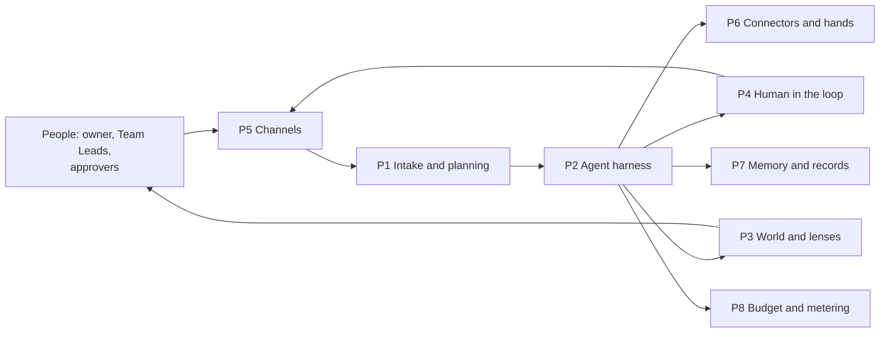
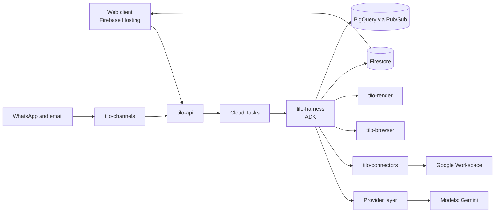
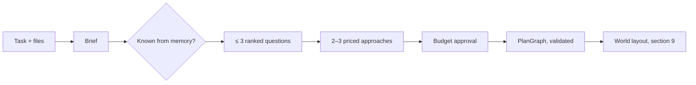
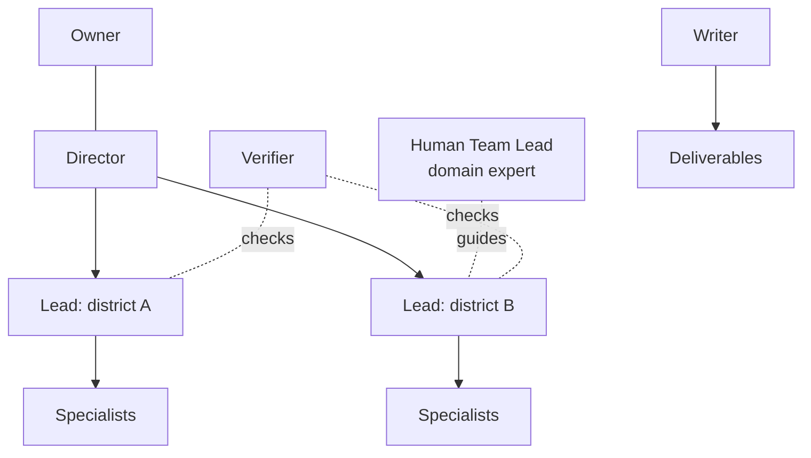
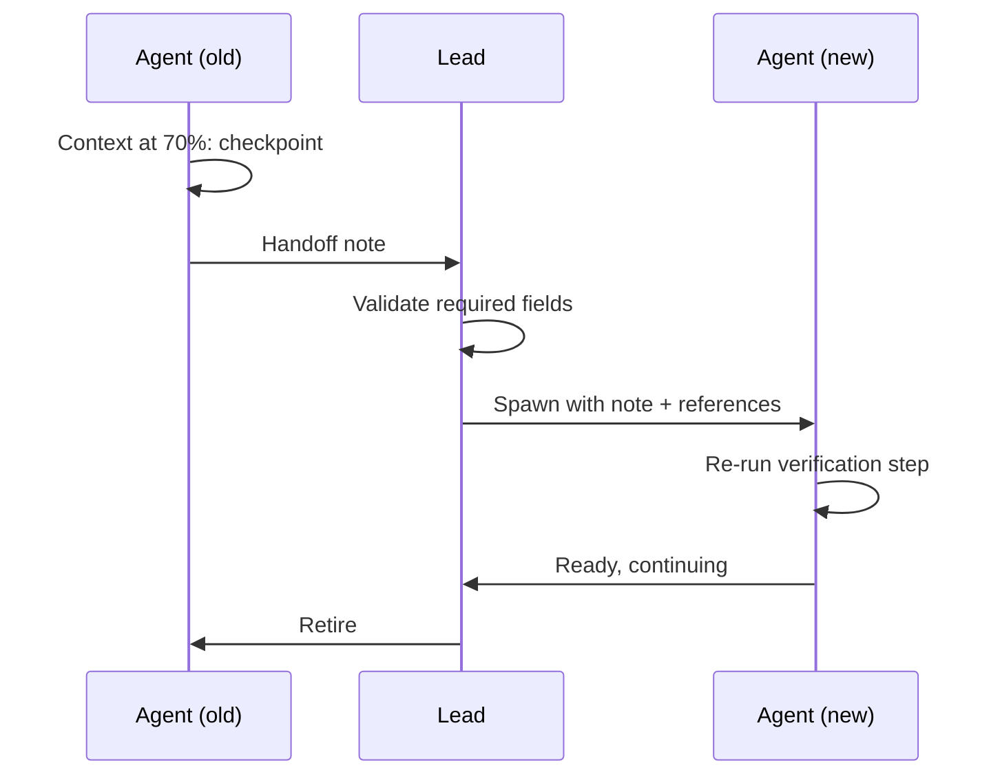
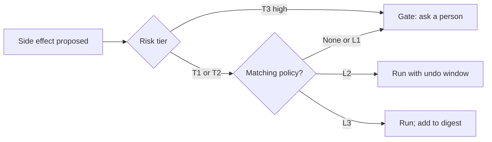
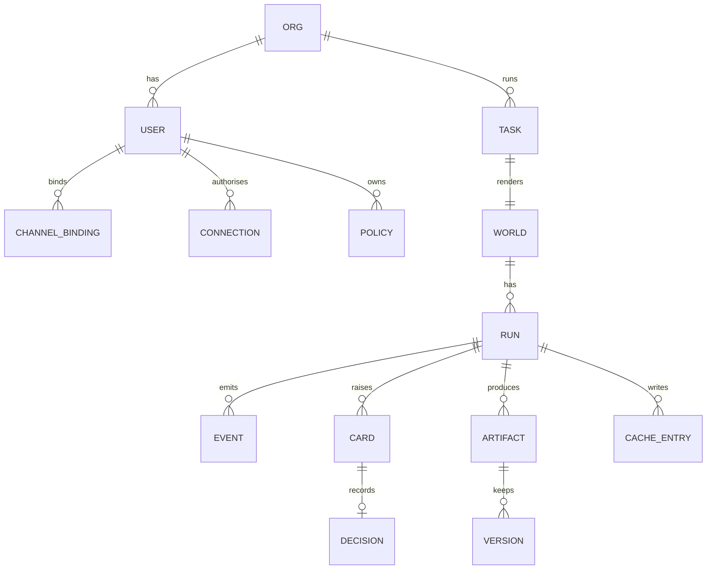

# Tilo — PRD v2: Platform Pillars (build-ready)

Sep 25, 2026 · @are u claude 3

## 1. Document control and executive summary

Tilo v2 is built pillar-first: eight platform pillars are built and tested before any demo scenario, so every scenario becomes a configuration of one platform rather than new code.

### 1.1 Document control

| Item | Value |
| --- | --- |
| Status | Draft v2.0 for team review |
| Supersedes | PRD v1 (kept as history). Where they conflict, v2 wins. Requirement IDs restart in v2. |
| Owner | \[Owner\]; workstream leads \[Member A\]–\[Member D\] |
| Target event | Google Cloud AI Builder Cup 2026, theme Future of Work & Enterprise Productivity |
| Key dates | Contracts frozen 29 Sep · thin slice live 3 Oct · pillars complete 9 Oct · code freeze 15 Oct · submit 17 Oct (official deadline 18 Oct; building and submission window 7 Sep – 18 Oct) |
| Design source of truth | Tilo Metropolis canvas (Claude Design); token values imported into `design/tokens.json` (OQ-07) |
| Runtime AI | Configurable: models are chosen in config at setup (section 6.4) under efficiency-first rules (6.6); the hackathon build uses Google models, as its rules require |
| How Claude Code uses this doc | Export as Markdown into `docs/prd/`. Requirement IDs are ticket IDs. Acceptance tests are the definition of done. |

### 1.2 What changed from v1

| Change | Why |
| --- | --- |
| Pillar-first structure; demo scenarios move to Phase 3 | Build the platform once; scenarios become configuration |
| Channels and Email Autopilot (web, mobile web, WhatsApp, email) | Real, everyday automation people feel on day one |
| Autonomy policies replace "irreversible actions always wait" | Full automation with explicit, revocable, audited user authorisation |
| Expert skill library and human Team Leads | Expert in the loop is Tilo's differentiator |
| Context handoff protocol | Long runs continue without a hiccup when an agent's context fills |
| Raw archive, provenance, versioning and rollback | Complete records, traceback and emergency fallback |
| Google Workspace connectors with the user's own sign-in | Real systems instead of a demo mailbox only |
| Uploaded context; PPTX and Google Slides output | Presentation and report work end to end |
| Config-driven model provider layer | Customisable models without code changes |
| Pilot programme and a time-reinvested metric | Evidence from real users, not assumptions |
| Hands roadmap, Build mode, workforce orchestration | Recorded as roadmap with contracts designed now |
| Hackathon rule updates | Fresh code and assets only, Google models or agentic platforms, deadline 18 Oct, IP terms (section 4.4) |

### 1.3 How to read this document

- **Part A, sections 1–5, for reviewers:** what Tilo is, the problem, evidence, pillars, goals, judging fit.
- **Part B, sections 6–19, for builders:** architecture, one section per pillar, contracts, security, quality. Every pillar section has the same shape: purpose, scope, requirements, events, open items.
- **Part C, sections 20–25, for delivery:** build plan, risks, decisions, roadmap, glossary and the Claude Code kickoff prompt.

| ID pattern | Meaning |
| --- | --- |
| `FR-INT-nn` | Intake and planning (P1) |
| `FR-AGT-nn` | Agent harness (P2) |
| `FR-WLD-nn` | World Engine and lenses (P3) |
| `FR-HIL-nn` | Human in the loop and autonomy (P4) |
| `FR-CHN-nn` | Channels and Email Autopilot (P5) |
| `FR-CON-nn` | Connectors, hands and deliverables (P6) |
| `FR-MEM-nn` | Memory, records and provenance (P7) |
| `FR-MTR-nn` | Budget, metering and evidence (P8) |
| `NFR` `SEC` `EV` `R` `D` `OQ` | Non-functional, security, evaluation, risk, decision, open question |
| Priority | **Must** (Phase 1 platform) · **Should** (by submission) · **Could** (stretch) · **Roadmap** (contract only) |

### 1.4 Executive summary

**What Tilo is.** You describe work in plain language. Tilo's Director plans it, proposes priced approaches, and runs it with a team of AI agents. You watch the work as a living isometric world, a plain-language Story, and a technical Trace. When agents need a person, they come to you on the web, your phone, WhatsApp or email, or to the expert who leads that team.

**The eight pillars.**

| # | Pillar | One line |
| --- | --- | --- |
| P1 | Intake and planning | Understand the task, ask only what matters, offer priced approaches |
| P2 | Agent harness | Directors, Leads and Specialists with expert skills, clean handoffs and recovery |
| P3 | World Engine and lenses | Every animation is a real event; World, Story and Trace stay in sync |
| P4 | Human in the loop and autonomy | Needs-you cards, gates, expert Team Leads, autonomy levels the user controls |
| P5 | Channels and Email Autopilot | Reach the user anywhere; reply on WhatsApp and Tilo writes and sends the email |
| P6 | Connectors, hands and deliverables | Google Workspace, browsing, uploads; decks, documents and sheets out |
| P7 | Memory, records and provenance | Reuse past work, record everything, trace any output to its cause, roll back |
| P8 | Budget, metering and evidence | Credits, budgets, time saved and credits saved, measured honestly |

**Why it matters.** Organisations are starting to delegate real work to agents, but that work is invisible, so it is hard to steer and harder to trust. Tilo makes agent work inspectable (every animation traces to an event), controllable (gates and autonomy levels) and accountable (ledger and provenance).

**What ships for the hackathon.** All eight pillars working on Google Cloud with Gemini, the design system from the Tilo Metropolis canvas, and scenarios chosen in Phase 3 from the backlog in section 4.

**Honest limits.** Desktop control, Build mode and workforce orchestration are roadmap. Email Autopilot runs for up to 100 test users until Google's app verification is complete. The WhatsApp channel stays task-scoped to comply with Meta's business messaging policy.

## 2. Problem, users and evidence plan

The gap is not what agents can do but whether people can see, steer and trust what they did; Tilo closes it, and the pilot in 2.4 will measure whether it does.

### 2.1 The problem

| Pain | What people experience today | Evidence status |
| --- | --- | --- |
| Invisible work | Multi-step agent runs show a spinner or a wall of logs; nobody can tell what is stuck | \[needs source\]: surveys on AI agent adoption barriers and trust |
| Wrong-moment interruptions | Agents ask about everything, or silently guess on things that matter | \[needs source\]: human-in-the-loop and automation-bias research |
| Untrusted output | Results arrive without sources or a trail, so people redo them by hand | \[needs source\]: verification effort for AI-generated work |
| Chained to the desk | Approvals and replies wait until the person is back at a laptop | Pilot evidence (EV-G3) |
| No expert oversight | Specialist work (security, finance, legal) is automated without the specialist in the loop | Pilot evidence (EV-G3) |
| Single-player automation | Automations belong to one person; colleagues cannot approve, teach or take over | \[needs source\]: shadow automation and governance gaps |

### 2.2 Mapping to the official problem statement

| Statement element | How Tilo covers it | Pillars |
| --- | --- | --- |
| Access knowledge | Grounded research with citations; memory of past runs, skills and artifacts | P6, P7 |
| Collaborate | Shared worlds with roles, expert Team Leads, meetings with recorded decisions | P2, P4 |
| Make decisions | Priced approaches, decision cards, gates that name the exact action | P1, P4 |
| Complete everyday work | Agents finish real deliverables; Email Autopilot handles replies from WhatsApp | P5, P6 |
| Productivity and efficiency | Time saved and credits saved, measured by a published method | P8 |
| Workflow execution | End-to-end runs with recovery, audit, provenance and rollback | P2, P7 |

### 2.3 Users

| ID | Persona | Context | Needs most | Pillars | Success signal |
| --- | --- | --- | --- | --- | --- |
| U1 | Operations manager (primary) | Owns recurring multi-source work: reports, supplier checks, analyses | Delegate whole tasks and trust the result | P1, P3, P7, P8 | Uses Tilo weekly; accepts outputs without redoing them |
| U2 | Mobile-first manager | In meetings and on the move; decides from a phone | Approve, answer and reply from WhatsApp or mobile web | P4, P5 | Most interactions completed from the phone |
| U3 | Expert Team Lead | Security, finance, legal or automation specialist | Guide agent teams in their domain; answer only real questions | P2, P4 | Answers in under 2 minutes; questions not repeated |
| U4 | Power user | Builds repeatable routines and skills | Teach once, reuse forever; tune autonomy | P2, P4, P7 | Routines run on schedule with few interventions |
| U5 | Approver or colleague | Owns a decision or a slice of the work | See only their part; approve with full context | P4 | Approves with one tap, no follow-up questions |
| U6 | Personal user | Home projects, personal email | The same power without enterprise setup | P5, P6 | Email Autopilot on by week two |
| U7 | IT and security reviewer | Signs off new tools | Credential policy, audit, data handling, kill switches | P4, P7, section 16 | Approves a pilot after one review |

**Not for (this release):** people seeking a general chatbot, fully unattended desktop automation, or financial trading.

### 2.4 Evidence plan (generate, never invent)

| ID | Study | Method | When | Output |
| --- | --- | --- | --- | --- |
| EV-G1 | Glanceability | 5–8 people find the blocked branch in a 20-agent run, once with the world, once with a raw log; time and error rate | 6–8 Oct | Deck number, method page |
| EV-G2 | Human baseline | Team members do each unit of work by hand, timed; median per unit | 1–8 Oct | Baselines for the time-saved method (section 14) |
| EV-G3 | Pilot programme | 6–10 testers from different roles use Tilo for 3 days on their own non-confidential tasks plus 3 shared tasks; instrumented runs, a 5-minute daily diary, an exit survey including "what did you do with the time saved?" | 10–12 Oct | Task success, time saved, trust score, time reinvested (self-reported), quotes |

Pilot rules: written consent; no confidential employer or client data; test Google accounts or personal accounts only; data deleted 30 days after the study unless the tester opts in to keep it.

### 2.5 Landscape

| Category | Typical examples | Where they stop |
| --- | --- | --- |
| Enterprise agent platforms | Gemini Enterprise, Microsoft Copilot Studio, Salesforce Agentforce | Execution shown as chat turns or flow diagrams; not built for watching and steering many agents |
| AI email assistants | AI drafting in major email clients | Draft inside the inbox; no cross-channel control, autonomy policies or audit trail |
| RPA | UiPath, Automation Anywhere, Power Automate | Brittle when screens change; specialist authoring; little reasoning |
| Workflow automation | Zapier, Make, n8n | The user designs every step; weak at open-ended work |
| Agent observability | LangSmith, Langfuse, Arize Phoenix | Built for engineers after the fact, not for the owner of the work |
| Agent-society research | [Generative Agents](https://arxiv.org/abs/2304.03442), [ChatDev](https://arxiv.org/abs/2307.07924), [MetaGPT](https://arxiv.org/abs/2308.00352), [AI Town](https://github.com/a16z-infra/ai-town) | Simulations and demos, not a governed control surface for real work |

**Differentiation.** Tilo is the only product we have found where the animated view of an agent team is driven one-to-one by real execution events, can be interrogated through a trace, keeps a domain expert in the loop, and lets people approve from anywhere. Competitors show agents; Tilo lets people run them.

## 3. Principles, pillars, goals and metrics

Nine principles govern every pillar; the release succeeds when all eight pillars pass their acceptance tests on the deployed stack by 9 Oct and the guardrail metrics stay at zero.

### 3.1 Product principles

| # | Principle | What it forces in the build |
| --- | --- | --- |
| PR-1 | Nothing moves unless it happened | Every animation, Story line and meter change comes from a recorded event (section 9) |
| PR-2 | Humans decide what matters; agents do the rest | Questions are ranked by impact; agents never ask what they can find out |
| PR-3 | Authorisation is explicit, scoped, revocable and audited | Autonomy policies (section 10) instead of blanket permissions |
| PR-4 | Experts stay in the loop | Every agent team can have a human Team Lead; questions route by domain |
| PR-5 | Reach people where they are | The same card works on desktop, mobile web, WhatsApp and email |
| PR-6 | Record everything; trace anything; roll back what you can | Append-only ledger, raw archive, provenance on every artifact |
| PR-7 | Customise by configuration, not code | Models, skills, connectors, autonomy and world theme are config |
| PR-8 | Easy, never childish | Friendly characters and clear feedback, with a professional density mode |
| PR-9 | Deterministic where it must be | Budgets, permissions, gates, event order and world geometry never depend on a model |

### 3.2 How the pillars fit together



The harness (P2) is the hub: it plans through P1, acts through P6, asks people through P4 and P5, shows its work through P3, and writes everything to P7 and P8.

### 3.3 Goals for this release

| ID | Goal | Measured by | Date |
| --- | --- | --- | --- |
| G1 | All eight pillars pass their acceptance tests on the deployed stack | CI plus the pillar test suites | 9 Oct |
| G2 | Design system implemented from the canvas on every screen in section 18 | Design QA checklist | 12 Oct |
| G3 | At least two scenarios run end to end with configuration only, no scenario-specific code | Scenario config files; code review | 14 Oct |
| G4 | Evidence studies EV-G1 to EV-G3 complete and published with method | `evals/` and `docs/evidence.md` | 13 Oct |
| G5 | Submission package complete | Checklist in section 20 | 17 Oct |
| G6 | Zero guardrail breaches in all testing | Guardrail metrics below | Always |
| G7 | A new model profile added and routed by configuration alone | Provider conformance suite passes on two profiles | 9 Oct |

### 3.4 Non-goals for this release

- A general-purpose chatbot, on the web or on WhatsApp.
- Any autonomous movement of money, including trading; the Treasury governs compute budget only.
- Desktop control, unattended virtual-machine automation, and the browser extension (roadmap, section 23).
- Generating and deploying arbitrary applications (Build mode, roadmap).
- Managing human staff, calendars or calls at company scale (workforce orchestration, roadmap).
- Storing or replaying passwords, cookies or browser sessions.
- Native mobile apps, multi-region failover, a public skills marketplace.
- Microsoft 365 connectors (next after this release; the connector contract already supports them).

### 3.5 Metrics

| ID | Metric | Definition | Target (eval set or pilot) |
| --- | --- | --- | --- |
| EV-01 | Task success | Runs whose deliverables pass acceptance checks with no human redo | ≥ 85% seeded; ≥ 60% open |
| EV-02 | Time to first plan | Intake submitted → approaches shown | p50 ≤ 12 s; p95 ≤ 25 s |
| EV-03 | Estimate accuracy | Actual ÷ estimated credits | Median within ±25% |
| EV-04 | Intervention rate | Unplanned needs-you cards per run | ≤ 2 per Town-tier run |
| EV-05 | Groundedness | Factual claims supported by a cited source | ≥ 90% |
| EV-06 | Recovery rate | Failed steps recovered without escalation | ≥ 70% |
| EV-07 | Cost per task | Credits per successful run, by tier, with USD | Reported |
| EV-08 | Memory reuse | Credits saved ÷ first-run credits on repeat runs | ≥ 50% |
| EV-09 | Injection resistance | Planted injections blocked or flagged with no side effect | 100% |
| EV-10 | Handoff continuity | Forced context handoffs that finish the task with no rework | ≥ 95% |
| EV-11 | Time saved (estimate) | Method in section 14 | Reported with method |
| EV-12 | Time reinvested | Share of saved time testers say went to higher-value work | Reported (self-reported) |
| EV-13 | Autopilot draft acceptance | Drafts sent without edits | ≥ 70% after the first pilot day |
| EV-14 | Expert load | Median Team Lead answer time; repeat-question rate | ≤ 2 min; ≤ 5% |
| EV-15 | Channel latency | WhatsApp instruction received → draft shown | p95 ≤ 15 s |

**Guardrail metrics (always zero or always met):** irreversible actions without authorisation = 0; emails to recipients outside policy = 0; credentials in any log, store, trace or prompt = 0; renderer ≥ 55 fps p95 with 40 agents on the reference laptop.

## 4. Judging alignment and scenario backlog

Every judging criterion maps to a pillar, so the pillars earn the score and scenarios only showcase it; scenarios are picked on 10 Oct from the backlog in 4.3.

### 4.1 Criteria to pillars

| Criterion (weight) | Sub-criterion | Earned by | Evidence judges will see |
| --- | --- | --- | --- |
| Technical Merit (40%) | Meaningful use of GenAI | P1 planning, P2 execution and verification, P5 drafting in the user's style | `docs/genai-map.md`: every model call site and its job |
|  | Technical implementation | Event contract, provider layer, recovery, handoff, tests | CI badge, test counts, architecture diagram |
|  | Scalability and sustainability | Stateless services, per-world single writer, memory lowering cost per run | Load-test results; cost per task by tier |
| Problem Alignment (25%) | Fit to the problem statement | Mapping in 2.2 | README intro; deck slide 3 |
|  | Potential impact | P8 meter, pilot results (EV-G3), Email Autopilot | Pilot numbers and quotes |
| Innovation (25%) | Originality | P3 world as the control surface; expert Team Leads | Live world with Trace beside it |
|  | Innovation in the use of GenAI | Gemini writes world semantics; autonomy policies; context handoff | Forced handoff shown live; policy audit trail |
| UX (10%) | Usability and accessibility | Section 18 design system; Story lens; WCAG 2.2 AA | Accessibility audit |
|  | Experience and integration | One card on every channel; three synced lenses | Approve on WhatsApp, see it land in the world |
| Best UI/UX award |  | Design system and stage mode | `design/` tokens and components |
| Best Use of Google Cloud AI Tools |  | Gemini, ADK, Agent Platform Sessions and Memory Bank, Model Armor, Gen AI evaluation, Cloud Run, Firestore, BigQuery, Pub/Sub | Service map (section 6.3) |
| Most Impactful Solution |  | Pilot evidence plus Email Autopilot | EV-11 to EV-13 |
| Social Choice (mechanics unknown, OQ-04) |  | Shareable replay links; short world timelapse | Replay link in README |

### 4.2 The delete-the-model test

A feature counts as GenAI-driven only if removing the model breaks it. Deterministic code handles geometry, budgets, permissions, gates and event order on purpose.

| Feature | Model's job | Without the model |
| --- | --- | --- |
| Intake | Extract goal, deliverables, audience, deadline, constraints | No structured brief |
| Questions and approaches | Rank questions by plan impact; design distinct priced approaches | A fixed form and one canned plan |
| World semantics | Name levels, districts and buildings in the task's own domain | Generic boxes |
| Execution and verification | Research, analyse, draft, check claims against sources | No work gets done |
| Email Autopilot | Triage mail, draft replies in the user's style from a short instruction | Keyword filters and blank drafts |
| Expert routing | Decide which Team Lead a question belongs to and phrase it answerably | Every question goes to the owner |
| Context handoff | Summarise state into a structured handoff note | Restarts from scratch |
| Story lens | Turn event runs into plain narration | A log dump |

### 4.3 Scenario backlog (selection on 10 Oct)

A scenario may only use configuration: a skill set, connectors, autonomy policy, seed data and a world theme. If it needs new code, that code belongs to a pillar and gets a pillar requirement first.

| ID | Scenario | Tier | Pillars exercised | Live or replay | Config it needs |
| --- | --- | --- | --- | --- | --- |
| SC-01 | Competitor pricing analysis for a leadership meeting | Town | P1–P4, P6–P8 | Live | Sandbox Web seed, research skills, deck template |
| SC-02 | Email Autopilot: reply from WhatsApp, email sent | Village | P4, P5, P6, P7 | Live | Test Gmail account, WhatsApp test number, autonomy level 1–2 |
| SC-03 | Inbox triage with drafted replies | Outpost | P5, P6 | Live | Gmail connector, triage skill |
| SC-04 | Presentation from uploaded documents plus research | Town | P1, P2, P6, P7 | Live | Upload set, PPTX template |
| SC-05 | Weekly invoice-to-PO matching | Village | P2, P6, P7, P8 | Live, scheduled | Synthetic invoices, matching skill |
| SC-06 | Kitchen renovation quotes (personal) | Town | P1, P4, P5, P6 | Live | Sandbox contractor sites |
| SC-07 | Scooter launch programme (K1) | City | All | Labelled replay of a real scoped run | Seed BOM, supplier islands |
| SC-08 | Show-once browser routine | Village | P2, P6, P7 | Could | Recorder on one Sandbox Web portal |
| SC-09 | Build mode: mini marketplace | City | Roadmap | Replay only if built | Roadmap contracts (section 23) |

**Selection rules:** finishes in ≤ 6 minutes at demo depth; exercises at least five pillars; rehearsable on seeded data; relatable to any judge. Current front-runners: SC-01 and SC-02, with SC-07 as the scale replay.

### 4.4 Hackathon rules and how Tilo complies

Re-read from the official site, FAQ and terms on 25 Sep 2026. Where they disagree, the terms say they prevail, so the plan follows the stricter reading.

| Topic | Official position | Tilo's plan |
| --- | --- | --- |
| Timeline | Registration and team formation 1 Sep – 11 Oct; prototype building and submission 7 Sep – 18 Oct; evaluation 19 Oct – 6 Nov; finalists 7 Nov; Demo Day in Singapore 4 Dec | Submit 17 Oct |
| One entry | One team, one solution, one theme; no cross-team registration | Future of Work & Enterprise Productivity |
| Technology | Google AI models (Gemini or Gemma) or Google agentic platforms (Agent Platform, Antigravity, AI Studio); deployed on Cloud Run or Firebase; built primarily on Google Cloud | Models set in config at setup (Google models for this build); Cloud Run and Firebase |
| Fresh work | Only fresh code and original assets created during the official timeline | Confirmed: all work started within the timeline; no code reused from other projects |
| Artifacts | Deployed URL; video strictly under 3 minutes on public YouTube, Vimeo or Google Drive; public GitHub repository; deck as PDF covering vision, impact, problem fit, feasibility, scalability, architecture and business case; English | Section 20.5 |
| Judging | Same four criteria for all themes. The terms describe Technical Merit as robustness, Google Cloud architectural depth and execution; Impact as problem-solution fit and measurable real-world viability; UX as quality, intuitiveness and clean interface design | Section 4.1; service map 6.3; pilot numbers |
| Content | No material subject to third-party rights or confidentiality | Pilot rules (2.4); original art |
| Intellectual property | The organiser gets a 6-month right of first refusal on any exclusive licence of submitted materials, a free worldwide right to publicise the submitted ideas, and a perpetual non-exclusive marketing licence | Accepted; if another competition conflicts, withdraw from that one |
| Conduct | Teams stay on the official Discord and dashboard; shortlisted members must respond on the named channels | One named contact person |
| Finale | At most 2 members attend (others barred even if self-funded); economy flights, stay and event-day meals covered; visas are the attendee's job; about 4 weeks' notice; bookings non-transferable | Travellers chosen early; visa check on 7 Nov |
| Prizes | Winner US$10,000; runners-up US$7,000 and US$5,000; US$2,000 each for Best Use of Google Cloud AI Tools, Most Impactful Solution, Social Choice and Best UI/UX; paid within 60 days with tax withheld at source | — |
| Support | Online sessions on the programme and the problem statements | Attend; log answers in `docs/decisions.md` |

Sources: [overview and timeline](https://aibuildercup.com/), [themes, requirements and judging](https://aibuildercup.com/themes.html), [FAQ](https://aibuildercup.com/Faqs.html), [prizes](https://aibuildercup.com/rewards.html), [terms and conditions](https://docs.google.com/document/d/e/2PACX-1vRm7ChZ6Ij9fG7uFDkxzUMpwgVeBmnQ6cMDnAIEEX84AiLBOOQ9cYbl3S5OzFBbcVb8TF55s-eVpiXb/pub).

## 5. Scope, phasing and cut rules

Build order is foundations, then pillars, then design integration, then scenarios; the Must scope is about 350 hours after the Claude Code assumption.

### 5.1 Phases

| Phase | Dates | Output | Exit test |
| --- | --- | --- | --- |
| 0 Foundations | 26–29 Sep | Repo, CI/CD, both Google Cloud projects, first Cloud Run deploy, all contracts v1 frozen, provider layer skeleton, tokens imported | CP0 |
| 1 Pillars | 30 Sep – 9 Oct | Eight pillars built against the contracts using fixtures, integrated weekly | CP3: every Must acceptance test green on the deployed stack |
| 2 Design integration | 30 Sep – 12 Oct (parallel) | Components, screens and world art from the canvas | CP4: design QA passes |
| 3 Scenarios and evidence | 10–14 Oct | 2–3 scenarios as configuration; pilot; eval passes | CP5 |
| 4 Submission | 15–17 Oct | Freeze, video, deck, README, submit | Submitted 17 Oct |

### 5.2 Scope by pillar

| Pillar | Must | Should | Could | Roadmap |
| --- | --- | --- | --- | --- |
| P1 Intake and planning | Text and file intake; ≤ 3 ranked questions; 2–3 priced approaches; budget approval | Plan edits before start | Voice intake | Multilingual plans |
| P2 Agent harness | Director, Leads, Specialists; verifier; skill library v0 (10 expert skills); Team Lead routing; context handoff; checkpoints and recovery | Scheduled runs | AppSpec apps (App Studio) | Build mode |
| P3 World and lenses | Layout generation and solver; event contract; renderer; Story and Trace; Inspect; Pause all; replay and scrub | Stage mode; mobile world canvas; professional density mode; level of detail | Timelapse export | Custom world themes |
| P4 Human in the loop | Cards and escalation ladder; gates; autonomy levels 0–2; Team Lead console; audit of every authorisation | Approver role and share links; level 3 rules | Quiet hours | Scoped Contributors |
| P5 Channels and Email Autopilot | Web and mobile web; email notifications; WhatsApp channel; Gmail triage, draft, send with undo | Style profile; voice notes; web push | Daily digest | Outlook; native apps |
| P6 Connectors, hands, deliverables | Gmail and Drive with the user's sign-in; cloud browser workers; uploads; PDF and PPTX output | Google Slides, Docs and Sheets output; MCP client | Calendar read | Microsoft 365; browser extension; desktop runner |
| P7 Memory and records | Memory layers and cache; ledger; raw archive with fingerprints; artifact versions and rollback; provenance; retention and delete | Export of a full run | — | Cross-org skill memory |
| P8 Budget and metering | Credits and Treasury; meter; time-saved and credits-saved methods; pilot instrumentation | Cost dashboards | — | Billing |

### 5.3 Capacity (estimates, re-planned at CP1)

| Block | Must (h) | Should (h) |
| --- | --- | --- |
| Foundations: infra, CI, contracts, provider layer, security baseline | 40 | — |
| P1 | 25 | 5 |
| P2 | 70 | 20 |
| P3 | 80 | 30 |
| P4 | 40 | 15 |
| P5 | 45 | 15 |
| P6 | 45 | 20 |
| P7 | 30 | 5 |
| P8 | 20 | 5 |
| Evidence, evals, submission | 45 | — |
| **Raw total** | **440** | **115** |
| **After Claude Code assumption (−30% on coding, about −20% overall)** | **≈ 350** | **≈ 90** |

Headcount is set outside this PRD, so these are effort estimates, not staffing. Re-plan at CP1 against measured velocity. The −30% coding saving from Claude Code is an assumption; measure it in the first week.

### 5.4 Checkpoints

| Checkpoint | Date | Must be true |
| --- | --- | --- |
| CP0 Foundations | 29 Sep | Contracts v1 frozen with fixtures; first deploy; provider layer routes one call; tokens imported |
| CP1 Skeletons | 2 Oct | Renderer plays a fixture at ≥ 45 fps with 20 agents; harness runs 3 agents emitting valid events; two model profiles route by config; Gmail sign-in reads a test inbox |
| CP2 Thin slice | 3 Oct | One flow works end to end on the deployed stack (intake → plan → world → a gated action) |
| CP3 Pillars | 9 Oct | Every Must acceptance test green on the deployed stack |
| CP4 Design and stretch gate | 12 Oct | Design QA passes; each Should item is done or flagged off; no new Should work after this |
| CP5 Scenarios | 14 Oct | Chosen scenarios run end to end three times in a row |
| Code freeze | 15 Oct | Bug fixes only |

### 5.5 Cut order and never-cut list

**When behind, cut in this order:** Could items → mobile world canvas → stage-mode polish → level 3 rules → Slides, Docs and Sheets output → MCP client → style profile → voice notes → scheduled runs → reduce scenarios to one live plus the K1 replay.

**Never cut:** gates and the authorisation audit; the Trace; Pause all; credential policy; ledger and raw archive; provider layer; context handoff; evals; kill switch and budget alerts.

**Nothing half-built is visible.** Every Should and Could feature sits behind a server-side flag, off by default in the demo environment. Navigation never shows "coming soon".

## 6. Architecture and the model provider layer

Tilo is a Firebase-hosted web client over seven Cloud Run services; every model, search, safety and speech call goes through a provider layer driven by configuration, so swapping or adding models never touches business logic.

### 6.1 System diagram



The client and channels write only through the API; the client reads live state from Firestore under security rules and never calls models, connectors or storage directly.

### 6.2 Services

| Service | Job | Priority |
| --- | --- | --- |
| Web client (Firebase Hosting) | React UI, PixiJS world, lenses, cards, settings | Must |
| `tilo-api` (Cloud Run) | Sessions, tasks, cards, approvals, policies, downloads, sharing, RBAC | Must |
| `tilo-harness` (Cloud Run, ADK Python) | Runs: one single-writer process per world; planning, agents, handoff, events | Must |
| `tilo-channels` (Cloud Run) | WhatsApp webhook and sender, email notifications, web push, channel identity binding | Must |
| `tilo-connectors` (Cloud Run) | OAuth token broker, Gmail and Drive adapters, MCP client, outbox for side effects | Must |
| `tilo-browser` (Cloud Run, proxy sidecar) | One isolated headless browser per instance; allowlisted egress; masking | Must |
| `tilo-render` (Cloud Run) | Deliverables: PPTX, PDF, charts; Google Slides and Docs via connectors | Must (PPTX, PDF) |
| `tilo-sandbox-web` (Cloud Run) | Fictional sites for scenarios and evals | Must |
| `tilo-liveapps` (Cloud Run) | Renders AppSpec live apps | Could |

### 6.3 Google Cloud service map (one job each)

| Service | Job in Tilo |
| --- | --- |
| Gemini 3.8 Flash, 3.7 Flash, 3.1 Flash-Lite (Agent Platform) | Default model profiles (section 6.4) |
| Agent Development Kit | Agent definitions, tools, callbacks, tracing |
| Agent Platform Sessions and Memory Bank | Director session state; long-term user and org preferences |
| Agent Platform code execution | Sandboxed analysis and recomputation |
| Model Armor | Screen intake, model output, tool output and inbound email and WhatsApp text |
| Gen AI evaluation service | Autoraters for plan quality and groundedness |
| Cloud Tasks, Cloud Scheduler | Start runs with rate limits; sweeper, schedules, autopilot polling fallback |
| Pub/Sub | Events to BigQuery; Gmail push notifications; schedule firings |
| Firestore | Worlds, events, cards, policies, checkpoints, cache metadata, grants |
| Cloud Storage | Artifacts and versions, raw archive, snapshots, masked screenshots |
| BigQuery | Ledger, audit log, eval results, analytics |
| Firebase Authentication, App Check | Google sign-in and anonymous demo sessions; abuse control |
| Secret Manager, Cloud KMS | Platform secrets; envelope encryption of user OAuth tokens |
| Cloud Logging, Monitoring, Trace | Logs, SLO alerts, spans |
| Cloud Build, Artifact Registry | CI/CD into Cloud Run |

### 6.4 Model provider layer (customisable by configuration)

**Contract.** All model access goes through one interface, `ModelProvider`, in `packages/providers`: `generate`, `stream`, `embed`, `count_tokens`, `capabilities`, `price`. Sibling interfaces cover `SearchProvider`, `SafetyProvider`, `SpeechProvider` and `RenderProvider`. Business code asks for a **role**, never a model name.

**Capabilities** each profile declares: structured output, tool calling, vision, audio input, context size, thinking levels, computer use, search grounding, code execution.

**Configuration** lives in `config/models.yaml` and is loaded at start-up; changes go through a pull request. The profiles below are an example for the hackathon build; the final set is chosen at setup under the efficiency rules in 6.6.

```yaml
profiles:
  flash-38:  { provider: google, model: gemini-3.8-flash, context: 1000000, caps: [json, tools, vision, audio, thinking, computer_use, grounding] }
  flash-37:  { provider: google, model: gemini-3.7-flash, context: 1000000, caps: [json, tools, vision, audio, thinking] }
  lite-31:   { provider: google, model: gemini-3.1-flash-lite, context: 1000000, caps: [json, tools] }
roles:
  director:   { primary: flash-38, fallback: flash-37, thinking: high }
  lead:       { primary: flash-38, fallback: flash-37, thinking: medium }
  specialist: { primary: flash-37, fallback: lite-31 }
  verifier:   { primary: flash-38, fallback: flash-37, thinking: high }
  writer:     { primary: flash-38, fallback: flash-37 }
  narrator:   { primary: lite-31 }
  autopilot:  { primary: flash-37, fallback: lite-31 }
rules:
  deny: ["gemini-2.5-*", "*-preview*"]
```

| Requirement | Acceptance test |
| --- | --- |
| PL-01 Business code never names a model | Lint fails on any model id outside `config/` and `packages/providers` |
| PL-02 Two adapters ship: `google` (default) and a generic OpenAI-compatible adapter | Conformance suite passes on the default profiles; the generic adapter passes against a local mock |
| PL-03 Router picks by role, capability and budget; falls back on errors, quota or missing capability | Kill the primary in a test; the call completes on the fallback and the Trace records both |
| PL-04 Prompts are templates in `prompts/`, with optional per-provider overrides | No prompt text in code; snapshot tests per role |
| PL-05 Conformance suite per profile: schema adherence, tool calling, repair rate, latency, safety handling | Runs nightly; a failing profile cannot be assigned to a role |
| PL-06 Prices come from `config/prices.yaml` with a date and source | Ledger reconciliation (section 14) uses the same file |
| PL-07 Denylisted ids never load | Start-up fails loudly if config references a denied model |

The same config-first rule covers skills (`config/skills/`), connectors (`config/connectors.yaml`), autonomy defaults (`config/autonomy.yaml`), world themes (`config/themes/`) and feature flags.

### 6.5 Environments and delivery

| Environment | Project | Purpose |
| --- | --- | --- |
| dev | `tilo-dev` | Daily work, evals, pilot; scale to zero |
| demo | `tilo-demo` | The submitted link; frozen after 15 Oct except logged hotfixes; min-instances during judging |

- **Region:** services and data in `asia-southeast1`; Gemini through the global endpoint.
- **Identity:** one least-privilege service account per service. `tilo-browser` cannot read Firestore or storage. Only `tilo-connectors` can decrypt OAuth tokens.
- **Ingress:** public only for `tilo-api`, Firebase Hosting, `tilo-channels` webhooks (signature-verified) and `tilo-sandbox-web`.
- **CI/CD:** GitHub Actions with Workload Identity Federation, Cloud Build, Artifact Registry, tagged Cloud Run revisions, smoke tests on the tag, then traffic shift; one-command rollback.

### 6.6 Cost efficiency by design

Every paid call has to earn its cost: the cheapest profile that passes a role's bar, deterministic code wherever it can do the job, and zero paid model calls in development and CI by default. Model choices stay in config and are set once the pillars are complete.

| Technique | Rule |
| --- | --- |
| Right-size per role | Profiles are ranked by cost; each role uses the cheapest profile that passes its conformance suite and eval bar, at the lowest thinking level that passes |
| Cascades | Try the cheap profile first; escalate only on schema failure, Verifier rejection or low confidence; log every escalation with its reason |
| Deterministic first | Parsing, arithmetic, geometry, policy, templates and charts are code, never a model call |
| Reuse | Result cache (P7); stable prompt prefixes so provider-side context caching can apply where offered; skills loaded only when needed |
| Small contexts | Per-role token caps; tool outputs compacted before they reach a model; summaries instead of raw pages |
| Batch the non-urgent | Evals, digests, style-profile builds and nightly jobs use batch or deferred processing where the provider offers it |
| Record and replay | Dev and CI run on recorded model responses; live calls need an explicit `LIVE=1`; UI work uses a fake provider |
| Cheap narration | Story lines are batched and written by the lowest-cost profile |
| Lean evals | Full passes run each case once; only deploy-gate cases run three times; passes stop at a credit cap in `config/evals.yaml` |
| Lean infrastructure | Scale to zero outside judging windows; request-based CPU billing; browsers started only when needed and closed fast; batched event writes; storage lifecycle rules |

| ID | Requirement | Acceptance test | Priority |
| --- | --- | --- | --- |
| EFF-01 | Dev and CI make no paid model calls unless `LIVE=1` | CI run with network egress to model endpoints blocked still passes | Must |
| EFF-02 | Cascade routing per role with logged escalation reasons | Eval report shows the share of calls completed on the lowest-cost tier, per role | Must |
| EFF-03 | Per-role token caps and output compaction | A call over its cap is compacted or refused, never silently sent | Must |
| EFF-04 | Stable prompt prefixes; cache-hit rate reported where the provider supports caching | Nightly report includes cache-hit rate per role | Should |
| EFF-05 | Batch path for non-urgent jobs | The nightly eval smoke runs through the batch path | Should |
| EFF-06 | Cost per task and per role tracked; a regression over 20% fails the nightly job | Seeded regression fails the job | Must |
| EFF-07 | Eval passes stop at their credit cap | A pass hitting the cap stops and reports partial results | Must |

## 7. Pillar P1: intake and planning

P1 turns a sentence and some files into a validated plan with a price in under 25 seconds at p95, asking at most three questions and only those that change the plan.

**Scope.** Text and file intake, brief extraction, ranked questions, priced approaches, budget approval, the plan graph, scenario configs. **Out of scope:** multilingual plans (roadmap).



### 7.1 Requirements

| ID | Requirement | Acceptance test (Given / When / Then) | Priority | Depends on |
| --- | --- | --- | --- | --- |
| FR-INT-01 | Intake accepts text up to 4,000 characters and up to 10 files (PDF, DOCX, PPTX, XLSX, CSV, PNG, JPG; 50 MB total) | Given text and 3 files, when submitted, then a task appears with brief chips in ≤ 4 s p50 and each file shows an extraction status | Must | — |
| FR-INT-02 | Files become model-readable (PDF natively; Office formats converted), are screened by the safety provider, and are stored as versioned artifacts with provenance | Given a DOCX containing hidden instructions, when ingested, then text is extracted, the instruction is flagged in the Trace, and the artifact has an origin record | Must | P7 |
| FR-INT-03 | The Director extracts a schema-valid brief: goal, deliverables, audience, deadline, constraints, sources, sensitivity | Given 20 eval intakes, then 100% of briefs validate against `brief.schema.json` and the user can edit every chip | Must | Provider layer |
| FR-INT-04 | At most 3 clarifying questions, ranked by expected change to the plan, each with suggested answers; skipping records the assumption used | Given a clear task, then 0 questions are asked; given a vague one, then ≤ 3 appear, and skipping shows "Assumed: …" | Must | — |
| FR-INT-05 | Memory is checked before asking: known preferences and past answers are applied, not asked again | Given a stored preference for PDF output, when a similar task arrives, then no format question appears and the brief cites the preference | Must | P7 |
| FR-INT-06 | 2–3 approaches that differ on at least 2 of 5 dimensions (depth, sources, parallelism, verification, output format), each with time range, credit range, risks and what it skips | Deterministic distinctness check passes on 100% of eval tasks | Must | — |
| FR-INT-07 | Estimates come from plan units × historical cost per unit type, shown as a range | EV-03 median within ±25% on the eval set | Must | P8 |
| FR-INT-08 | The user picks an approach and confirms a budget cap; an autonomy policy may pre-approve budgets under a threshold | Given a policy of "auto-approve under 100 credits", when an approach costs 80, then it starts and the audit log names the policy | Must | P4, P8 |
| FR-INT-09 | The plan compiles to a `PlanGraph`: units, dependencies, roles, skills, connectors, gates; validated deterministically; every irreversible action maps to a gate | Given a plan with an email send, then validation fails unless a gate guards it | Must | P4 |
| FR-INT-10 | The user can edit the plan before start (add or remove units, change output format) and sees a re-estimate | Removing a unit updates the estimate in ≤ 2 s | Should | — |
| FR-INT-11 | Scenario configs preload skills, connectors, seed data, autonomy policy and world theme from `config/scenarios/<id>.yaml` | Loading SC-01's file needs no code change and passes its smoke test | Must | P2, P4, P6 |
| FR-INT-12 | Out-of-policy tasks are refused with the reason and the nearest task Tilo can do | Eval refusal set: 100% refused with an alternative offered | Must | Section 16 |
| FR-INT-13 | A task can start from a channel message ("Tilo, prepare the weekly supplier summary") | A WhatsApp or email instruction creates a task with a confirmation card | Should | P5 |
| FR-INT-14 | Voice intake through the speech provider | A 30-second voice note yields the same brief as its transcript | Could | Provider layer |

### 7.2 Events emitted

`world.requested` · `plan.questions_asked` (new) · `plan.approaches_proposed` (new) · `budget.granted` · `world.planned`. Registry in section 9.5.

### 7.3 Open items

- Unit-type cost history is empty at launch; seed it from the first eval pass (29 Sep – 2 Oct).
- Office-to-PDF conversion runs in `tilo-render` with a headless office suite; confirm container size and cold start at CP1.

## 8. Pillar P2: agent harness, expert skills, Team Leads and context handoff

P2 runs work like a small, well-run team: a Director, district Leads and Specialists loaded with expert-written skills, supervised by agents and by human Team Leads, with all state held outside the agents so any agent can be replaced mid-task without losing work.

### 8.1 Topology and roles



| Role | Job | Model role (section 6.4) | Limit (config) |
| --- | --- | --- | --- |
| Director | Plans, assigns, arbitrates between districts, talks to the owner | `director` | 1 per world |
| Lead (supervisor) | Owns a district: decomposes units, reviews Specialist output at milestones, routes questions, runs handoffs | `lead` | 1 per district |
| Specialist | Executes one unit with its skill and tools | `specialist` | ≤ 6 concurrent per world |
| Verifier | Checks claims, numbers and formats independently of the author | `verifier` | Per deliverable |
| Writer | Produces deliverables from verified material | `writer` | Per deliverable |
| Narrator | Turns events into Story lines | `narrator` | 1 per world |

Supervision chain: Specialist → Lead → Director → human Team Lead or owner. Supervisors review at milestones, not every step, to bound cost. Hierarchy depth is capped at three agent levels.

### 8.2 Expert skill library

A skill is a versioned folder that an expert writes and signs off; agents load it only when the plan needs it.

```text
skills/<domain>/<skill-id>/
  SKILL.md        when to use, steps, quality bar, checklists, pitfalls
  skill.yaml      id, version, domain, author, reviewer, tools allowed, inputs and outputs schemas
  examples/       worked inputs and outputs
  tests/          golden cases with expected results
```

- **Selection.** The planner sees only each skill's name and one-line description; the executing agent loads the full body. This keeps planning context small.
- **Pinning.** A run pins skill versions; the Trace shows which version produced which output.
- **Governance.** New or changed skills need the domain expert's approval; per-skill success rates are tracked.
- **v0 library (10 skills):** web research with citations; table extraction; price comparison; deck writing; executive summary; email triage; email reply drafting; invoice-to-PO matching; verification checklist; quote comparison.
- **Teaching (Should).** A Team Lead's answer can be promoted into a proposed skill change for expert review.

### 8.3 Human Team Leads and question routing

- **Team Leads** are people assigned to a domain (for example Security, Finance, Automation, Research), optionally scoped to districts, in `config/teams.yaml` or the Team Lead console.
- **Must-ask rules.** An agent must ask its supervisor, and the supervisor must ask a person, when: the brief is ambiguous in a way that changes the output; a choice has trade-offs outside policy; the step touches money, personal data, legal terms or outside communication not covered by an autonomy policy; or a unit fails 3 times.
- **Routing.** The Lead classifies the question's domain and sends it to the matching Team Lead, otherwise to the owner. Each question carries context, options, a suggested answer, a deadline and a safe default.
- **No repeats.** Answers become decisions in P7. A new question similar to an answered one is answered from the decision, with a citation and a log entry.
- **Load control.** Questions to one person are batched; a per-person hourly cap (default 6) sends overflow into a digest.

### 8.4 Communication between teams

- Agents never message each other in free text. Every exchange is a typed **handoff envelope** (from, to, artifact references, summary, acceptance criteria, provenance ids) sent through the harness and recorded as an event.
- Each world has a shared blackboard: the plan graph, artifact registry and decision log. Agents read it through tools scoped to their district.
- Conflicting priorities between districts go to the Director, whose decision is logged.

### 8.5 Context handoff protocol



- At 60% of context the agent compacts tool outputs; at 70% it hands off.
- The note follows `handoff.schema.json`: goal, unit ids, done, in progress (with artifact refs), decisions, open questions, next steps, verification to re-run, gotchas.
- The successor proves it understood the state by re-running the verification step before continuing.
- Crash recovery uses the same path: checkpoints after every unit, a 15-second heartbeat, and a sweeper that restarts any agent silent for 90 seconds from its last checkpoint. Side effects go through an outbox, so they happen exactly once.

### 8.6 Requirements

| ID | Requirement | Acceptance test | Priority |
| --- | --- | --- | --- |
| FR-AGT-01 | Roles and limits as in 8.1, set from config | Changing `max_specialists` to 3 caps concurrency at 3 in a load test | Must |
| FR-AGT-02 | Specialists run units in parallel where the plan graph allows | A 4-source research plan runs 4 units concurrently | Must |
| FR-AGT-03 | Skill registry: load, validate, pin versions, list in Trace | A run's Trace lists every skill and version used | Must |
| FR-AGT-04 | 10 v0 skills with golden tests passing | `make skills-test` green | Must |
| FR-AGT-05 | Must-ask rules enforced | Eval tasks with planted ambiguity raise a question; clear tasks raise none | Must |
| FR-AGT-06 | Domain routing to Team Leads with owner fallback | A security question reaches the Security Team Lead; with none configured, the owner | Must |
| FR-AGT-07 | Repeat questions answered from decisions | A near-duplicate question is auto-answered with a citation; EV-14 repeat rate ≤ 5% | Must |
| FR-AGT-08 | Typed handoff envelopes only; every exchange is an event | No agent-to-agent free text in any Trace | Must |
| FR-AGT-09 | Context handoff at 70% with validated notes | Chaos test: forced handoffs finish with no rework ≥ 95% (EV-10) | Must |
| FR-AGT-10 | Checkpoints, heartbeat, sweeper restart | Kill a harness instance mid-run; the run resumes within 2 minutes | Must |
| FR-AGT-11 | Outbox guarantees side effects happen once | Retrying a send step never produces a second email | Must |
| FR-AGT-12 | Independent Verifier on every deliverable | Planted false claims are caught or marked unverified ≥ 90% | Must |
| FR-AGT-13 | Retries up to 3 with a changed method, then escalate | Fault injection shows `agent.recovered` or an escalation, never a silent stop | Must |
| FR-AGT-14 | Scheduled runs (Clock Tower) | A weekly schedule fires on time and reuses memory | Should |
| FR-AGT-15 | Promote a Team Lead answer into a proposed skill change | The proposal appears for expert review with a diff | Should |
| FR-AGT-16 | AppSpec live apps built from a declarative spec | An AppSpec renders and refreshes on schedule | Could |

**Events:** `agent.*` (including new `agent.context_handoff_started` and `agent.context_handoff_completed`), `skill.loaded` (new), `question.routed` and `question.answered` (new). Mapping in section 9.

## 9. Pillar P3: World Engine and lenses

P3 renders each task as a living isometric world driven one-to-one by harness events, with Story and Trace lenses kept in sync; two frozen contracts, `WorldLayout` and `TiloEvent`, let the renderer and the harness be built in parallel from 29 Sep.

### 9.1 World grammar

| Element | Represents | Rule |
| --- | --- | --- |
| World | One task or routine | Tier by agent count: Outpost 1–2, Village 3–6, Town 7–15, City 16+ |
| Level | A phase of the work | Stacked plates; handoffs between phases ride the lift |
| District | A workstream | ≤ 6 per level; pastel plot, pill label, one Lead |
| Building | A capability or sub-task | ≤ 5 per district; generated from the kit or a common building |
| Common buildings | Platform functions | Town Hall, Your Desk, Library, Browser Station, Workshop, Meeting Hall, Connector Post, Memory Vault, Treasury, Watchtower, Delivery Dock, Clock Tower, Agent Foundry, **Mail Room** (new: Email Autopilot), **Expert Office** (new: Team Leads) |
| Island and bridge | External system and its connection | Road = API; rail = MCP; footpath = browser; **pier = messaging channel** (new) |
| Gate | Authorisation point before a side effect | Opens by a person's approval or by a policy, visibly different |
| Cloud cover | No access yet | Lock glyph; lifts on consent |

### 9.2 `WorldLayout` v1 (contract)

The model writes the **semantic** part (names, districts, buildings, kit parts, icons) and a deterministic solver writes the **geometry** (positions, roads, tints). Layouts failing validation go back to the model for up to two repairs, then to a deterministic fallback layout.

```json
{
  "v": "1.0", "world_id": "w_01", "tier": "village", "theme": "metropolis",
  "semantic": {
    "levels": [{ "id": "L1", "name": "Inbox", "districts": [
      { "id": "D1", "name": "Triage", "icon": "inbox", "lead": "A_l1",
        "buildings": [{ "id": "B1", "name": "Mail Room", "kind": "common", "common_type": "mail_room", "plan_units": ["U1"] }] }] }],
    "islands": [{ "id": "I1", "name": "Gmail", "conn": "api", "bridge": "road", "state": "connected" },
                { "id": "I2", "name": "WhatsApp", "conn": "channel", "bridge": "pier", "state": "connected" }],
    "gates": [{ "id": "G1", "guards": "send_email", "between": ["B1", "I1"], "policy_ref": "pol_autopilot_l2" }],
    "agents": [{ "id": "A_dir", "rank": "director" }, { "id": "A_l1", "rank": "lead", "team_lead": "tl_ops" }]
  },
  "geometry": "<computed by the solver; never produced by a model>"
}
```

Validation rules WE-01 to WE-16 carry over from v1 unchanged in intent: tier matches counts; every plan unit maps to exactly one building and no decorative buildings exist; every external system has an island; every side effect has a gate; roads equal plan dependencies; names are 2–24 plain characters; kit parts and icons come from published lists; tints come from the solver; unknown event types render in the Trace only; replaying the same layout and events always yields the same frame.

### 9.3 `TiloEvent` v1 (contract)

| Field | Type | Meaning |
| --- | --- | --- |
| `v` | string | Schema version, `"1.0"` |
| `id` | ULID | Unique id |
| `seq` | integer | Strictly increasing per world (one writer per world) |
| `ts` | RFC 3339 UTC, ms | When it happened in the harness |
| `world_id`, `run_id` | ids | Scope |
| `type` | `family.verb` | Registered type (9.4) |
| `actor`, `target` | ids | Who caused it, what it affected |
| `level`, `district` | ids or null | Where it renders |
| `item` | object or null | `{kind, artifact_id, label}` for carried items |
| `severity` | `info` · `fyi` · `nudge` · `needs_you` · `blocked` · `gate` | Drives the escalation ladder |
| `credits` | number | Credits spent by this step |
| `summary` | string ≤ 140 | Plain-language line for Story and tooltips |
| `cause` | event id or null | Causation chain for the Trace |
| `vis` | district ids or `"all"` | Server-side redaction scope |
| `authz` | object or null | **New.** For side effects: \`{by: user |
| `data` | object | Type-specific payload, schema per type |
| `trace` | object | `{model_role, profile, tokens_in, tokens_out, tool, latency_ms, archive_ref}` |

### 9.4 Honesty rules

| ID | Rule |
| --- | --- |
| HR-1 | Every animation, Story line and meter change is caused by a recorded event |
| HR-2 | No idle animation implies work that is not happening |
| HR-3 | Movement is cosmetic and capped at 2 s; the world never runs ahead of the harness |
| HR-4 | Replays carry a permanent "Replay of run #… recorded \[date\]" banner |
| HR-5 | Unknown event types appear in the Trace only |
| HR-6 | Any time compression shows a visible speed badge |
| HR-7 | **New.** Actions authorised by a policy look different from actions a person approved, and both link to the authorisation |

### 9.5 Event registry

Each registered type has exactly one world effect, one HUD effect, one Story line and one Trace row. The full per-type mapping lives in `contracts/events/registry.yaml` with a fixture and a renderer test per type; this table is its summary. New types are marked (+).

| Family | Types | World effect (summary) |
| --- | --- | --- |
| world | `requested` `planned` `started` `paused` `resumed` `completed` `failed` | Island appears; plan outlines fade in; Town Hall lights; grey veil on pause; fireworks at Delivery Dock; half-mast flag on failure |
| plan (+) | `questions_asked` `approaches_proposed` | Director at Town Hall with a question bubble; three blueprint scrolls |
| budget | `requested` `granted` | Treasury lamp; coins move to the district |
| level, district | `created` `completed` | Plate rises; plot unrolls; edge or label gains a check |
| building | `planned` `constructing` `operational` `scaled` `completed` `archived` | Wireframe; builder bots; windows glow; annex; check badge; greyed |
| agent | `spawned` `assigned` `moved` `working` `handoff` `help_requested` `escalated` `blocked` `recovered` `idle` `cloned` `retired` | Foundry door; walk; focused face; carry item; raised hand; walk up the chain; red marker; determined face; bench; split; walk into Memory Vault |
| agent (+) | `context_handoff_started` `context_handoff_completed` | Agent sets its backpack down at the Memory Vault; successor picks it up and walks back |
| skill (+) | `loaded` | Book flies from the Library to the agent; role card glows |
| question (+) | `routed` `answered` | Agent walks to Your Desk or the Expert Office; sealed note returns |
| meeting | `called` `started` `decision` `ended` | Bell; invitees gather; sealed decision card to Town Hall |
| connection | `requested` `consented` `established` `rate_limited` `expiring` `expired` `revoked` | Bridge scaffold; bridge opens; cones; flicker; planks drop; cloud returns |
| data | `transfer` | Truck crosses the bridge carrying a crate or scroll |
| channel (+) | `message_in` `message_out` | Boat docks at the pier by Your Desk; outgoing boat leaves |
| artifact | `created` `reviewed` `delivered` | Item appears; verifier stamp; parcel to Delivery Dock |
| artifact (+) | `versioned` `rolled_back` | Version badge ticks; badge rewinds |
| approval | `requested` `resolved` | Agent waits at the gate; a person opens it |
| policy (+) | `applied` `changed` | Gate opens with a policy stamp; Treasury-style ledger flip at Town Hall |
| alert | `raised` `resolved` | Flag or marker by severity (section 10.2); cleared |
| memory | `hit` `saved` | Backpack glows; items deposited in the Memory Vault |
| app | `spec` `building` `tested` `deployed` `refreshed` | App Studio blueprint, chimney, kiosk (Could) |

### 9.6 Lenses and modes

- **World lens:** the isometric view with camera, zoom and level switching.
- **Story lens:** plain-language timeline from `summary` fields, narrated in batches by the Narrator.
- **Trace lens:** every event with its causation chain, model profile, tokens, latency, authorisation and a link to the raw archive record.
- **Sync:** selecting anything in one lens selects it in the other two within 200 ms.
- **Inspect:** a panel for any agent, building, bridge, gate, meeting or artifact.
- **Replay:** scrub any finished run; the reducer is deterministic and snapshots every 250 events.
- **Stage mode** (1920×1080) and **professional density mode** (smaller characters, labels on, no decorative motion) are display settings, not separate code paths.

### 9.7 Renderer and performance

- PixiJS v8 with texture atlases; greyscale bodies tinted at runtime; Rive only for the Director and the celebration.
- A choreographer queues animations per actor so events never skip; movement durations are capped (HR-3).
- Level of detail: beyond 60 visible agents, crowds aggregate into one figure with a count.
- Budgets: ≥ 55 fps p95 with 40 agents on the reference laptop (a 4-year-old mid-range laptop with integrated graphics, current Chrome); ≥ 30 fps with 20 agents on a mid-range phone.
- No WebGL2: the Story lens and a static world image take over; every card still works.
- Reduced motion: movement becomes fades; the celebration becomes a static badge.

### 9.8 Requirements

| ID | Requirement | Acceptance test | Priority |
| --- | --- | --- | --- |
| FR-WLD-01 | Layout generation (semantic by model, geometry by solver) with validation, repair and fallback | 100% of eval plans produce a valid layout; ≥ 90% on the first pass | Must |
| FR-WLD-02 | Contracts are JSON Schemas in `contracts/`; types generated for Python and TypeScript | CI fails if generated types drift from schemas | Must |
| FR-WLD-03 | Every registered event type has a fixture, a mapping and a renderer test | Coverage test at 100% of registered types | Must |
| FR-WLD-04 | Deterministic reducer and snapshots | Same layout and events give identical frames at the same `seq` | Must |
| FR-WLD-05 | Live rendering from Firestore with event lag ≤ 1 s p95 | Beacon data on the load test | Must |
| FR-WLD-06 | World, Story and Trace in sync; Inspect on every object | Selecting an agent highlights it in all three lenses in ≤ 200 ms | Must |
| FR-WLD-07 | Pause all stops every agent in ≤ 2 s and shows a veil | Pause during a 6-agent run; no event after 2 s except `world.paused` | Must |
| FR-WLD-08 | Replay and scrub of any finished run; replay banner always visible | Scrub to any point in ≤ 500 ms for runs ≤ 5,000 events | Must |
| FR-WLD-09 | Honesty rules HR-1 to HR-7 enforced in code | Static check: no animation outside the choreographer; policy-authorised gates render with a stamp | Must |
| FR-WLD-10 | Performance budgets in 9.7 | Automated perf test on the reference laptop profile | Must |
| FR-WLD-11 | Accessibility: keyboard world outline, screen-reader Story, reduced motion | Manual pass with NVDA and VoiceOver; axe clean | Must |
| FR-WLD-12 | Stage mode | 1920×1080 layout, presenter hotkeys, reset with confirm | Should |
| FR-WLD-13 | Mobile world canvas | 30 fps with 20 agents on the reference phone | Should |
| FR-WLD-14 | Professional density mode | Toggle changes rendering only; no event or layout difference | Should |
| FR-WLD-15 | Themes from `config/themes/` (Metropolis default) | A second theme loads with no code change | Could |

## 10. Pillar P4: human in the loop and autonomy policies

P4 decides when a person is involved and proves who authorised every side effect: an escalation ladder for questions, gates for actions, and autonomy policies that let users pre-authorise exactly the actions they want automated, revocable in one tap.

### 10.1 Roles

| Capability | Owner | Team Lead | Approver | Viewer |
| --- | --- | --- | --- | --- |
| Start and stop runs, set budgets | Yes | No | No | No |
| Answer questions | Yes | In their domain | Assigned cards | No |
| Open gates | Yes | In their domain, if the policy allows | Assigned gates | No |
| Create and change autonomy policies | Yes | Propose only | No | No |
| See the world, Story and Trace | All | Their districts plus summaries | Their cards plus context | Shared scope |

Scoped Contributors who talk to agents directly are roadmap. Server-side redaction uses the event `vis` field; hidden districts show fog with no names or counts.

### 10.2 Escalation ladder

| Rung | `severity` | World signal | Notified on | Effect on work |
| --- | --- | --- | --- | --- |
| FYI | `fyi` | Small dot on the building | Story only | None |
| Nudge | `nudge` | Speech bubble for 3 s | In-app toast | None |
| Needs you | `needs_you` | Yellow flag; agent raises a hand | In-app, plus the user's chosen channels | That branch waits |
| Blocked | `blocked` | Red marker; puzzled face | In-app, plus chosen channels | That branch stops |
| Meeting invite | `needs_you` + `meeting.called` | Meeting Hall lights | In-app, plus chosen channels | Decision branch waits |
| Approval gate | `gate` | Agent waits at the gate with the item | All enabled channels, highest priority | The action waits |
| Connection consent | `needs_you` + `connection.requested` | Bridge under construction | In-app (consent needs the web) | That connection waits |

### 10.3 One card, every channel

Every request uses one card structure: header (rung, building, agent), what happened (≤ 140 characters), why it matters, 2–3 options with one marked "Suggested" and a reason, an add-context field, and Show me · Snooze · Delegate to Director.

| Channel | Rendering | Rule |
| --- | --- | --- |
| Web and mobile web | Anchored card or bottom sheet | Full card |
| WhatsApp | Interactive message with up to 3 reply buttons; longer content links to the web | Only from the user's verified, bound number (section 11) |
| Email | Summary with signed, single-use action links, valid 24 h | Questions only; gates need sign-in |

**Card rules.** Same-type cards from one district within 60 s merge. Every card has a timeout and a safe default; the Director applies the default and posts a Nudge saying so. A suggested option is never an irreversible action. Gates default to `hold` and never time out to "go".

### 10.4 Autonomy policies



**Levels** (set per action type and scope):

| Level | Name | Behaviour |
| --- | --- | --- |
| L0 | Observe | Agents may only draft; nothing leaves Tilo |
| L1 | Ask each time (default) | Every side effect waits at a gate |
| L2 | Instruction is approval | If the user's own instruction explicitly asks for the action ("reply yes, 4pm works"), Tilo acts, with an undo window (default 60 s) |
| L3 | Standing rules | Pre-authorised action classes run automatically within limits and appear in a daily digest |

**Risk tiers** are assigned deterministically by action type and context:

| Tier | Examples | Highest level allowed |
| --- | --- | --- |
| T1 | Create a draft; save a file to the user's own Drive; spend credits under the run budget | L3 |
| T2 | Reply in an existing thread to a known contact; post a status update to a named teammate | L3 |
| T3 | New recipients; attachments; external file sharing; deleting anything; money, contract or legal terms; content flagged by injection detection | L1 only, always a person |

**Policy object** (`contracts/policy.schema.json`): id, owner, action type, scope (connectors, recipients or domains, districts), limits (per day, credits), conditions (no attachments, no new recipients, no safety flags), level, undo window, expiry, notification channel, created and changed by. The engine is deterministic code; a model never decides whether something is authorised.

**Kill switches.** "Stop all autopilot" in the app and on WhatsApp (`STOP AUTOPILOT`) sets every policy to L1 instantly. Pause all stops the agents too.

**Audit.** Every side-effect event carries `authz` (person, policy or Team Lead, with a reference and time). The Autonomy log lists every automated action with an undo or report button, and a weekly summary goes to the owner.

### 10.5 Team Lead console

A filtered queue of questions routed to the Team Lead's domain, their decision history, answer-time stats, and a "Promote to skill" action (Should). It reuses the needs-you queue components.

### 10.6 Requirements

| ID | Requirement | Acceptance test | Priority |
| --- | --- | --- | --- |
| FR-HIL-01 | Escalation ladder and card structure as in 10.2 and 10.3 | Each rung renders correctly in world, HUD and Story from fixtures | Must |
| FR-HIL-02 | Batching, timeouts and safe defaults | Three cards from one district in 60 s merge; a timed-out card applies its default and posts a Nudge | Must |
| FR-HIL-03 | Gates hold every side effect not covered by a policy | Remove the policy mid-run; the next send waits at a gate | Must |
| FR-HIL-04 | Deterministic risk tiers; T3 never automated | Property test: no T3 action executes without a person's approval | Must |
| FR-HIL-05 | Autonomy levels L0–L2 with policy objects, expiry and scope | Given an L2 email policy, when the user instructs a reply, then it sends after the 60 s window unless cancelled | Must |
| FR-HIL-06 | L3 standing rules with limits and a daily digest | An L3 rule sends at most its daily limit; the digest lists each send | Should |
| FR-HIL-07 | Kill switches from app and WhatsApp | `STOP` AUTOPILOT sets all policies to L1 in ≤ 5 s; confirmed on every channel | Must |
| FR-HIL-08 | `authz` on every side-effect event; Autonomy log with undo or report | 100% of side-effect events in the eval set carry `authz` | Must |
| FR-HIL-09 | Roles and redaction as in 10.1 | A Viewer's API responses never contain hidden-district names | Must |
| FR-HIL-10 | Team Lead console | A routed question appears in ≤ 2 s; answering resumes the agent in ≤ 2 s | Must |
| FR-HIL-11 | Cards on web, mobile web, WhatsApp and email with the channel rules in 10.3 | The same card answered on WhatsApp updates the web in ≤ 2 s | Must |
| FR-HIL-12 | Approver role and share links | An Approver answers a gate from a shared link after sign-in | Should |
| FR-HIL-13 | Quiet hours | During quiet hours only `gate` and `blocked` notify | Could |

## 11. Pillar P5: channels and Email Autopilot

P5 reaches people on the web, mobile web, WhatsApp and email, and runs Email Autopilot: Tilo triages Gmail, asks on WhatsApp what to say, writes the reply in the user's style and sends it within the user's autonomy policy, with the draft ready in 15 seconds at p95.

### 11.1 Channels

| Channel | Used for | Priority |
| --- | --- | --- |
| Web app | Everything | Must |
| Mobile web (installable) | Cards, approvals, Story, world | Must; web push Should |
| WhatsApp (WhatsApp Business Platform, Cloud API) | Cards, approvals, Email Autopilot instructions, task starts and status | Must |
| Email from Tilo's sending domain | Notifications, digests, question cards with signed links | Must |
| Outlook, Teams, Slack | Same card model | Roadmap |

**Binding a WhatsApp number.** The user opts in on the web app, enters their number and confirms a one-time code sent over WhatsApp. Only bound numbers can give commands. Numbers are stored encrypted, with a hash for lookup. Binding is re-confirmed every 30 days.

**Staying within WhatsApp's business policy.** The bot is task-scoped: Tilo alerts, approvals, email replies, starting a Tilo task and checking its status. Anything else gets a one-line reply pointing to the web app. Tilo answers truthfully if asked whether it is automated. The first message outside a user's 24-hour window uses a pre-approved utility template. Keywords: `STOP AUTOPILOT` (all policies to L1), `PAUSE` (Pause all), `UNSUBSCRIBE` (WhatsApp off).

### 11.2 Email Autopilot flow

```mermaid
sequenceDiagram
  participant G as Gmail
  participant T as Tilo
  participant U as User (WhatsApp)
  G->>T: New mail (push notification)
  T->>T: Triage: needs a reply
  T->>U: Riya asks if Thursday 3pm works. What should I say?
  U->>T: Yes, but 4pm, and ask for the rate sheet
  T->>T: Draft in the user's style; policy check
  T->>U: Preview with Send / Edit / Cancel (L1) or Sending in 60 s (L2)
  T->>G: Send in the same thread
  T->>U: Sent
```

### 11.3 Triage

- **Categories:** needs a reply, needs an action, FYI, newsletter or promotion, suspicious.
- **Priority:** a score from sender importance, deadline language, thread history and the user's VIP list.
- **Learning:** every correction (relabel, "don't ask me about these") becomes a preference in P7 and changes future triage.
- **Delivery:** "needs a reply" items go to the user's chosen channel as they arrive or in scheduled batches; everything else goes to a digest.

### 11.4 Drafting and sending

| Rule | Detail |
| --- | --- |
| Inputs | Thread (untrusted data), the user's instruction (trusted), style profile, contact formality, signature, language |
| Content | Uses only facts from the instruction and the thread; any new commitment must come from the instruction; unclear points are asked, not guessed |
| Injection | Text in emails is data; instructions inside an email are never followed and are flagged |
| Threading | Replies stay in the thread with correct reply headers; reply-to-sender by default |
| Formats | Reply, reply-all, forward and new email. Adding any recipient, attaching files or forwarding outside the thread is risk tier T3 and always asks |
| Presets | Confirm, decline politely, follow up, reschedule, formal letter; the user can add their own |
| Style profile | Built with consent from up to 200 recent sent emails: greetings, sign-offs, length, formality, language. Stored as structured settings, not raw emails. Editable. |
| Preview | To, subject and the first 600 characters, with Send / Edit / Cancel. Edit takes a free-text change and redrafts |
| Undo | L2 sends are queued in the outbox with a scheduled time; Cancel works until then; after sending, a confirmation with a link |

### 11.5 Launch constraints

- **Google:** reading Gmail uses restricted scopes. In testing mode, up to 100 named test users; sign-ins expire after about 7 days, so the product must handle re-consent cleanly. Public launch needs Google's app verification and a third-party security assessment.
- **WhatsApp:** development uses a test number with registered recipients; production needs a verified business account and approved templates.
- **Judges:** the public demo uses web and email channels; WhatsApp appears in the video and, if the organisers agree, for named judges.

### 11.6 Requirements

| ID | Requirement | Acceptance test | Priority |
| --- | --- | --- | --- |
| FR-CHN-01 | Web and mobile web render every card and the world | Card parity test across both | Must |
| FR-CHN-02 | WhatsApp webhook: signature verified, idempotent, ordered per user | Replayed or forged webhooks are rejected; duplicates processed once | Must |
| FR-CHN-03 | Number binding with one-time code, encryption and 30-day re-confirmation | Unbound numbers get only the opt-in instructions | Must |
| FR-CHN-04 | Task-scoped bot with refusal for off-topic requests | Eval set of 30 off-topic messages: 100% redirected | Must |
| FR-CHN-05 | Cards as interactive WhatsApp messages; answers sync to all channels | Answer on WhatsApp; the web card closes in ≤ 2 s | Must |
| FR-CHN-06 | Keywords `STOP AUTOPILOT`, `PAUSE`, `UNSUBSCRIBE` | Each works in ≤ 5 s and is confirmed | Must |
| FR-CHN-07 | Email notifications and digests with signed single-use links | A reused or expired link is refused; gates require sign-in | Must |
| FR-CHN-08 | Gmail push watch with polling fallback | New mail is triaged in ≤ 60 s p95 | Must |
| FR-CHN-09 | Triage into five categories with priority and learning from corrections | Pilot: ≥ 85% agreement with the user's own labels after day 1 | Must |
| FR-CHN-10 | Draft from instruction plus thread, within the content rules in 11.4 | Eval: 0 invented commitments across 50 drafting cases | Must |
| FR-CHN-11 | Preview with Send / Edit / Cancel (L1) and send with undo window (L2) | L2 send can be cancelled within 60 s; no send after cancel | Must |
| FR-CHN-12 | Recipient, attachment and forwarding changes are T3 | Property test: no send adds a recipient without a person's approval | Must |
| FR-CHN-13 | Threaded send via Gmail through the outbox, exactly once | Retry storms never duplicate a send | Must |
| FR-CHN-14 | Instruction to draft ready in ≤ 15 s p95 (EV-15) | Latency test on 50 cases | Must |
| FR-CHN-15 | Style profile with consent, editable, deletable | Deleting it removes all derived settings | Should |
| FR-CHN-16 | Voice notes transcribed by the speech provider | A voice instruction produces the same draft as its transcript | Should |
| FR-CHN-17 | Web push notifications | Push arrives in ≤ 10 s on Android Chrome | Should |
| FR-CHN-18 | Daily digest of automated actions and FYI mail | Digest lists every L2 and L3 action with undo or report | Could |

**Events:** `channel.message_in`, `channel.message_out`, `artifact.created` (draft), `policy.applied`, `approval.requested`, `approval.resolved`, `data.transfer` (send), `artifact.delivered`.

## 12. Pillar P6: connectors, hands and deliverables

P6 is how agents touch the real world: Google Workspace with the user's own sign-in, the web through isolated cloud browsers, uploaded files, and finished deliverables in PDF and PPTX, all behind two interfaces (`Connector` and `HandsProvider`) so new systems plug in by configuration.

### 12.1 Connector contract

| Field | Meaning |
| --- | --- |
| `id`, `name`, `icon` | Identity and the island shown in the world |
| `auth` | `oauth2` (user sign-in, PKCE), `platform` (team-owned key) or `none` |
| `scopes` | Least-privilege scopes per capability, requested only when a task needs them |
| `capabilities` | read, list, search, write, send, share, delete |
| `actions` | Each action with its risk tier (T1–T3, section 10.4) and its gate type |
| `limits` | Rate limits and batch sizes |
| `data_class` | What data it returns (personal, business, public) and redaction rules |

Connectors are declared in `config/connectors.yaml` and implemented as adapters in `services/connectors/adapters/`.

**Token broker.** OAuth tokens are envelope-encrypted with Cloud KMS and stored per user; only `tilo-connectors` can decrypt them. Refresh is automatic; disconnecting revokes the token at the provider and deletes it. The consent sheet lists every scope in plain words. Tilo never sees or stores passwords.

### 12.2 Connectors in this release

| Connector | Capabilities | Priority |
| --- | --- | --- |
| Gmail | Read, search, labels, drafts, send in thread | Must |
| Google Drive | Read files and folders the user picks; write deliverables to a Tilo folder | Must |
| Google Slides, Docs, Sheets | Create deliverables natively | Should |
| MCP client | Connect allowlisted MCP servers; map their tools into the harness with a risk tier each | Should |
| Google Calendar | Read availability for scheduling replies | Could |
| Web search | Grounded search through the search provider (Google Search grounding by default) | Must |
| Microsoft 365 (Graph: Outlook, OneDrive, Teams) | Same contract | Roadmap |

### 12.3 Cloud browser workers

- One isolated headless browser per session on `tilo-browser`; no cookies or sessions persist between runs.
- Egress only through an allowlist proxy; secure fields masked in screenshots; screenshots feed the Browser Station.
- Interaction uses deterministic scripts first and the provider's computer-use capability when a page changes.
- Tilo never types passwords. A site that needs a login raises a needs-you card: connect by API, upload an export, or skip.
- At most 3 browser sessions per world (config).

### 12.4 Deliverables

| Format | How | Priority |
| --- | --- | --- |
| PDF | Rendered from templates in `tilo-render` | Must |
| PPTX | Template-based with brand tokens; charts rendered from data by code, never drawn by a model | Must |
| DOCX, XLSX, CSV, Markdown | Template-based | Should |
| Google Slides, Docs, Sheets | Through the Drive connector | Should |

Every deliverable is versioned and carries a provenance manifest (sources, skills and versions, agents, verifier result, approvals) in P7. Templates live in `templates/` and are configurable per org.

### 12.5 Hands roadmap (contract now, build later)

`HandsProvider` exposes navigate, find element, click, type, read accessibility tree, screenshot and file operations. This release implements it with cloud browsers only. Later implementations plug into the same interface:

| Hands | What it adds | Key safety rules |
| --- | --- | --- |
| Browser extension (Chrome and Edge) | Record and replay in the user's own signed-in browser | Per-site permissions; visible control banner |
| Desktop runner (Windows first) | Record and replay desktop apps through accessibility APIs | Always-visible overlay; kill hotkey; per-routine app allowlist; the agent never types passwords |
| Virtual-machine mode | Unattended routines without taking over the user's screen | Dedicated machine per org; full session recording |

### 12.6 Requirements

| ID | Requirement | Acceptance test | Priority |
| --- | --- | --- | --- |
| FR-CON-01 | Connector contract and registry from config | Adding a mock connector by config makes it appear as an island with its scopes | Must |
| FR-CON-02 | Token broker with KMS encryption, refresh, revoke and delete | Disconnect revokes at the provider and leaves no token in any store | Must |
| FR-CON-03 | Incremental scopes with a plain-language consent sheet | A task needing Drive write asks only for that scope, when needed | Must |
| FR-CON-04 | Gmail adapter: read, search, labels, drafts, threaded send | Integration tests against a test account | Must |
| FR-CON-05 | Drive adapter: picker-based read; write to a Tilo folder | Files outside the picked set are never read | Must |
| FR-CON-06 | Every connector action declares a risk tier; the policy engine enforces it | Lint fails on an action without a tier | Must |
| FR-CON-07 | Cloud browser workers with isolation, allowlist egress and masking | Requests to non-allowlisted hosts are blocked and logged | Must |
| FR-CON-08 | Login-required sites raise a needs-you card; no password entry ever | A login page produces the card, never a filled field | Must |
| FR-CON-09 | PDF and PPTX deliverables from templates with data-bound charts | Chart values equal the source table in every eval deliverable | Must |
| FR-CON-10 | Provenance manifest on every deliverable | Each deliverable links to sources, skills, agents and approvals | Must |
| FR-CON-11 | Google Slides, Docs and Sheets output | A deck appears in the user's Drive folder and opens in Slides | Should |
| FR-CON-12 | MCP client with an allowlist and per-tool risk tiers | An unlisted MCP server cannot connect | Should |
| FR-CON-13 | `HandsProvider` interface with the cloud-browser implementation | A second mock implementation passes the same conformance tests | Must |
| FR-CON-14 | Google Calendar read | A reschedule reply proposes times that are actually free | Could |

## 13. Pillar P7: memory, records and provenance

P7 makes Tilo remember what helps, record everything that happened, trace any output back to its cause, and roll back what can be rolled back; every record is append-only and tamper-evident.

### 13.1 Memory layers

| Layer | Holds | Store | Reuse rule |
| --- | --- | --- | --- |
| Working memory | The run's plan graph, artifact registry and blackboard | Firestore | This run only |
| Result cache | Tool results and extracted tables, keyed by normalised request plus source fingerprint, with `origin_cost` | Firestore metadata, Cloud Storage blobs | Web results fresh for 7 days; files until they change; never cached: email bodies |
| Artifact memory | Past deliverables and their manifests | Cloud Storage | Offered as a starting point, never silently reused |
| Decisions | Answers from owners and Team Leads, with scope and expiry | Firestore | Answers repeat questions (FR-AGT-07) |
| Preferences | User and org preferences, triage corrections, style profile | Agent Platform Memory Bank | Applied in planning and drafting |
| Skills | Expert skills and versions | Git | Section 8.2 |

A cached result is reused only if a fit check (model) and the Verifier accept it; every reuse emits `memory.hit` and is credited in P8.

### 13.2 Records

| Record | Contents | Store | Integrity |
| --- | --- | --- | --- |
| Event ledger | Every `TiloEvent` | BigQuery, append-only | Deduplicated by `id` |
| Raw archive | Every model call (prompt, response, parameters, profile), tool call, and inbound or outbound channel message, with secrets removed | Cloud Storage, JSONL per run, encrypted with Cloud KMS | SHA-256 per record plus a per-run hash chain; any edit breaks the chain |
| Artifact versions | Every version of every deliverable and intermediate artifact, with parent links | Cloud Storage object versioning plus Firestore metadata | Content hashes |
| Decision and policy log | Every answer, policy change and automated action with `authz` | Firestore plus BigQuery | Append-only |
| Checkpoints | Agent state after every unit; world snapshots every 250 events | Firestore and Cloud Storage | Versioned |

### 13.3 Provenance and traceback

- A provenance graph links every artifact to the agent, skill version, model profile, inputs and sources that produced it, the events that caused it, and the person or policy that authorised it.
- **"Why is this here?"** on any claim, number or slide in a deliverable opens the Trace at its cause, using the claims ledger and cell sources.
- Exports carry a provenance manifest (JSON) so the trail survives outside Tilo.

### 13.4 Versioning, rollback and emergency fallback

| What | Rollback |
| --- | --- |
| Artifacts | Restore any version; the restore is a new version, never a deletion; emits `artifact.rolled_back` |
| Runs | Restart from any checkpoint as a new branch of the run (Should) |
| Config, skills, templates | Git history; deploys pinned to a tag |
| Policies | Version history in the Autonomy log; restore a previous version |
| Sent emails and other external effects | Cannot be undone after the undo window; Tilo offers a compensating action (for example a correction email) as a new gated action |

**Emergency fallback.** The kill switch puts the public link into replay-only mode; any run can be exported as a bundle (events, archive, artifacts, manifest) for incident review; snapshots restore a world to any point.

### 13.5 Requirements

| ID | Requirement | Acceptance test | Priority |
| --- | --- | --- | --- |
| FR-MEM-01 | Memory layers as in 13.1 with freshness rules | A 6-day-old web result is reused; an 8-day-old one is refetched | Must |
| FR-MEM-02 | Fit check plus Verifier before reuse | A cache hit rejected by the Verifier is logged as a miss and saves nothing | Must |
| FR-MEM-03 | Event ledger in BigQuery with deduplication | Replayed Pub/Sub messages produce no duplicate rows | Must |
| FR-MEM-04 | Raw archive with per-record hashes and a per-run hash chain | Tampering with one record fails the chain check | Must |
| FR-MEM-05 | Secrets never reach the archive, logs or prompts | Secret scanner over a full eval pass finds 0 tokens or passwords | Must |
| FR-MEM-06 | Artifact versioning and non-destructive restore | Restore v2 of a deck; v3 is created and identical to v2 | Must |
| FR-MEM-07 | Provenance graph and "Why is this here?" | Every number in an eval deck traces to a source cell | Must |
| FR-MEM-08 | Decision and policy log with `authz` on every automated action | Audit query returns the authoriser for 100% of side effects | Must |
| FR-MEM-09 | Retention and deletion per section 16 | Deleting a user removes their data from every store within 30 days, verified by a script | Must |
| FR-MEM-10 | Run export bundle | Export and re-import a run; replay is identical | Should |
| FR-MEM-11 | Restart a run from a checkpoint as a branch | The branch reuses finished units and credits them as saved | Should |

## 14. Pillar P8: budget, metering and evidence

P8 puts a price on every step before it runs and a measured number on every claim afterwards: 1 credit = US$0.005 at standard list prices, budgets are reserved before spending, and time saved and credits saved follow published one-sentence methods.

### 14.1 Credits and the Treasury

- **Unit.** 1 credit = US$0.005 at standard (non-promotional) list prices from `config/prices.yaml`, covering model tokens, tools and compute. The unit stays stable when providers run promotions.
- **Reserve, then commit.** Each step reserves its estimated cost plus 15% before running and commits the actual cost after. A step that cannot reserve waits.
- **Budget requests.** At 80% of the approved budget the Director raises `budget.requested` with the remaining plan and a new estimate; an autonomy policy may pre-approve small top-ups.
- **Caps.** Per run, per user per day, and per org per day, all from config. Demo defaults: 300 credits per public run; US$15 soft and US$25 hard daily model spend on `tilo-demo`, the hard cap flipping the kill switch.

### 14.2 Time saved

**For judges, in one sentence:** *We count the units of work the agents finished, multiply by the minutes a person took for the same unit in our timing study, and subtract the minutes you spent steering and reviewing.*

- Units come from `building.completed` (`data.unit_type`, `data.unit_count`); Email Autopilot counts `reply_handled` and `mail_triaged` units.
- Baselines are medians from EV-G2; the 25th–75th percentiles give the range.
- Steering minutes (intake, questions, cards, take-over) and review minutes (time deliverables are open before approval) are measured and subtracted.
- Failed or unverified units count as zero. Always shown as "≈ … (estimate)" with a link to the method page.

### 14.3 Credits saved

**For judges, in one sentence:** *When Tilo reuses a result, we credit what that result actually cost the first time, minus the cost of the lookup.*

Saved = `origin_cost` − lookup cost, counted only when the fit check and Verifier accept the reuse. Estimates of what another approach might have cost are never counted.

### 14.4 Meter and evidence

| Number | Shown on | Computed from |
| --- | --- | --- |
| Credits used | HUD meter, Inspect, Ledger view | Sum of event `credits` |
| Credits saved | Meter, celebration | 14.3 |
| Time saved (estimate) | Meter, celebration, Autopilot digest | 14.2 |
| Cost per task | README, deck | Ledger `runs` table × US$0.005 |
| Pilot results (EV-G3) | Deck, `docs/evidence.md` | Pilot instrumentation plus survey |

**Reconciliation.** Daily, ledger credits × US$0.005 must match billed model spend in the billing export within ±10%; larger drift raises an alert and freezes new claims in the deck until explained.

**Pilot instrumentation.** Pilot accounts tag every run and card with a tester id; the daily diary and exit survey live in a simple form linked from the app; results are aggregated only.

### 14.5 Requirements

| ID | Requirement | Acceptance test | Priority |
| --- | --- | --- | --- |
| FR-MTR-01 | Credit unit and prices from config with date and source | Price change needs a pull request; ledger uses the new price from its effective date | Must |
| FR-MTR-02 | Reserve-then-commit budgets with 15% reserve | No run exceeds its approved budget in a 100-run soak test | Must |
| FR-MTR-03 | Budget request at 80% | The request card shows remaining plan and a new estimate | Must |
| FR-MTR-04 | Per-run, per-user and per-org caps; hard cap triggers the kill switch | Exceeding the demo hard cap switches the link to replay-only | Must |
| FR-MTR-05 | Time-saved method with ranges and the method page | Every displayed estimate links to the method and shows its range | Must |
| FR-MTR-06 | Credits-saved method | Saved credits equal origin cost minus lookup in every `memory.hit` | Must |
| FR-MTR-07 | HUD meter live during runs | Meter updates within 1 s of the event | Must |
| FR-MTR-08 | Daily reconciliation with alert | A seeded 15% drift raises an alert | Must |
| FR-MTR-09 | Pilot instrumentation, diary and survey | Pilot report generated from data with one command | Must |
| FR-MTR-10 | Cost dashboards by task type and model profile | Dashboard shows cost per task by tier and profile | Should |

## 15. Data model and contracts

Fourteen versioned JSON Schemas in `contracts/` are the single source of truth for every structure that crosses a service boundary; both Python and TypeScript types are generated from them, and CI fails on any drift.

### 15.1 Entities



| Entity | Key fields | Store | Retention (default) |
| --- | --- | --- | --- |
| Org | id, name, plan, settings, flags | Firestore | Life of account |
| User | uid, org, roles, Team Lead domains, notification preferences | Firestore | Life of account |
| ChannelBinding | user, channel, number hash, encrypted number, verified at, expires | Firestore | Until unbound |
| Connection | user, connector id, scopes, encrypted token ref, status | Firestore; token encrypted with KMS | Until disconnected |
| Policy | id, owner, action type, scope, limits, level, expiry, history | Firestore | Life of account; history 1 year |
| Task | id, brief, files, scenario ref, status | Firestore | 90 days |
| World | id, layout, theme, tier | Firestore | 90 days |
| Run | id, world, approach, budget, status, checkpoints | Firestore | 90 days |
| Event | `TiloEvent` | Firestore (live, 30 days); BigQuery (ledger, 1 year) | As stated |
| Card | id, rung, options, suggested, timeout, safe default, answer, answered by | Firestore | 90 days |
| Artifact and Version | id, kind, versions, content hash, manifest | Cloud Storage plus Firestore | 90 days |
| Decision | question, answer, answered by, scope, expiry | Firestore | 1 year |
| CacheEntry | key, source fingerprint, origin cost, fetched at, blob ref | Firestore plus Cloud Storage | 7–30 days by source |
| Archive record | run, seq, kind, payload (redacted), hash, previous hash | Cloud Storage (KMS) | 30 days in demo; configurable |

### 15.2 Contract files

| File | Describes | Frozen |
| --- | --- | --- |
| `brief.schema.json` | Structured brief from intake | 29 Sep |
| `plan.schema.json` | `PlanGraph`: units, dependencies, roles, skills, connectors, gates | 29 Sep |
| `layout.schema.json` | `WorldLayout` | 29 Sep |
| `event.schema.json` + `events/registry.yaml` + `events/data/*.json` | `TiloEvent`, every registered type and its `data` payload | 29 Sep |
| `card.schema.json` | Needs-you, gate, consent and meeting cards | 29 Sep |
| `policy.schema.json` | Autonomy policies and risk tiers | 29 Sep |
| `handoff.schema.json` | Context handoff note | 29 Sep |
| `envelope.schema.json` | Agent-to-agent handoff envelope | 29 Sep |
| `skill.schema.json` | `skill.yaml` | 29 Sep |
| `connector.schema.json` | Connector declarations | 29 Sep |
| `providers.schema.json` | `models.yaml` and `prices.yaml` | 29 Sep |
| `manifest.schema.json` | Provenance manifest | 1 Oct |
| `scenario.schema.json` | Scenario configs | 1 Oct |
| `appspec.schema.json` | Live apps (Could) | Later |

**Versioning.** Semantic versions per schema. Additive changes are minor; breaking changes need a major version, a migration and the owner's approval. Every schema has valid and invalid fixtures, and every scenario has a fixture set.

### 15.3 Firestore layout and access

```text
orgs/{org}/users/{uid}
orgs/{org}/policies/{policy}
orgs/{org}/connections/{conn}
orgs/{org}/decisions/{decision}
orgs/{org}/worlds/{world}/events/{seq:08d}            full stream (owner)
orgs/{org}/worlds/{world}/views/{scope}/events/{seq}  redacted stream per scope
orgs/{org}/worlds/{world}/cards/{card}
orgs/{org}/worlds/{world}/checkpoints/{id}
```

The harness is the only writer of events and writes each redacted view itself. Clients read only paths their role allows, under security rules. Every client write goes through `tilo-api`.

## 16. Security, privacy and safety

Tilo never sees a password, never lets a model decide whether an action is authorised, and treats every email, web page, file and message as untrusted data; the controls below are acceptance-tested like features.

### 16.1 Credential policy (hard rules)

1. No password fields anywhere in Tilo; agents never type passwords.
2. Third-party access only through OAuth with least-privilege, incremental scopes; tokens envelope-encrypted with Cloud KMS and decryptable only by `tilo-connectors`.
3. Browser sessions are ephemeral; no cookies or sessions are stored between runs.
4. Secrets never enter prompts, logs, traces, the raw archive or analytics.
5. Platform secrets live in Secret Manager; CI uses Workload Identity Federation with no keys in the repo.

### 16.2 Threats on the new surfaces

| Threat | Surface | Control |
| --- | --- | --- |
| Spoofed WhatsApp commands | `tilo-channels` | Webhook signature check; bound numbers only; PIN for T3 approvals over WhatsApp |
| Forwarded email action links | Email notifications | Signed, single-use, 24-hour links; gates need sign-in |
| Instructions hidden in incoming mail | Email Autopilot | Mail is data; quarantined reading; T3 for any new recipient or attachment; flagged mail can never be auto-answered |
| Runaway automation | Autonomy policies | Deterministic engine; daily limits; undo window; kill switch; digest |
| Impersonated Team Lead | Team Lead console | Google sign-in; domain assignment by the owner; every answer carries `authz` |
| Token theft | Connections | KMS encryption; per-service identities; revoke on disconnect; access logs |
| Data leakage through the archive | Raw archive | Redaction before write; KMS encryption; restricted access; short retention |
| Exfiltration through links or browsing | Browser workers | Egress allowlist; no data in query strings; blocked requests logged |
| Cost abuse on the public link | `tilo-api` | App Check, rate limits, per-run and daily caps, kill switch |

### 16.3 Prompt-injection defence in depth

1. External content is passed to models only as clearly delimited data, never as instructions.
2. The safety provider (Model Armor by default) screens intake, tool output, inbound mail and messages, and model output.
3. Privilege separation: agents that read untrusted content have no side-effect tools; they return structured data to a privileged agent.
4. Every side effect passes the deterministic policy engine and risk tiers (section 10.4).
5. Recipient, domain and egress allowlists.
6. Gates and undo windows before anything leaves Tilo.
7. Red-team cases in every eval pass (section 19); any failure blocks deploys to `tilo-demo`.

### 16.4 Controls

| ID | Control | Test |
| --- | --- | --- |
| SEC-01 | Credential policy 16.1 | Secret scan of stores and logs after a full eval pass: 0 findings |
| SEC-02 | OAuth token encryption and single-decryptor rule | IAM test: only `tilo-connectors` can call decrypt |
| SEC-03 | Policy engine is the only path to side effects | Static check: connector side-effect methods callable only from the outbox |
| SEC-04 | Safety screening on every untrusted input | Injection eval set 100% flagged or neutralised (EV-09) |
| SEC-05 | Quarantined readers without side-effect tools | Tool-permission test per role |
| SEC-06 | Channel identity binding and PIN for T3 | Unbound or wrong-PIN approvals are rejected |
| SEC-07 | Redacted event views per role | Scoped users never receive hidden names or counts |
| SEC-08 | Signed webhooks and signed email links | Forged or replayed requests rejected |
| SEC-09 | Egress allowlist for browsers | Blocked-host test |
| SEC-10 | Rate limits, App Check and spend caps | Load test hits limits cleanly with clear messages |
| SEC-11 | Audit of every authorisation | 100% of side effects carry `authz` |
| SEC-12 | Least-privilege service accounts | IAM review checklist signed at CP3 |
| SEC-13 | Dependency and code scanning in CI | Builds fail on critical findings |
| SEC-14 | Raw archive redaction and encryption | Archive sample contains no tokens, secure fields or full card numbers |

### 16.5 Privacy

- **Minimise:** email bodies are never cached; the style profile stores settings, not emails; analytics carry no content.
- **Consent:** explicit opt-in for Gmail access, the style profile, WhatsApp and the pilot, each revocable.
- **Retention and deletion:** as in section 15.1; account deletion removes data from every store within 30 days; users can export their data.
- **Residency:** data stored in `asia-southeast1` for this release.
- **Regimes:** designed around principles common to GDPR, UK GDPR, Singapore's PDPA, Japan's APPI, Australia's Privacy Act, Korea's PIPA, India's DPDP Act, China's PIPL and California's CCPA/CPRA. Legal review is needed before any commercial launch.

### 16.6 Platform policies

- **Google user data:** Gmail and Drive data are handled under Google's API Services User Data Policy, including its Limited Use requirements; no user data is used to train models.
- **WhatsApp:** the task-scoped design in section 11.1 keeps Tilo a business function, not a general chatbot.
- **Hackathon rules:** the product runs Google models on Google Cloud; development tools are declared in the README (OQ-05); all code and assets are created within the official timeline; nothing confidential or third-party is used without rights (section 4.4).

## 17. Non-functional requirements

The bar: no cold starts on user paths, no spinner longer than the step it covers, no dropped frames on the reference laptop, and no bill that forces the service offline.

### 17.1 Latency

| ID | Measure | Target |
| --- | --- | --- |
| NFR-01 | Landing page to interactive | ≤ 2.0 s desktop broadband; ≤ 3.5 s mid-range phone on 4G |
| NFR-02 | Intake → first brief chips | ≤ 4 s p50 |
| NFR-03 | Intake → approaches (EV-02) | ≤ 12 s p50; ≤ 25 s p95 |
| NFR-04 | Approval → world visible | ≤ 6 s p95 |
| NFR-05 | Event emitted → rendered | ≤ 1 s p95 |
| NFR-06 | Card answered (any channel) → agent resumes | ≤ 2 s p95 |
| NFR-07 | Pause all or `STOP AUTOPILOT` → effective | ≤ 2 s and ≤ 5 s |
| NFR-08 | New mail → triaged | ≤ 60 s p95 |
| NFR-09 | WhatsApp instruction → draft preview (EV-15) | ≤ 15 s p95 |
| NFR-10 | Scrub to any point in a finished run | ≤ 500 ms for ≤ 5,000 events |

### 17.2 Availability and operations

| ID | Requirement |
| --- | --- |
| NFR-20 | ≥ 99.5% availability of the demo link during 19 Oct – 6 Nov and 25 Nov – 4 Dec, checked every minute |
| NFR-21 | Min-instances = 1 for `tilo-api`, `tilo-harness` and `tilo-channels` during those windows; browsers pre-warmed at intake |
| NFR-22 | Graceful degradation: model or quota failure offers labelled replays and a clear banner; channels queue and retry |
| NFR-23 | Alerts on uptime, error rate > 2%, spend thresholds, quota errors, webhook failures and token-refresh failures |
| NFR-24 | One flag switches the public link to replay-only |
| NFR-25 | Only GA models; denylist enforced at start-up; fallback profile per role |
| NFR-26 | Structured logs with run, world and trace ids; runbook for deploy, rollback, kill switch, reset, quota errors, model fallback and token re-consent |

### 17.3 Cost ceilings

| Item | Ceiling |
| --- | --- |
| Whole programme (26 Sep – 4 Dec) | New-customer credits plus ≤ US$150 own spend (assumption, OQ-06) |
| Public demo run | 300 credits (≈ US$1.50) |
| Public link volume | 3 runs per session per hour; 30 per hour globally; queue beyond |
| Daily model spend on `tilo-demo` | US$15 soft; US$25 hard (triggers NFR-24) |
| Pilot | ≤ 1,500 credits per tester per day |
| WhatsApp messaging | Utility templates only when outside the 24-hour window; monitor monthly cost |

### 17.4 Scalability

- Stateless services and one writer per world: capacity grows by adding Cloud Run instances.
- Memory reuse lowers the marginal cost of repeat and scheduled work.
- Load test on `tilo-dev` before 12 Oct: 20 concurrent runs, 200 viewers on one world, 100 autopilot users with synthetic mail; publish p95 event lag and error rate.

### 17.5 Accessibility, language and devices

- WCAG 2.2 AA; axe checks in CI; manual keyboard and screen-reader pass (NVDA, VoiceOver) on core flows; targets ≥ 24×24 px desktop and ≥ 44×44 px mobile.
- Story lens and keyboard world outline as the non-visual equivalent; reduced motion respected.
- Strings externalised (ICU message format); CSS logical properties for right-to-left; English at submission.
- Full support: current and previous Chrome and Edge (Windows, macOS, Android) and Safari 17+ (macOS, iOS). Best effort: Firefox. No WebGL2: Story lens fallback.

### 17.6 Maintainability

- Contracts and config are the interfaces (sections 6.4 and 15); business code never names a model, prompt text or connector secret.
- Every requirement ID appears in at least one test name.
- Each service has a `CLAUDE.md` with its purpose, commands, contracts used and rules (section 20.4).

## 18. UX and design system

The world does the explaining, so the interface stays calm: one primary action per screen, exact words wherever money, access, authorisation or failure is involved, and a professional density mode for people who want no play at all. Token values come from the Tilo Metropolis canvas when the design files are imported (OQ-07); this section fixes roles, rules and screens.

### 18.1 Principles

| ID | Principle | Check |
| --- | --- | --- |
| UX-1 | One filled primary button per screen | Design QA count |
| UX-2 | Feedback within 100 ms for every tap | Interaction test |
| UX-3 | Progress always visible during a run | Screenshot audit |
| UX-4 | Characters carry state; text labels optional at normal zoom, on in density mode | Glanceability test EV-G1 |
| UX-5 | Celebrate completion, never spending or approving | Event-mapping test |
| UX-6 | Serious moments use the exact copy rules in 18.4 | Copy review |
| UX-7 | No streaks, hearts, leagues, guilt or fake urgency | Design QA |
| UX-8 | Inspired by playful learning apps, copying none of their assets, colours, fonts or sounds | Asset licence register |
| UX-9 | Automated actions are always visible and always undoable within their window | Autonomy log audit |

### 18.2 Design system

| Element | Rule |
| --- | --- |
| Tokens | `design/tokens.json` exported from the canvas; CSS variables for the app; a generated module for the renderer |
| Colour roles | `brand.primary` + `brand.primary-lip`; `surface.0–2`; `district.1–6` (assigned by the solver); `signal.fyi/nudge/needs/blocked/gate/done`; `ink.1–3`; `fog`; **`policy`** (new: marks policy-authorised actions) |
| Contrast | Body text ≥ 4.5:1; colour never carries meaning alone |
| Type | One open-licence rounded sans for UI; one monospace for the Trace; scale 12/14/16/20/24/32/40 px; stage mode × 1.25 |
| Shape | 12 px controls, 20 px cards and sheets, pill labels |
| Pressable button | 48 px desktop, 52 px mobile; 4 px darker bottom lip; pressed moves down 4 px in 80 ms; disabled is flat |
| Motion | 120 ms press, 200 ms sheets, 320 ms camera; springs only on characters; reduced motion respected |
| Density modes | Friendly (default) and Professional (smaller characters, labels on, no decorative motion, tighter spacing) |
| Sound | Off by default |

### 18.3 Screens

Desktop 1440×900: 72 px left rail, centre stage, 360 px right rail (meter, needs-you queue, roster). Mobile 390×844: bottom tabs (World, Story, Needs you, Library, More), bottom sheets with three heights. Stage 1920×1080: presenter layout.

| ID | Screen | Priority | Pillar |
| --- | --- | --- | --- |
| S-01 | Start: task box, file drop, suggested tasks | Must | P1 |
| S-02 | Understanding: brief chips and questions | Must | P1 |
| S-03 | Approaches and budget | Must | P1 |
| S-04 | World with HUD | Must | P3 |
| S-05 | Inspect panel | Must | P3 |
| S-06 | Needs-you queue and card | Must | P4 |
| S-07 | Gate sheet (person or policy) | Must | P4 |
| S-08 | Connection consent sheet | Must | P6 |
| S-09 | Meeting | Must | P2 |
| S-10 | Story lens | Must | P3 |
| S-11 | Trace lens with archive links | Must | P3, P7 |
| S-12 | Delivery and celebration | Must | P6, P8 |
| S-13 | Library and Memory Vault | Must | P7 |
| S-14 | Worlds list and replays | Must | P3 |
| S-15 | Autonomy: policies, levels, kill switch, Autonomy log | Must | P4 |
| S-16 | Channels: WhatsApp binding, email, notification preferences | Must | P5 |
| S-17 | Email Autopilot home: triage view, drafts, sent, digest | Must | P5 |
| S-18 | Team Lead console | Must | P4 |
| S-19 | Connections | Must | P6 |
| S-20 | Skills library (browse, versions, success rates) | Should | P2 |
| S-21 | Artifact history, restore and "Why is this here?" | Must | P7 |
| S-22 | Settings: data, export, delete; density mode | Must | P7 |
| S-23 | How we estimate; status page | Must | P8 |
| S-24 | Pilot diary and survey | Must | P8 |
| S-25 | Stage mode overlay | Should | P3 |

### 18.4 Copy at serious moments

| Moment | Rule | Example |
| --- | --- | --- |
| Budget | Exact number, plain equivalent, how to stop | "This run can use up to 520 credits (about US$2.60). You can pause it any time." |
| Gate | Exact action, recipient, irreversibility | "Send this reply to riya@harrier.example? Once sent, it can't be unsent." |
| Policy action | Who authorised it and how to undo | "Sent under your rule 'Replies to known contacts'. Undo within 60 s." |
| Access | Who sees what; the password rule | "Tilo will read your Gmail to sort replies. You sign in with Google; Tilo never sees your password." |
| Error | What happened, what Tilo did, what's next | "An email asked me to forward your files. I ignored it and flagged it for you." |
| Estimate | Always marked, always linked | "About 2 h 10 min saved (estimate) · How we estimate" |

**WhatsApp copy rules:** short lines; the sender's name and a one-sentence summary first; at most 3 buttons; never the full email body unless asked; every automated send confirmed with a one-line receipt.

### 18.5 Characters and buildings

Agent faces (neutral, focused, talking, raised hand, puzzled, determined, delighted, sleepy), rank badges, memory backpack, key-card and carried items each map to events in section 9.5. Building states (planned, constructing, operational, scaled, needs you, blocked, complete, archived) and the new Mail Room, Expert Office and pier follow the same rule: every visual state has a triggering event.

### 18.6 Design acceptance

1. Every Must screen exists at 1440×900 and 390×844, and in stage mode where listed.
2. One primary button per screen; serious-moment copy matches 18.4.
3. Every animation traces to a registered event; policy-authorised actions show the policy colour and stamp.
4. Density mode and reduced motion give the full story without decoration.
5. WCAG 2.2 AA checks pass; no third-party brand assets.

## 19. Quality and evaluation

Quality is enforced in layers: every requirement has a test named after its ID, a 170-case eval set measures model quality per pillar, chaos and red-team suites try to break it, and six gates block any deploy to `tilo-demo` that regresses.

### 19.1 Test layers

| Layer | Covers | Tooling |
| --- | --- | --- |
| Unit | Pure logic: policy engine, risk tiers, reducer, solver, estimators | pytest, Vitest |
| Contract | Every schema with valid and invalid fixtures; generated types in sync | JSON Schema validators in CI |
| Property | Policy engine (no T3 automation, no recipient added without a person), budgets never exceeded | Hypothesis (Python), fast-check (TypeScript) |
| Integration | Connectors against test accounts; Firestore and Pub/Sub emulators; webhook signatures | pytest with emulators |
| End to end | Core user flows in the browser on desktop and mobile sizes | Playwright |
| Visual regression | Renderer frames from fixtures; key screens | Screenshot diffs |
| Performance | Frame rate, event lag, latency targets in section 17 | Scripted runs on the reference profile |
| Chaos | Instance kills, 10% tool-call failures, forced context handoffs | Chaos flags on `tilo-dev` |
| Model quality | The eval set in 19.2 | Section 19.3 |

### 19.2 Eval set (170 cases)

| Group | Cases | Measures | Threshold |
| --- | --- | --- | --- |
| E-PLAN intake and planning | 10 | Brief validity, question ranking, approach distinctness, estimate accuracy | 100% valid; 100% distinct; EV-02, EV-03 |
| E-RES research and analysis (Sandbox Web) | 10 | Task success, groundedness | EV-01, EV-05 |
| E-DOC deliverables | 6 | Required sections present, chart values equal sources, files open cleanly | 100% |
| E-MAIL Email Autopilot | 50 | Triage agreement with ground truth; invented commitments; style rubric; threading and recipient rules | ≥ 85% triage; 0 invented commitments; style ≥ 4/5 |
| E-CHN off-topic WhatsApp messages | 30 | Correct redirection | 100% |
| E-ROUTE Team Lead routing | 20 | Domain accuracy; repeat detection | ≥ 90%; repeat rate ≤ 5% |
| E-HAND forced handoffs | 20 | Finished with no rework | ≥ 95% (EV-10) |
| E-RED red team | 14 | Hidden web text, document and email injections, exfiltration bait, WhatsApp spoofing, link smuggling, obfuscated characters | 100% blocked or flagged, zero side effects (EV-09) |

Each case lives in `evals/cases/<group>/<id>.yaml` with inputs, scripted answers, ground truth and checks. A full pass runs every case once, and deploy-gate cases three times, on `tilo-dev`.

### 19.3 Methods

- **Deterministic checks first:** schemas, numbers against ground truth, recipient rules, file validity.
- **Autoraters** through the Gen AI evaluation service for plan quality, groundedness and style, with custom rubrics.
- **Human calibration:** two team members score 20 items blind; agreement is published. The judge runs on the strongest profile, which may favour its own family's outputs; human calibration is the check on that.
- **Honest reporting:** counts first ("34 of 40"), then percentages, then the spread across repeats; failures grouped by cause.

### 19.4 Deploy gates for `tilo-demo`

1. EV-01 task success at or above threshold on seeded cases.
2. EV-05 groundedness ≥ 90%.
3. EV-09 injection resistance at 100%.
4. EV-10 handoff continuity ≥ 95%.
5. Zero invented commitments in E-MAIL; policy property tests green.
6. EV-02 p95 ≤ 25 s and layout validity at 100% after repair.

### 19.5 Cadence

| When | What |
| --- | --- |
| Every pull request | Unit, contract, property and affected integration tests |
| Nightly from 30 Sep | Smoke eval (one case per group), chaos smoke, performance smoke |
| 7 Oct, 12 Oct, 15 Oct | Full eval pass; 15 Oct numbers go into the deck and README |
| Judging windows | Weekly smoke on `tilo-demo` |

Results go to `evals/results.md` with the build hash, model profiles, cost of the pass and every failure listed.

## 20. Build plan and Claude Code working agreement

Four workstreams build the pillars in parallel against contracts frozen on 29 Sep; Claude Code does most of the typing, humans own the contracts, security-sensitive code and every merge.

### 20.1 Workstreams

| Workstream | Owns | Owner |
| --- | --- | --- |
| WS-A World and experience | P3, design system, all screens, mobile, stage mode | \[Member A\] |
| WS-B Intelligence | P1, P2, provider layer, P7 memory and provenance | \[Member B\] |
| WS-C Reach and trust | P4 policy engine, P5 channels and Email Autopilot, P6 connectors, security, infra | \[Member C\] |
| WS-D Evidence and delivery | P8, evals, pilot, K1 recording, video, deck, README | \[Member D\] |
| Product owner | Scope calls, cut decisions, organiser questions | \[Owner\] |

One person can own several workstreams; owners are assigned outside this PRD.

### 20.2 Timeline

| Week | WS-A | WS-B | WS-C | WS-D | Gate |
| --- | --- | --- | --- | --- | --- |
| 26–29 Sep | Web scaffold; token import; grid, camera; fixture player | Contracts with WS-A; provider layer; brief extraction | Projects, CI/CD, first deploy; Firestore paths and rules; KMS; WhatsApp test number; Google OAuth test app | Eval case template; Sandbox Web content; EV-G2 protocol | **CP0 29 Sep** |
| 30 Sep – 4 Oct | Agents, buildings, HUD, cards, Story | Planner, approaches, layout solver, executor, skills registry, 10 skills drafted | Policy engine and risk tiers; Gmail and Drive adapters; channels webhook and binding; outbox | Timing study; nightly smoke; thin-slice recording | **CP1 2 Oct · CP2 3 Oct** |
| 5–9 Oct | Trace, Inspect, replay, Autonomy and Channels screens, Team Lead console | Team Lead routing, repeat detection, context handoff, recovery, memory layers, raw archive, provenance | Email Autopilot end to end, L1–L2, kill switches; PPTX and PDF render; browser workers | First full eval pass (7 Oct); glanceability test | **CP3 9 Oct** |
| 10–14 Oct | Design QA, accessibility pass, stage and density modes | Fixes from evals; scheduled runs | Security review, load test, style profile | Pilot (10–12 Oct); scenario configs; second eval pass (12 Oct); K1 recording | **CP4 12 Oct · CP5 14 Oct** |
| 15–17 Oct | Freeze; footage in stage mode | `docs/genai-map.md` | Freeze `tilo-demo`; link hygiene | Final eval pass; video, deck, README; submit 17 Oct | **Submit** |

**Daily rhythm.** A 15-minute sync: what merged, which checkpoint is at risk, what gets cut if it slips (section 5.5). Re-plan at CP1 using measured velocity.

### 20.3 Repository layout and stack

```text
tilo/
  CLAUDE.md                root rules for Claude Code (20.4)
  docs/prd/                this PRD exported as Markdown
  docs/adr/                architecture decision records
  contracts/               JSON Schemas, event registry, fixtures
  config/                  models, prices, skills, connectors, autonomy, teams, themes, scenarios, flags
  prompts/                 prompt templates per role, optional per-provider overrides
  skills/                  expert skills (section 8.2)
  templates/               deliverable templates
  packages/providers/      provider layer (Python)
  packages/contracts-py/   generated Python types
  packages/contracts-ts/   generated TypeScript types
  apps/web/                React, TypeScript, PixiJS v8
  services/api/            FastAPI
  services/harness/        ADK (Python)
  services/channels/       FastAPI: WhatsApp, email, push
  services/connectors/     FastAPI: token broker, adapters, outbox, MCP client
  services/browser/        headless browser workers and proxy
  services/render/         PPTX, PDF, charts
  services/sandbox-web/    fictional sites
  evals/                   cases, checks, results
  infra/                   Terraform, budgets, alerts, schedules
  .github/workflows/       CI, nightly, deploy
```

Stack: Python 3.12 with `uv`, FastAPI and ADK; TypeScript with `pnpm`, React and PixiJS v8; pytest, Hypothesis, Vitest, fast-check and Playwright; Terraform for infrastructure. One `make` entry point: `make dev`, `make check`, `make test`, `make eval`, `make deploy ENV=dev`.

### 20.4 Claude Code working agreement

| Rule | Detail |
| --- | --- |
| Source of truth | Contracts, then this PRD, then ADRs, then code comments |
| Unit of work | One ticket per requirement ID (or a small related group); branch `feat/FR-CHN-11-undo-window`; commit trailer `Req: FR-CHN-11` |
| Order of work | Plan mode first; write the acceptance test from the PRD; implement; run `make check`; open a pull request under 400 lines |
| Never | Hard-code a model id; put a secret in code or prompts; bypass the policy engine or outbox; change a frozen contract without an ADR; add a dependency without recording its licence |
| Human review required | Sign-in and tokens, the policy engine, webhooks, anything touching T3 actions, contract changes |
| Helpers | A review subagent for security-sensitive paths; a test-writer subagent; hooks that format, lint and run affected tests before a session ends |
| Parallel work | One git worktree per workstream; rebase daily on `main` |
| Usage | Plan limits reset every 5 hours with a weekly cap; use a lighter model for routine edits and the strongest for architecture and hard bugs; keep `CLAUDE.md` files current so sessions don't re-read the codebase |
| Definition of done | Acceptance test green in CI with the ID in its name; events registered and fixtured if emitted; docs updated; no new console errors; deployed to `tilo-dev` |

Every service has its own `CLAUDE.md`: purpose, commands, contracts it reads and writes, config it uses, requirement IDs it owns, and local rules.

### 20.5 Submission package

| Item | Rule |
| --- | --- |
| Deployed link | Stable to 4 Dec; works logged out on desktop and phone; no console errors |
| Video | Strictly under 3 minutes (target 2:50) on public YouTube, Vimeo or Google Drive, tested logged out; real runs only; any speed-up badged |
| Repository | Public GitHub repository; open-source licence; README with try-it, architecture, GenAI map, eval results, security notes, honest notes, how to run |
| Deck | PDF, about 14 slides: vision, impact, problem-statement fit, benefit, feasibility, scalability, solution architecture and business case; every number traceable to `evals/results.md` or `docs/evidence.md` |
| Form | Theme: Future of Work & Enterprise Productivity; category per organisers' answer (OQ-03) |

## 21. Risks

The biggest risks are scope (eight pillars in three weeks), the unresolved 4 Oct date, and Email Autopilot sending something wrong; each has a named owner and a trigger that forces action. P = probability, I = impact (High, Medium, Low).

| ID | Risk | P | I | Early warning | Mitigation | Owner |
| --- | --- | --- | --- | --- | --- | --- |
| R-01 | Pillar scope exceeds capacity | H | H | CP1 missed; velocity below plan | Cut order (5.5); re-plan at CP1 against measured velocity | \[Owner\] |
| R-02 | Model and cloud costs use up credits before the build is finished | M | H | Daily cost report above plan | Efficiency rules in 6.6: cheapest capable profile, cascades, caching, recorded responses in dev and CI, scale to zero | \[Owner\] |
| R-03 | Pillar-first leaves no time for scenarios | M | H | CP3 slips past 9 Oct | Scenarios are config only; SC-01 and SC-02 fixtures exist from day 1 | \[Owner\] |
| R-04 | Autopilot sends a wrong or unwanted email | M | H | Pilot edits spike; complaints | L1 default; T3 always asks; undo window; 0 invented commitments gate; kill switch | \[Member C\] |
| R-05 | WhatsApp access restricted by policy or review | M | M | Warnings from Meta; template rejections | Task-scoped design; utility templates; email and push fallbacks | \[Member C\] |
| R-06 | Google OAuth limits (100 test users, \~7-day sign-ins) disrupt pilot or judging | H | M | Re-consent failures | Clean re-consent flow; demo accounts; start verification early for later launch | \[Member C\] |
| R-07 | Prompt injection triggers a harmful action | M | H | Red-team failure | Defence in depth (16.3); policy engine; deploy gate | \[Member C\] |
| R-08 | Credential or token exposure | L | H | Secret-scan hit | Credential policy; KMS; single decryptor; scanning | \[Member C\] |
| R-09 | Context handoff loses state | M | M | EV-10 below 95% | Validated notes; verification re-run; chaos tests | \[Member B\] |
| R-10 | Team Leads become a bottleneck | M | M | Answer time over 2 min in pilot | Batching, caps, repeat detection, safe defaults | \[Member B\] |
| R-11 | Provider layer adds complexity or latency | L | M | Latency above targets | Thin interface; conformance suite; direct fast paths inside adapters | \[Member B\] |
| R-12 | Renderer performance on judges' machines | M | M | CP1 below 45 fps | Level of detail; atlases; density mode; Story fallback | \[Member A\] |
| R-13 | Design files arrive late or don't export cleanly | M | M | Tokens not imported by 29 Sep | Role-based tokens now; placeholder art from the same palette; swap later | \[Member A\] |
| R-14 | Claude Code usage limits stall work | M | M | Weekly cap reached mid-week | Per-person plans; lighter models for routine work; usage credits as backup; small sessions | \[Owner\] |
| R-15 | Organisers disallow outside AI coding tools | L | H | Organiser answer | Ask now (OQ-05); declare tools in README | \[Owner\] |
| R-16 | Pilot recruitment or consent problems | M | M | Fewer than 6 testers by 8 Oct | Recruit now; test accounts; short consent form | \[Member D\] |
| R-17 | Model retirement or change | M | H | Deprecation notices | GA models only; denylist; fallback per role; weekly check | \[Member B\] |
| R-18 | Cost overrun | M | M | Daily spend over soft cap | Caps, reconciliation, kill switch | \[Member D\] |
| R-19 | "Is this real?" doubt from judges | H | H | Rehearsal questions | Honesty rules; Trace on every animation; labelled replays; counts-first evals; open repo | \[Owner\] |
| R-20 | Fresh-project rule challenge | L | H | Organiser query | All code and assets created after the programme opened; dated commits and design history kept | \[Owner\] |
| R-21 | IP terms (6-month right of first refusal, perpetual marketing licence) limit later deals or entries elsewhere | M | M | Any exclusive licensing talk before mid-2027 | Accepted as is; withdraw from any conflicting competition | \[Owner\] |
| R-22 | Final model profiles, chosen late, break prompts or quality | M | M | A profile change without a conformance and smoke-eval run | Conformance suite and smoke evals on every profile change; per-provider prompt overrides | \[Owner\] |

Review at every checkpoint and weekly; any risk that becomes High/High gets a named action in the next daily sync.

## 22. Open questions and decisions log

Every open question has a default the team builds on until it is answered, so none blocks work; organiser answers are saved in writing in `docs/decisions.md`.

### 22.1 Open questions

| ID | Question | Default until answered | Ask / owner | By |
| --- | --- | --- | --- | --- |
| OQ-01 | Answered: the official timeline sets building and submission from 7 Sep to 18 Oct. Still open: the exact cut-off time and time zone on 18 Oct | Submit on 17 Oct, a day early | Discord and support email / \[Owner\] | 27 Sep |
| OQ-03 | Category field on the submission form (the current list is a placeholder until submissions open) | Pick Future of Work & Enterprise Productivity when the form opens | Discord / \[Owner\] | 10 Oct |
| OQ-04 | Social Choice mechanics and timing | Public replay links; keep replays online | Discord / \[Owner\] | 10 Oct |
| OQ-05 | Are outside AI coding tools allowed during development? | Yes, declared in the README; product runtime uses Google models only | Discord / \[Owner\] | 27 Sep |
| OQ-06 | Spend ceiling for the programme | New-customer credits plus ≤ US$150 | Team / \[Owner\] | 27 Sep |
| OQ-07 | Design files: token values, components, screens; does the art export as SVG? | Role-based tokens; placeholder art from the same palette | Team / \[Member A\] | 29 Sep |
| OQ-09 | May named judges use WhatsApp during evaluation? | Web and email for judges; WhatsApp in the video | Discord / \[Owner\] | 10 Oct |
| OQ-10 | Are cloud credits provided to participants? | No | Discord / \[Member C\] | 27 Sep |
| OQ-11 | Finale format and whether the build may change after submission | Submitted build is the finale build | Discord / \[Owner\] | 10 Oct |
| OQ-12 | Sending domain for Tilo emails (SPF, DKIM, DMARC) | Team-owned domain configured by 1 Oct | Team / \[Member C\] | 1 Oct |
| OQ-13 | Current metric names in the Gen AI evaluation service | Custom rubrics plus our own checks | Docs / \[Member D\] | 30 Sep |
| OQ-14 | Is a Pro-tier Gemini model GA for the Verifier and judge? | Flash profiles only | Docs / \[Member B\] | 7 Oct |
| OQ-15 | How do the IP terms (right of first refusal, marketing licence) affect later commercial plans and entries in other competitions? | Accepted; withdraw from the other competition if a conflict arises | Adviser and organisers / \[Owner\] | 15 Oct |

### 22.2 Decisions

| ID | Decision | Why | Status |
| --- | --- | --- | --- |
| D-01 | Build pillars first; pick scenarios in Phase 3 | Scenarios become configuration; the platform is the product | Accepted |
| D-02 | v2 is a new document; requirement IDs restart | Clean structure for reviewers and Claude Code | Accepted |
| D-03 | Config-driven provider layer; profiles chosen at setup (Google models for the hackathon build); efficiency-first routing (6.6) | Customisable without code changes | Accepted |
| D-04 | Autonomy policies with deterministic risk tiers; T3 always needs a person | Full automation without losing control | Accepted |
| D-05 | WhatsApp channel is task-scoped | Complies with WhatsApp's business policy | Accepted |
| D-06 | Email Autopilot defaults to L1; L2 sends after a 60-second undo window | Trust first, speed by choice | Accepted |
| D-07 | Expert skills are versioned folders approved by domain experts | Quality and accountability | Accepted |
| D-08 | Context handoff at 70% with validated notes | Long runs without hiccups | Accepted |
| D-09 | Raw archive with per-record hashes and a per-run chain, KMS-encrypted | Tamper-evident records | Accepted |
| D-10 | Model writes world semantics; a solver writes geometry | Valid, repeatable layouts | Accepted (from v1) |
| D-11 | One writer per world; Firestore live; Pub/Sub to BigQuery ledger | Ordering, replay, analytics | Accepted (from v1) |
| D-12 | 1 credit = US$0.005 at standard list prices; reserve then commit | Stable, honest unit | Accepted (from v1) |
| D-13 | Python, FastAPI and ADK; TypeScript, React and PixiJS v8; Terraform | Team speed and renderer performance | Accepted |
| D-14 | `asia-southeast1` for data; Gemini global endpoint | Close to users and the finale | Accepted (from v1) |
| D-15 | Treasury governs compute budget only | No financial risk | Accepted (from v1) |
| D-16 | Browser extension, desktop runner, Build mode and workforce orchestration are roadmap, with contracts designed now | Protects the release scope | Accepted |
| D-17 | Submit on 17 Oct (deadline 18 Oct) | Buffer for upload problems | Accepted |
| D-18 | SC-01 and SC-02 lead the scenario shortlist; final choice on 10 Oct | Relatable and covers most pillars | Proposed |

## 23. Roadmap and business hypotheses

Every roadmap item reuses the eight pillars and their contracts, so the platform grows by adding adapters, skills and policies rather than rewrites; nothing here is promised, and none of it appears in the hackathon demo.

### 23.1 Roadmap

| Horizon | Item | Built on |
| --- | --- | --- |
| 0–3 months after the finale | Microsoft 365 connectors (Outlook, OneDrive, Teams) | `Connector` contract (P6) |
|  | Browser extension: record and replay in the user's signed-in browser | `HandsProvider` (P6), skills (P2) |
|  | Google app verification for public Email Autopilot; production WhatsApp | P5, section 16.6 |
|  | Scoped Contributors; skill promotion workflow; quiet hours | P4, P2 |
| 3–9 months | Windows desktop runner (attended), then macOS | `HandsProvider`, autonomy policies |
|  | **Build mode**: spec-first software factory | See 23.2 |
|  | Native mobile apps; Slack and Teams channels | P5 card model |
|  | Multilingual plans and deliverables | P1, P6 templates |
| 9–18 months | **Workforce orchestration** | See 23.3 |
|  | Virtual-machine mode for unattended routines | `HandsProvider` |
|  | Tilo SDK: any agent framework that emits `TiloEvent` gets the world, lenses, gates, ledger and memory | Contracts (section 15) |
|  | Expert skill marketplace with review and licensing | Skill library (8.2) |

### 23.2 Build mode (contract sketch)

A City-tier world where agent teams build software from a spec: plan and API contracts first (OpenAPI 3.1), human expert approval at each spec gate, one isolated sandbox and git branch per ticket, tests and security scans in CI, a preview environment per change, and gates on database migrations, production deploys and live payment keys. Every commit carries trailers (`Req`, `Agent-Id`, `Run-Id`, `Approved-By`) so any line of code traces to its ticket, conversation and approver; every milestone is a tagged release for rollback. It reuses P2 (teams, skills, handoff), P4 (gates, policies), P6 (a git connector and sandbox hands) and P7 (provenance).

### 23.3 Workforce orchestration (contract sketch)

People join the world as first-class actors: a people directory with roles and reporting lines, timetables from calendars, meeting transcripts and summaries with participants' consent, a shared board for daily, weekly and monthly targets, people talking to agent supervisors through the card model, and a dependency map that shows which work and systems are affected when something goes down. It reuses P2 routing, P4 roles, P5 channels, P6 calendar and monitoring connectors, and P7 records. It never becomes a tool for monitoring individual employees' productivity.

### 23.4 Business hypotheses

| ID | Hypothesis | Test | What would prove it wrong |
| --- | --- | --- | --- |
| H-1 | Teams pay per builder seat plus metered credits; viewers, approvers and Team Leads are free | Pricing interviews; pilot conversion | Buyers refuse metered AI costs |
| H-2 | Email Autopilot is the entry point that pulls users into bigger work | Share of autopilot users who start a world within 30 days | Autopilot users never start a world |
| H-3 | Scheduled worlds drive retention | Active scheduled worlds at 4 and 12 weeks | Most worlds are one-off |
| H-4 | Expert-in-the-loop is what regulated teams pay a premium for | Security and compliance reviews in pilots | Experts refuse to act as Team Leads |
| H-5 | Governance (audit, policies, provenance) beats raw capability in enterprise buying | Procurement feedback | Governance treated as table stakes |

No market-size figures appear until they have a real source; unsupported ones are marked \[needs source\].

### 23.5 Lines Tilo will not cross

- The world shows agent work; it will not monitor individual employees.
- No autonomous movement of money.
- No credential custody; OAuth and user-driven sign-in only.
- No general-purpose chatbot on messaging channels.

## 24. Glossary

| Term | Meaning |
| --- | --- |
| Pillar | One of eight platform capabilities (P1–P8) that every scenario reuses |
| Scenario | A configuration file (skills, connectors, seed data, autonomy, theme) that runs on the pillars with no new code |
| World | The living isometric view of one task; every element maps to the plan or a real event |
| Tier | World size by agent count: Outpost 1–2, Village 3–6, Town 7–15, City 16+ |
| Level, district, building | Phase, workstream, capability or sub-task |
| Island, bridge, pier | External system and its connection: road = API, rail = MCP, footpath = browser, pier = messaging channel |
| Gate | Authorisation point before a side effect; opened by a person or a policy |
| Director, Lead, Specialist | Agent ranks: plans the world; runs a district; executes a unit |
| Verifier, Writer, Narrator | Checks claims; produces deliverables; writes Story lines |
| Team Lead | A human domain expert who guides agent teams in their domain |
| Skill | A versioned folder of expert instructions, schemas, examples and tests |
| Handoff envelope | The typed message agents use to pass work to each other |
| Context handoff | Replacing an agent whose context is nearly full with a successor, using a validated handoff note |
| Escalation ladder | FYI, Nudge, Needs you, Blocked, Meeting invite, Approval gate, Connection consent |
| Card | The standard request to a person, the same on every channel |
| Autonomy level | L0 Observe, L1 Ask each time, L2 Instruction is approval, L3 Standing rules |
| Risk tier | T1 low, T2 medium, T3 high; T3 always needs a person |
| Policy | A user's pre-authorisation of an action type within a scope and limits |
| `authz` | The event field naming who or what authorised a side effect |
| Email Autopilot | Gmail triage, WhatsApp instruction, reply drafted in the user's style and sent under policy |
| Style profile | Structured settings describing how the user writes emails |
| Provider layer | The interface through which every model, search, safety and speech call goes, configured in `config/models.yaml` |
| Profile, role | A configured model with capabilities; the job an agent does, mapped to profiles |
| `WorldLayout`, `TiloEvent` | The two core contracts for the world and its events |
| Lenses | World, Story and Trace, always in sync |
| Honesty rules | HR-1 to HR-7: nothing moves unless it happened |
| Ledger | Append-only record of every event and credit in BigQuery |
| Raw archive | Hash-chained record of every model call, tool call and message |
| Provenance manifest | The record of sources, skills, agents and approvals behind a deliverable |
| Credit | Tilo's cost unit: US$0.005 at standard list prices |
| Time saved, credits saved | Measured by the one-sentence methods in section 14 |
| Hands | Whatever acts on screens for agents: cloud browsers now; extension, desktop runner and VM mode later |
| Sandbox Web | Team-hosted fictional websites for repeatable scenarios and evals |
| Stage mode, density mode | Presentation layout; the professional, low-decoration display setting |
| Checkpoint (CP) | A dated gate in the build plan with pre-agreed cuts if missed |

## 25. Claude Code kickoff prompt

Export this doc as Markdown to `docs/prd/tilo-prd-v2.md` in an empty repository, put any design exports in `design/source/`, then paste the prompt below into Claude Code at the repository root. It drives Phase 0 to CP0 and then the pillar build.

```text
You are the lead engineer for Tilo, an agentic work platform for the Google Cloud AI Builder Cup 2026
(theme: Future of Work & Enterprise Productivity; submission deadline 18 Oct 2026, we submit 17 Oct).

SOURCES OF TRUTH (read fully before writing any code)
1. docs/prd/tilo-prd-v2.md is the spec. Contracts (section 15) win over prose. Requirement IDs
   (FR-INT, FR-AGT, FR-WLD, FR-HIL, FR-CHN, FR-CON, FR-MEM, FR-MTR, NFR, SEC, PL) are ticket IDs,
   and each acceptance test is the definition of done.
2. design/source/ holds design exports if present. If absent, use neutral role-based tokens and
   placeholder shapes; never invent brand colours or copy third-party assets.
3. If anything is ambiguous, apply the PRD's stated default, log the question in
   docs/open-questions.md, and keep going. Never invent requirements.

HARD RULES
- Models are configuration: every call goes through the provider layer (PRD 6.4) and the efficiency rules (PRD 6.6); the hackathon build's profiles use Google models. Business code
  never names a model; model ids live only in config/ and packages/providers.
- Deploy on Cloud Run and Firebase, region asia-southeast1. Built primarily on Google Cloud.
- Fresh code only: do not copy code from other projects. Record every dependency's licence.
- No secrets in code, prompts, logs or fixtures. Tilo never handles passwords.
- Every side effect goes through the outbox and the deterministic policy engine; risk tier T3
  always needs a person (PRD 10.4). A model never decides authorisation.
- Honesty rules HR-1 to HR-7 (PRD 9.4): nothing animates without a recorded event.
- No scenario-specific code. If a scenario needs code, add a pillar requirement first.
- English everywhere.

HOW WE WORK
- Plan mode first for every ticket. Write the acceptance test from the PRD, then implement.
- One requirement ID (or a small related group) per branch: feat/<ID>-<slug>. Commit trailer:
  Req: <ID>. Pull requests under 400 lines. Run `make check` before finishing.
- Test names include the requirement ID. Emitted events must be registered and fixtured.
- Keep the root CLAUDE.md and each service's CLAUDE.md current: purpose, commands, contracts
  read and written, config used, requirement IDs owned, local rules.
- Create subagents in .claude/agents/: security-reviewer (auth, tokens, policy engine,
  webhooks, T3 paths), test-writer, contract-guardian (blocks schema drift). Add hooks that
  format, lint and run affected tests before a session ends.
- Ask me before: changing a frozen contract (write an ADR in docs/adr/), applying Terraform to
  any cloud project, anything that costs money, sending any real email or WhatsApp message,
  and merging security-sensitive code.

PHASE 0 (target: CP0 on 29 Sep) - do in this order
1. Scaffold the monorepo exactly as PRD 20.3: Makefile (dev, check, test, eval,
   deploy ENV=dev), uv for Python 3.12, pnpm for TypeScript, pre-commit, LICENSE,
   README skeleton, root and per-service CLAUDE.md.
2. Contracts (PRD 15.2): write every JSON Schema with valid and invalid fixtures;
   contracts/events/registry.yaml covering every type in PRD 9.5 with a data schema each;
   generate Python and TypeScript types; CI fails on drift.
3. Provider layer (PRD 6.4): ModelProvider, SearchProvider, SafetyProvider, SpeechProvider,
   RenderProvider interfaces; a google adapter using the Google Gen AI SDK on Agent Platform;
   a generic OpenAI-compatible adapter tested against a local mock; a record-and-replay provider so dev and CI make no paid calls (EFF-01); role router with fallback;
   config loaders for models.yaml and prices.yaml; denylist enforced at start-up;
   conformance suite (PL-01 to PL-07).
4. Infrastructure as code for tilo-dev: Cloud Run services (hello endpoints), Firestore,
   Pub/Sub to BigQuery, Cloud Storage buckets, Cloud KMS keyring, Secret Manager,
   Artifact Registry, one service account per service, GitHub Actions with Workload
   Identity Federation. Produce the plan and the exact commands; I apply them.
5. Web shell: React, TypeScript, PixiJS v8; tokens from design/tokens.json (placeholders if
   missing); a fixture player that renders a Village world from a contracts fixture at the
   frame-rate budget in PRD 9.7.
6. Harness skeleton: an ADK app that runs a 3-agent fixture plan and writes valid TiloEvents
   to the Firestore emulator as the single writer for that world.

CP0 IS DONE WHEN
- All schemas and fixtures pass in CI; generated types are committed.
- The provider router serves one real call on the default profile and falls back in a test.
- tilo-api hello and the web shell are deployed to tilo-dev.
- The fixture player renders the fixture world; the harness skeleton emits valid events.
- docs/progress.md shows checkpoint status, finished IDs, blockers and next tickets.

AFTER CP0
Follow PRD 20.2 week by week and 5.4 checkpoints. Pick tickets by pillar from the
requirement tables, Must before Should. Respect the cut order in PRD 5.5 if behind.

END EVERY SESSION WITH
What merged (IDs), tests added, what's next, risks or blockers, and open questions.
```
